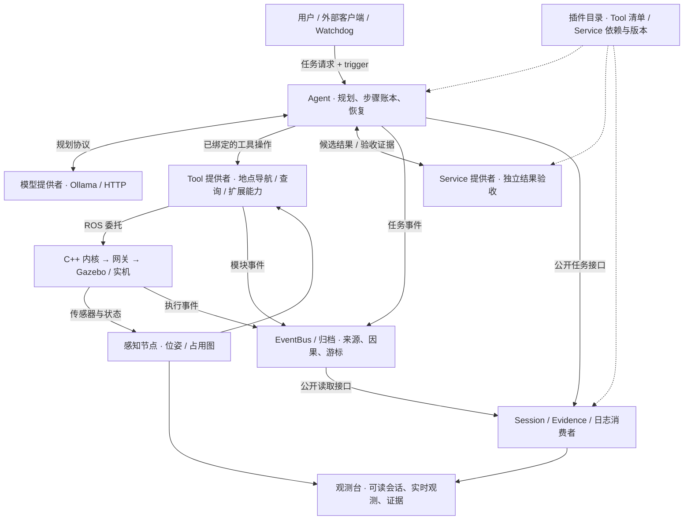

# Edge Agent ROS

**让机器人通过自然语言接受任务，通过插件扩展能力，通过证据解释执行结果。**

项目面向部署在机器人计算单元上的单机 Agent：将用户目标转成工具调用，由 ROS 2 执行和验收，遇到故障保留原因、执行状态与恢复依据。目标是逐步支持不同机器人、软件任务和长期运行；当前可复现的基线是 **Docker 中的单台轮式机器人与室内外 Gazebo 场景**。

架构借鉴 **dsh 的 Plugin / Service / Tool**，保留未来与 **SuperAgent 的 Router / Worker 角色**协作的空间。当前实现并非 dsh SDK，也尚未实现跨机器人调度。执行内核和网关使用 C++20，Agent 与多数独立服务使用 Python，观测台使用浏览器前端；插件按协议接入，可选择自己的实现语言。

[快速运行](#快速运行) · [架构与插件边界](#架构与插件边界) · [开发一个插件](docs/plugin-development.md) · [Coding Agent 入口](AGENTS.md) · [部署与平台](docs/deployment.md)

## 现在可以做什么

可选的三维点云地图、多相机预览、RGB-D 像素测距和模型适配器可以按需安装。同一规划入口已经分别通过本地 Qwen 和真实 DeepSeek 调用 ROS 状态工具。用工作台观察各插件的状态、输入和装卸边界，可以从[感知与模型插件快速上手](docs/perception-model-quickstart.md)开始。

| 能力 | 可以亲自验证的行为 | 入口 |
|---|---|---|
| 自然语言执行 | “去庭院巡检”解析地点、经过门口、到达并核实停稳；“去维修区巡检”返回限制通行原因 | [任务与观测台](docs/console.md) |
| 观测与复盘 | 查看激光、融合地图、机器人状态；以可读 Session 查看目标、计划、反馈和结果，再按引用追查原始事件 | [Session 与取证](docs/sessions.md) |
| 插件扩展 | 注册 HTTP Tool；添加不暴露 Tool 的共享 Service，例如独立结果验收器或 Session 提供者 | [插件开发规范](docs/plugin-development.md) |
| 有界恢复 | 暂态错误退避重试；候选结果已保存时可续办验收；对未知物理结果保留待核查状态 | [任务账本与恢复](agent/README.md) |
| 模型与能力演进 | 管理器可从里程计或用户数列任务的缺口自动发布受限只读工具并续办。需要新算法时，设计插件生成草案，编码 Agent 或本地 Ollama 可为纯文本 Tool 生成受限表达式，经独立样本验收与部署者批准后热装。 | [插件作者](docs/plugin-authoring.md) · [插件管理](docs/plugin-manager.md) · [源码候选的验收和发布](docs/specs/SDD-014-authored-software-provider.md) |
| 运行巡检 | 可选的独立 Watchdog 直接读取 Agent 与 Console。归档失联期间保存事故，恢复后从持久游标补收任务受阻证据。重试预算耗尽时给出原因与人工步骤。 | [Watchdog 运行手册](docs/watchdog.md) · [架构评价与演进计划](docs/architecture/plugin-evolution.md) |

具名地点任务有不依赖模型的解析路径；自由表述的能力取决于模型及已注册工具。当前 Agent 主要执行持久化步骤计划，尚不是任意任务都能完成的通用反馈循环。模型自写查询的实验也保留了失败记录，见 [Session 验收报告](docs/testing/session-evidence.md)。

## 快速运行

需要 Git、可运行 **Linux 容器**的 Docker Engine / Docker Desktop，以及 Docker Compose v2。ROS 2 Jazzy 和 Gazebo Harmonic 在容器内运行。

```sh
git clone https://github.com/SUSTechWLA/edge-agent-ros.git
cd edge-agent-ros
```

| 环境 | 在项目根目录运行 |
|---|---|
| Windows PowerShell | `.\scripts\start.ps1` |
| Linux / Ubuntu / macOS，启动仿真 | `sh scripts/deploy.sh sim up` |
| Linux 实机，已有兼容 ROS 驱动和执行器 | `sh scripts/deploy.sh hardware up` |

启动脚本检查服务和仿真观测是否就绪。首次构建需要访问 Docker Hub、Ubuntu 和 ROS 软件源；使用 Docker Desktop 配置的 VPN / 代理。可通过 `EDGE_BASE_IMAGE` 选择含相同 SDK 的预装[基础镜像](docker/Dockerfile.base)。服务器访问、ARM64 与板卡验收条件见[部署矩阵](docs/deployment.md)；以上命令不表示所有平台都完成了实机验证。

1. 打开[观测台](http://127.0.0.1:8765/)，下发 `去庭院巡检`。默认起点为工位，机器人沿标注路线经过门口。
2. 在[任务会话](http://127.0.0.1:8765/#sessions)查看 `navigate_place` 的目标、反馈和结果；成功记录中可追查地图版本、路线和 `observed_xy`。
3. 下发 `回到工位`，再试 `去维修区巡检`。后者应为 `BLOCKED`，原因是 `scene.place_inaccessible`。
4. 在[运行复盘](http://127.0.0.1:8765/#review)或事件页按任务 ID 查看原始证据，区分规划失败、工具失败和结果尚未证实。

场景的区域、地标与通行连接目前由人工标注，激光负责前方障碍检测，Gazebo 世界位姿用于独立核验。自动建图和语义区域发现仍需扩展。[场景设计与验证](docs/semantic-scene.md)

<details>
<summary>直接使用 ROS 委托、取消任务与停止容器</summary>

```powershell
.\scripts\mission.ps1 run my-first-inspection "0.8,0.0" "0.8,0.7" --wait
.\scripts\mission.ps1 status my-first-inspection
.\scripts\mission.ps1 run cancel-example "-2,1" "0,0"
.\scripts\mission.ps1 cancel cancel-example --wait
docker compose ps
docker compose logs --tail 30 core gateway
docker compose stop
docker compose start
```

委托支持 1–8 个点，x、y 均在 [-4,4] 米内，须给出可行路段；具名地点工具可以选择门口路径。同 ID、同目标重投返回原任务。客户端等待超时不会取消机器人动作，明确取消需调用 `cancel`。

账本保存在 Compose 命名卷 `state`，普通 stop/start 或 down/up 保留历史。重新创建仿真会复位场地，历史位置仍代表过去的运行。`SUCCEEDED` 要求相应契约的结果证据；运动取消需要核实停止。ROS 内核的 `RECOVERY_REQUIRED` 可能仍保留底盘占用，应按原操作 ID 对账；语言任务的同名状态也可能只是只读观测过期。查看诊断、`can_retry` 和[恢复边界](agent/README.md)，不要仅按状态名称重发运动。

</details>

## 架构与插件边界

从一个实际案例开始，追查模型如何提出新工具、一次错误表达式如何进入下一次推理，以及哪个进程有权批准安装。[单机验收与故障对照](docs/testing/event-driven-evolution.md)

一次用户请求引出的功能缺口可以触发独立设计插件。它校验作者收据，再让模型按当时已安装的接口设计 Tool、Service 或事件消费者。对于可用受限文本操作表示的目标，独立编码作者能继续交付代码和工具清单。设备动作、新软件依赖、正式发布分别需要它们自己的验收与授权。[运行手册](docs/plugin-evolution-operations.md) · [模块间事件和授权](docs/module-eventbus.md) · [实测能力、瓶颈与迭代计划](docs/architecture/plugin-evolution.md)

**Plugin 是扩展单元，Tool 是供模型选择的操作，Service 是模块间使用的接口。** 一个插件可以提供多个 Tool / Service，也可以只消费事件。增加 Session、诊断或验收能力，不需要把它伪装成模型每次都要调用的工具。



Agent 拥有任务与步骤状态，运动内核拥有物理执行状态。EventBus 传递可关联的事实，Session 将事实整理成阅读视图；二者都不替代执行授权，也不凭摘要改写任务终态。这里的 EventBus 由持久账本、模块事件源、ROS 事件与 HTTP 游标读取协作实现，**不是单一的进程内发布订阅对象**。[事件通路](docs/module-eventbus.md) · [上下文与术语](docs/harness-extensions.md)

“一切皆插件”是扩展原则：新业务优先使用已有接口，必要时才新增最小的通用扩展点。保持接口、状态归属和资源交接可检验，比把所有类改名为 Plugin 更重要。

| 扩展对象 | 当前装卸边界 |
|---|---|
| HTTP Tool、共享 Service、Session 提供者、事件消费者 | 可在约定的查找/调用边界注册或撤回。Service 支持依赖解析、版本绑定和 `draining`；进程由部署方单独启动、停止。 |
| 提示、诊断文案、已安装 ROS 消息类型的观测清单 | 按各自读取周期更新；不会自动改变已保存计划、融合算法或执行策略。 |
| 导航场景、感知算法、运动内核和设备驱动 | 可以按现有协议替换实现，但当前需要协调重启或交接；尚无通用的有状态在线迁移。 |

`ready` 只表示服务声明及依赖可解析，不代表进程健康。目录层的 `draining` 拒绝新绑定、允许匹配的旧绑定继续；具体消费者仍有自己的检查，例如 Session 在读取期间遇到 draining 会拒绝该次结果。**当前没有同一 Service 多版本自动路由，也不能保证任意插件更换都零停顿。** [完整扩展矩阵](docs/harness-extensions.md#扩展矩阵)

## 为项目增加能力

开发者和 Coding Agent 使用同一套流程：[AGENTS.md](AGENTS.md) → [插件开发规范](docs/plugin-development.md) → [SDD 模板](docs/specs/TEMPLATE.md) → 实现与证据 → [PR 模板](.github/PULL_REQUEST_TEMPLATE.md)。

1. **先选择扩展点。** 模型需要主动选择的操作用 Tool；多个模块复用的能力用 Service；观察既有事实用事件消费者。先查已有接口，明确当前是否支持所需装卸行为。
2. **先落契约和验收。** 定义输入输出、上下文 ID、状态所有者、版本、失败与重试语义。列清安装、排空、卸载、旧任务和回退的预期。
3. **隔离实现。** 业务逻辑放在提供者中，消费者按公开契约调用；新增插件不直接修改其他模块的私有账本。需要新扩展点时，单独说明宿主改动的必要性。
4. **证明兼容。** 除新增功能成功外，测试依赖缺失、断连、换版、重复请求与在途任务；同时证明无关任务仍可用、原副作用没有重复执行。
5. **留可复查的证据。** 将 SDD、实现、测试、版本和运行结果关联。更新测试选择器的消费者依赖，使后续小改动可准确选测。

可从两个已有例子开始：**零 Tool 的结果验收插件**见 [result-verifiers](examples/result-verifiers/README.md)；**可替换的会话阅读服务**见 [sessions_plugin](sessions_plugin/README.md)。命名沿用 dsh / SuperAgent / ROS；新概念须说明与已有概念的可观察差别，不为同一职责另起名称。

## 目录与阅读路线

| 目录 | 职责 / 阅读后应能回答的问题 |
|---|---|
| [agent/](agent/README.md) | 自然语言如何成为计划？Tool / Service 如何绑定？故障怎样续办？ |
| [plugins/](plugins/README.md)、[contracts/](contracts/)、[policies/](policies/) | 能力清单、提示和诊断、现场发布规则在哪里配置？ |
| [src/](src/)、[perception/](perception/)、[scene/](scene/)、[sim/](sim/) | ROS 接口、运动执行、感知、语义场景与仿真如何协作？ |
| [sessions_plugin/](sessions_plugin/README.md)、[evidence/](evidence/README.md)、[console/](console/) | 如何从用户可读的 Session 追到任务和事件的原始事实？ |
| [observations/](observations/README.md)、[examples/](examples/)、[client/](client/) | 如何接传感器、独立服务或事件消费者？ |
| [scripts/](scripts/)、[docker/](docker/)、[compose.yaml](compose.yaml) | 如何启动、部署、管理版本与验证？ |
| [文档总目录](docs/README.md) | 按任务查部署、使用、架构、规格、验收报告及精选证据。 |
| [tests/](tests/) | 复跑契约与仿真。系统套件写入 `.ci-results/system/runs/`。独立验收的精选原件和本机完整日志按运行号保存在 [artifacts/verification/](artifacts/verification/README.md)。 |

[贡献与发布流程](CONTRIBUTING.md)说明分支、提交、SDD 和发布；[目标架构教材](docs/architecture/index.html)用于学习后续方向。判断当前能力时，以实现、相应 SDD 的验收记录及其版本为准，不能把目标图当作已交付能力。

## 验证与能力边界

```sh
# 先查看改动会影响哪些消费者，再运行选中的测试
python tests/system_suite.py --changed-since origin/main --plan
python tests/system_suite.py --changed-since origin/main
# 发布候选运行完整仿真回归
python tests/system_suite.py
```

测试使用隔离 Compose 项目；每次运行单独保存摘要、阶段日志和证据。真实模型推理需显式配置，可用 `--ollama-cache-volume edge-agent-ros_models` 复用本机模型卷；未执行的项目须标为跳过。[系统测试与选测规则](docs/testing/single-edge.md) · [插件验收记录](docs/evidence/runtime-plugins-sample.json) · [Session 验收](docs/testing/session-evidence.md)

仅改文档可运行 `python tests/document_contract.py -v`、`python tests/repository_contract.py -v`、`python scripts/check_sdd.py --base <开发基线>` 和 `git diff --check`。功能改动按依赖选测，执行内核、公共契约与发布候选遵守完整回归门槛。可用 `.\scripts\verify.ps1` 单独验证 C++ 执行和停车链路；长期运行与故障注入见 [SDD-004](docs/specs/SDD-004-single-edge-lifecycle.md)。

已验证的主要环境为 Windows Docker Desktop 单机仿真；Linux/ARM64 硬件镜像有指令模拟测试。RK3588、Jetson 等物理板卡、真实驱动、复杂导航和制动距离仍需现场验收。跨域 Brain / Edge 协作、完整人工批准流程、任意代码自主开发与安全投放、通用有状态插件迁移属于后续工作。能力扩展应逐项交付契约与证据，不能由一次仿真成功推断任意任务或无限运行已得到保证。
