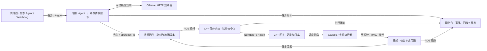

# Edge Agent ROS

给一台模拟轮式机器人下达 **“去庭院巡检”**。Edge 将地点解析为工坊、门廊和庭院间的路线，逐点驱动机器人、确认停稳，并记录到达位置。浏览器能同时看到原始激光、融合地图、机器人当前区域和任务进度。开发者可以沿同一条任务记录追到规划输入、工具调用、ROS 动作和失败原因。

项目基于 C++20、ROS 2 Jazzy、Gazebo Harmonic 和 Docker Compose。具名地点任务可以离线执行，自由表述可接本地 Ollama 或独立 HTTP 规划器。[观测台使用手册](docs/console.md) · [部署矩阵](docs/deployment.md) · [插件与事件扩展手册](docs/harness-extensions.md)

## 第一次运行

开发电脑需要能运行 Linux 容器的 Docker Engine 或 Docker Desktop，以及 Docker Compose v2。完整仿真在容器内运行。首次检出仓库后，从项目根目录启动：

```sh
git clone https://github.com/SUSTechWLA/edge-agent-ros.git
cd edge-agent-ros
```

| 环境 | 启动命令 |
|---|---|
| Windows PowerShell | `.\scripts\start.ps1` |
| Linux 服务器、Ubuntu、macOS | `sh scripts/deploy.sh sim up` |
| Linux 实机，接入已有 ROS 驱动和执行器 | `sh scripts/deploy.sh hardware up` |

启动脚本会检查服务与仿真观测是否就绪。首次构建需要访问 Docker Hub、Ubuntu 和 ROS 软件源，可使用 Docker Desktop 配置的 VPN/代理。项目自带仿真地图；可用 `EDGE_BASE_IMAGE` 指定含相同 SDK 的预装基础镜像。远程服务器采用 SSH 端口转发访问同一观测台。[基础镜像配方](docker/Dockerfile.base) · [模型安装与复启](docs/model.md)

### 跟随一次室内外任务

1. 打开[本机观测台](http://127.0.0.1:8765/)，点击「下发任务」，输入 `去庭院巡检`。地图初始位置是工位，场景层标出门口和庭院，激光与占用栅格显示实时观测。
2. 查看步骤 `navigate_place` 的参数和结果。场景插件解析“庭院”的别名，为路线保存地图版本、摘要和经过的节点。机器人穿过门口后，终态应为 `SUCCEEDED`，证据中可查 `observed_xy`。
3. 再下发 `回到工位`。最后试一次 `去维修区巡检`。维修区在地图上存在，但标记为限制通行；任务应进入 `BLOCKED`，按 `scene.place_inaccessible` 可以查到原因。

默认场地采用人工标注的区域、地标和通行连接，实际激光用于探测前路障碍，独立 Gazebo 世界位姿可核对机器人是否穿过门口。[场地与验收方法](docs/semantic-scene.md) · [地图数据](scene/campus.json)

## 从任务到运动



场景提供者能被其他语义导航服务替换。内核负责动作是否得到授权、停稳和证据是否足够。外部模块可向 `/edge/events` 发布自己的带因果标识的事实，日志消费者可以独立接入、断开、续读。[扩展矩阵与故障追踪](docs/harness-extensions.md)

## 使用结构化 ROS 委托

```powershell
.\scripts\mission.ps1 run my-first-inspection "0.8,0.0" "0.8,0.7" --wait
.\scripts\mission.ps1 status my-first-inspection
```

成功响应包含 `state=SUCCEEDED`、`verified_count=2` 和两个按顺序排列的实测位置。坐标单位是米。同 ID、同目标重投返回原任务。可提交一至八个点，x、y 均在 [-4,4] 米范围内。直接给点位时须给出可行路段；场景插件可为已标注地点选择门口路径，网关按真实扫描对前方障碍制动。

```powershell
.\scripts\mission.ps1 run cancel-example "-2,1" "0,0"
.\scripts\mission.ps1 cancel cancel-example --wait
docker compose ps
docker compose logs --tail 30 core gateway
docker compose stop
docker compose start
```

客户端等候超时只会结束本地等待。用同一任务 ID 查询结果，明确取消请调用 cancel。状态保存在 Compose 命名卷 `state` 中；普通 stop/start 或 down/up 会保留账本。重新创建整套仿真会将 Gazebo 场地复位，账本里的历史位置代表过去那次运行。

## 单机系统测试

涉及运行代码的修改先查看受影响的测试组，观察行为是否改变，再定位是哪层产生了差异。在项目根目录执行：

```sh
python tests/system_suite.py --changed-since origin/main --plan
python tests/system_suite.py --changed-since origin/main
python tests/system_suite.py
```

最后一条运行完整仿真回归。使用本机已有的 Ollama 模型卷时追加 `--ollama-cache-volume edge-agent-ros_models`。每次运行在 `.ci-results/system/runs/<运行号>/` 独立保存摘要、阶段日志和证据。未配置模型时，摘要显式标记真实推理已跳过。查阅[系统测试报告、架构评价与测试选择规则](docs/testing/single-edge.md)。

要看系统在连续任务中何时自己恢复、何时需要人处理，可运行 `python tests/system/lifecycle_acceptance.py --tasks 96`。探针在独立仿真中重复投递用户请求、暂停传感器链路、重启 Agent，并监听实际故障事件。现有服务能保留任务和处置依据。面向值班人的持久待办、通知回执和有时限的批准属于下一阶段。[生命周期实测样本](docs/evidence/lifecycle-sample.json) · [持续运行与人工介入规格](docs/specs/SDD-004-single-edge-lifecycle.md)

只验证 C++ 内核、停车和执行链路故障时可单独运行：

```powershell
.\scripts\verify.ps1
```

开发者还可在**空闲、起点为工位的默认仿真**上执行 `python3 tests/semantic_acceptance.py`，复测具名地点往返、未知地点、限制区和遮挡制动。脚本通过公开 API 提交任务，采集独立世界位姿，并把每项输入、终态和误差写入证据文件。Windows 可使用已安装的 Python 3 解释器。[语义任务验收](tests/semantic_acceptance.py)

`verify.ps1` 使用临时、独立命名的 Compose 项目。脚本会注入两次进程级故障，完成后清理当次临时容器和卷。JSON、实际轨迹、SQLite 只读导出、单元测试输出和容器日志保存在 `artifacts/verification/<UTC时间-运行ID>/`。已构建同一版镜像时可以传 `-SkipBuild`。查看[核心验收报告](docs/v1/validation.md)。

复核实际模型调用时，先按[模型配置](docs/model.md)启动 Ollama，再运行 `python3 tests/model_trace_acceptance.py`。这一用例读取 ROS 状态，并验证重复告警去重、子任务继承 trace 和事件导出。仓库保存了两份可直接阅读的历史结果：[真实模型、工具及 ROS 回执](docs/evidence/trace-sample.json) · [一次状态查询与六项场景任务](docs/evidence/semantic-sample.json)。

| 想弄清的问题 | 从哪里看 |
|---|---|
| 如何按规格开发、分支提 PR 和发布？ | [贡献流程与 GitHub 规则](CONTRIBUTING.md)、[Coding Agent 导航](AGENTS.md)、[SDD 清单](docs/specs/) |
| 如何加一种工具、换模型提示、热挂传感器或扩展报错？ | [扩展手册](docs/harness-extensions.md)、[工具契约](plugins/README.md)、[传感器清单示例](observations/README.md) |
| 如何关联用户询问、watchdog 告警和模块证据？ | [触发与模型追溯](agent/README.md)、[运行事件与独立消费者](docs/module-events.md) |
| 这次到底测了什么，失败案例与复测证据在哪？ | [联合验收与复测命令](docs/v1/console-validation.md) |
| 自然语言怎么变成动作？中途重启怎么知道从哪继续？ | [例子、接口和重试边界](docs/console.md)、[实测记录](artifacts/console/missions.json) |
| 如何测试插件热插拔、占用重试和恢复？ | [独立 Compose 故障测试](tests/console_resilience.py)、[实际执行证据](artifacts/console/resilience.json) |
| 本版做到了什么，哪些要求属于后续版本？ | [PRD 与验收标准](docs/v1/PRD.md) |
| Brain 或外部系统如何下任务？ | [公开 ROS 接口](docs/v1/interfaces.md)、[命令行客户端](client/mission.py) |
| 为什么每一步要单独验收？什么时候会拒绝重试？ | [任务策略与持久化](docs/v1/core.md)、[实现](src/edge_core/src/core_node.cpp) |
| 如何移动、确认取消、在失联时停稳？ | [执行网关](docs/v1/gateway.md)、[网关实现](src/edge_gateway/src/edge_gateway_node.cpp)、[仿真执行器看门狗](sim/velocity_watchdog.cpp) |
| 怎样独立证明机器人真的动过？ | [Docker 与 Gazebo 验收模块](docs/v1/simulation.md)、[黑盒测试](tests/verify.py) |
| 单 Edge 将来怎样接模型和多机器人？ | [目标架构教材](docs/architecture/index.html)、[板卡验收](docs/architecture/board-validation.md) |

## 运行中断后怎么判断

- ROS 巡检委托的 `SUCCEEDED` 要求每个路点有到达后的新鲜里程计证据，网关还会确认停稳。语言任务按实际工具验收，例如只读路线预览返回地图版本和路径，位置查询返回测量来源与时间。
- `CANCELED` 表示当前移动已核实停止，或取消时没有在途移动。接受取消时可能会先看到 `CANCELING`。
- `FAILED` 的详情说明是派发、执行或验收阶段失败。检查日志与动作记录后可决定是否发起新的任务。
- 当 **ROS 内核** 的在途运动进入 `RECOVERY_REQUIRED`，底盘占用可能仍被保留。按原操作 ID 检查执行器和独立停稳观测，保留原卷用于追查。内核尚无在线解除未知占用的运维接口。
- **语言任务** 也可能进入 `RECOVERY_REQUIRED`。例如里程计过期会使只读状态查询耗尽重试，此时没有物理动作。查看任务里的诊断、原操作 ID 和 `can_retry`。处理完原故障且 `can_retry` 为真时，可通过工作台续办原步骤。[任务接口](agent/README.md)

## 首版的部署边界

Windows Docker Desktop 上已验证单机器人仿真。Linux/ARM64 硬件镜像在指令模拟环境验证过 ROS 输入、感知、任务与观测台链路。其他场地须标定坐标系与通行约束，持续避障或复杂地形导航需相应导航栈。跨区域 Brain 协作、RK3588/Jetson 驱动、加速器与制动距离仍需现场验收。[部署矩阵](docs/deployment.md) · [历史平台证据](artifacts/console/platforms.json)
