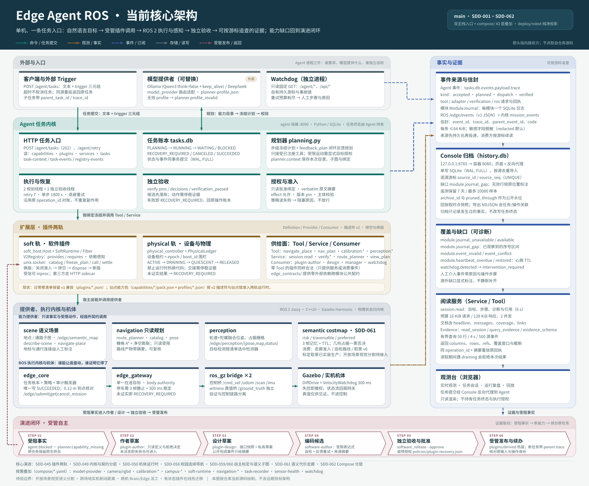
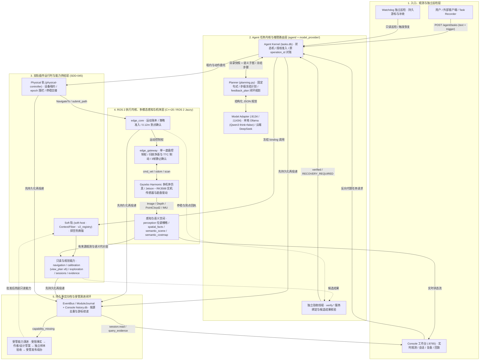

# Edge Agent ROS

**让机器人通过自然语言接受任务，通过插件扩展能力，通过证据解释执行结果。**

项目面向部署在机器人计算单元上的单机 Agent。用户目标转成工具调用，由 ROS 2 执行和验收，遇到故障保留原因、执行状态与恢复依据。默认 Docker 场景提供单台轮式机器人，另有大型校园可复测轮式车、无人机、四足和双足的机载观测及各自支持的动作。

架构借鉴 **dsh 的 Plugin / Service / Tool**，保留未来与 **SuperAgent 的 Router / Worker 角色**协作的空间。当前实现并非 dsh SDK，也尚未实现跨机器人调度。执行内核和网关使用 C++20，Agent 内核、零依赖公共契约（`edge_contracts/`）与多数独立服务使用 Python，观测台使用浏览器前端；插件按协议接入，可选择自己的实现语言。

[系统核心架构](#系统核心架构) · [快速运行](#快速运行) · [插件双轨与装卸边界](#插件升级的两条轨道) · [开发一个插件](docs/plugin-development.md) · [Coding Agent 入口](AGENTS.md) · [部署与平台](docs/deployment.md) · [Compose 分层索引](compose/README.md)

## 现在可以做什么

在移动四孔板标定工位输入「请帮我标定当前传感器」。本地 Qwen3 模型基于有来源的语义场景子图（`semantic_scene`）与 ROAM 语义空间代价走廊（`plan_capture_views` v6），驱动灵遨差速车围绕固定靶板自主换位、采样、去重、求解并完成留出孔心核验（Gazebo 实测 8 次换位全部停稳，留出孔心 RMS 5.80 mm，相对 SDF 安装真值误差 5.25 mm / 0.132°）。静止工位同样支持棋盘与四孔板人工出示标定及软件时间偏移估计。[移动自标定工位](docs/testing/fixed-rover-calibration.md) · [ROAM 标定实测回执](artifacts/verification/sdd061-roam-autocal-20261127/summary.json) · [静止工位与实车方法](docs/testing/guided-calibration.md)

在校园 Gazebo 任务台输入「前往校园前广场南侧露台」，轮式车可以从教学楼门厅出发，穿过门廊，沿广场步道到达露台。全校地图标出任务位置，放大图显示全程规划和实走轨迹。本次出发规划 22.24 米，Gazebo 实测行驶 21.79 米，到点误差 5.96 厘米。[观看完整导航演示](artifacts/verification/campus-long-navigation-20261124/campus-terrace-navigation.mp4) · [打开本次任务](http://127.0.0.1:8910/exploration-mission.html?task_id=campus-terrace-film-20261124-01) · [启动与真值验证](docs/testing/campus-smooth-navigation.md)

导航试算可按机体、地图和算法组合。Agent 能独立读取空间观测、查询融合定位、解析地点及生成路线，并支持在二值障碍硬否决之上叠加有界语义通行/偏好代价层（`SDD-061`）。Jetson 只读站点使用实时里程计，四种机体的路线和地面执行交接另有隔离夹具。[导航插件边界](navigation/README.md) · [板端接入与复测](docs/testing/navigation-plugins.md)

**看一次有人能读懂的运行录像。** 在校园门厅给无人车一句没有坐标的中文任务，点击“内核确认已停车”，同时观察地图帧龄、现场画面、激光回波、IMU 角速度和下发线速度；再看它在哪一刻取得新观测并重新选点。视频由已封存的十路数据离线生成。纯软件任务也能用同一插件。[分章回放](artifacts/verification/recording-showcase/mission-01/index.html) · [独立观测与原始归档](artifacts/verification/recording-showcase/mission-01/README.md) · [录制自己的任务](task_recorder/README.md)

在同一个仓库目录开发。`main` 保存完整源码、文档、仿真、测试和验收记录；`deploy/robot` 从指定开发提交自动投影生成，仅交付纯净的边缘端运行代码、必要配置、顶层 `README.md` 与 `ROBOT_SOURCE` 来源指针。边缘端可用 `cat ROBOT_SOURCE` 查询对应的开发提交，用 `sh scripts/robot.sh observe` 启动常规观测，或用 `python3 scripts/calibration_station.py` 启动传感器自动标定工位。[板端操作手册](deploy/robot/README.md) · [无人车出厂与首次进场](docs/rover-commissioning.md)

大型校园实验采用代尔夫特理工大学的测绘建筑和正射影像。教学训练楼、机器人广场、八道运动场、草地和林带通过一条约 777 米的步道接入校园街网。打开日用任务台可看完整的 565 × 1,190 米校园，点「校园三维」浏览原模型，点「聚焦任务」查看教学楼门口的规划路线与实测轨迹。十个常驻容器共用一个校园世界。轮式车、无人机、四足和双足另有按需启动的专项仿真。[校园任务台](http://127.0.0.1:8910/exploration-mission.html) · [日用容器职责](docs/testing/campus-smooth-navigation.md#日用校园站) · [四种机体的查看与复测](docs/testing/campus-robot-view.md)

可选的三维点云地图、多相机预览、RGB-D 像素测距和模型适配器可以按需安装。同一规划入口支持本地 Ollama（针对 Qwen3 混合模型自动注入 `think=false` 与 `keep_alive` 常驻加速）与云端 DeepSeek 切换。用工作台观察各插件的状态、输入和装卸边界，可以从[感知与模型插件快速上手](docs/perception-model-quickstart.md)开始。

准备上机时，先在校园工作台下发“检查导航传感器”。打开任务会话，在“当前结果”中选择“查看证据”，即可从原始工具回执核对当时的传感器读数和采样时间。[四种机体的故障演练、恢复范围与上板顺序](docs/testing/edge-field-readiness.md)

| 能力 | 可以亲自验证的行为 | 入口 |
|---|---|---|
| 自然语言执行 | “去庭院巡检”解析地点、经过门口、到达并核实停稳；“去维修区巡检”返回限制通行原因 | [任务与观测台](docs/console.md) |
| 闭环反馈规划 | 传感器自标定与语义探索按步消费有界观测摘要与 `semantic_scene`，在受限目标授权下闭环推进 | [标定规格](docs/specs/SDD-059-guided-sensor-calibration.md) · [语义空间代价](docs/specs/SDD-061-semantic-costmap-corridor.md) |
| 观测与复盘 | 查看激光、融合地图、机器人状态；以可读 Session 查看目标、计划、反馈和结果，再按引用追查原始事件 | [Session 与取证](docs/sessions.md) |
| 插件扩展 | 注册 HTTP Tool；添加不暴露 Tool 的共享 Service，例如独立结果验收器或 Session 提供者 | [插件开发规范](docs/plugin-development.md) |
| 有界恢复 | 暂态错误退避重试；候选结果已保存时可续办验收；对未知物理结果保留待核查状态 | [任务账本与恢复](agent/README.md) |
| 模型与能力演进 | 管理器可从里程计或用户数列任务的缺口自动发布受限只读工具并续办。需要新算法时，设计插件生成草案，编码 Agent 或本地 Ollama 可为纯文本 Tool 生成受限表达式，经独立样本验收与部署者批准后热装。 | [插件作者](docs/plugin-authoring.md) · [插件管理](docs/plugin-manager.md) · [源码候选的验收和发布](docs/specs/SDD-014-authored-software-provider.md) |
| 运行巡检 | 可选的独立 Watchdog 直接读取 Agent 与 Console。归档失联期间保存事故，恢复后从持久游标补收任务受阻证据。重试预算耗尽时给出原因与人工步骤。 | [Watchdog 运行手册](docs/watchdog.md) · [架构评价与演进计划](docs/architecture/plugin-evolution.md) |

具名地点任务有不依赖模型的解析路径；自由表述的能力取决于模型及已注册工具。当前 Agent 同时支持一次性持久化步骤计划与受站点策略约束的多步闭环反馈计划（`feedback_plan`），尚不是无边界的通用开放世界自主循环。模型自写查询的实验也保留了失败记录，见 [Session 验收报告](docs/testing/session-evidence.md)。

## 快速运行

需要 Git、可运行 **Linux 容器**的 Docker Engine / Docker Desktop，以及 Docker Compose v2。ROS 2 Jazzy 和 Gazebo Harmonic 在容器内运行。

单底盘的 Body Runtime 可通过 `compose/body-runtime.yaml` 在隔离 Gazebo 中启用。使用原导航入口即可验证控制权交接、网关掉线停车和旧指令重放。[运行步骤与验收条件](docs/specs/SDD-050-body-runtime.md)

```sh
git clone https://github.com/ChaosOrderAI/dsh-edge-agent-ros.git
cd dsh-edge-agent-ros
```

| 环境 | 在项目根目录运行 |
|---|---|
| Windows PowerShell | `.\scripts\start.ps1` |
| Linux / Ubuntu / macOS，启动仿真 | `sh scripts/deploy.sh sim up` |
| 移动四孔板自标定仿真工位 | `python3 scripts/calibration_station.py up --mode sim-mobile` |
| Linux 实机，已安装板端镜像及 ROS 驱动 | 按[首次上板](docs/board-first-boot.md)设置机体身份与话题，运行 `sh scripts/deploy.sh hardware observe`、`sh scripts/deploy.sh hardware preflight` |

启动脚本检查服务和仿真观测是否就绪。首次构建需要访问 Docker Hub、Ubuntu 和 ROS 软件源；使用 Docker Desktop 配置的 VPN / 代理。可通过 `EDGE_BASE_IMAGE` 选择含相同 SDK 的预装[基础镜像](docker/Dockerfile.base)。服务器访问、ARM64 与板卡验收条件见[部署矩阵](docs/deployment.md)；以上命令不表示所有平台都完成了实机验证。

1. 打开[观测台](http://127.0.0.1:8765/)，下发 `去庭院巡检`。默认起点为工位，机器人沿标注路线经过门口。
2. 在[任务会话](http://127.0.0.1:8765/#sessions)查看 `navigate_place` 的目标、反馈和结果；成功记录中可追查地图版本、路线和 `observed_xy`。
3. 下发 `回到工位`，再试 `去维修区巡检`。后者应为 `BLOCKED`，原因是 `scene.place_inaccessible`。
4. 在[运行复盘](http://127.0.0.1:8765/#review)或事件页按任务 ID 查看原始证据，区分规划失败、工具失败和结果尚未证实。

场景的区域、地标与通行连接目前由人工或站点构建器标注，激光负责前方障碍检测，Gazebo 世界位姿用于独立核验。自动建图和语义区域发现仍需扩展。[场景设计与验证](docs/semantic-scene.md)

<details>
<summary>直接使用 ROS 委托、取消任务与停止容器</summary>

```powershell
.\scripts\mission.ps1 run my-first-inspection "0.8,0.0" "0.8,0.7" --wait
.\scripts\mission.ps1 status my-first-inspection
.\scripts\mission.ps1 run cancel-example "-2,1" "0,0"
.\scripts\mission.ps1 cancel cancel-example --wait
docker compose ps
docker compose logs --tail 30 core gateway
docker compose stop
docker compose start
```

委托支持 1–8 个点，默认 x、y 均在 [-4,4] 米内（大型校园日用站通过场地配置放宽至授权区域），须给出可行路段；具名地点工具可以选择门口路径。同 ID、同目标重投返回原任务。客户端等待超时不会取消机器人动作，明确取消需调用 `cancel`。

账本保存在 Compose 命名卷 `state`，普通 stop/start 或 down/up 保留历史。重新创建仿真会复位场地，历史位置仍代表过去的运行。`SUCCEEDED` 要求相应契约的结果证据；运动取消需要核实停止。ROS 内核的 `RECOVERY_REQUIRED` 可能仍保留底盘占用，应按原操作 ID 对账；语言任务的同名状态也可能只是只读观测过期。查看诊断、`can_retry` 和[恢复边界](agent/README.md)，不要仅按状态名称重发运动。

</details>

## 系统核心架构

下图按仓库当前源码绘制，展示单机任务从外部触发、Agent 内核与模型推理、双轨插件治理、ROS 2 执行与感知，到持久证据归档及受管能力演进的完整边界：



各层状态所有者与调用/事实流向如下（`edge_contracts/` 提供零外部依赖的公共事件、描述符、空间事实、语义子图与代价图契约）：



- **四个互不越权的状态所有者**：`Agent Kernel` 持有语言任务与步骤终态；`edge_core` + `edge_gateway` 持有物理运动控制权与停稳确认；`soft-host` / `physical-controller` 分别持有软件实例引用计数与硬件独占租约；`EventBus / history.db` 与 `Session` 只记录和投影已发生的事实，**发布事件不授予执行权，观测摘要也不改写任务终态**。[事件通路](docs/module-eventbus.md) · [上下文与术语](docs/harness-extensions.md)

### 插件升级的两条轨道

SDD-045 给两类插件提供了不同的升级入口。查询、会话和计算由 Python soft 宿主管理；直接读取原始相机的进程由部署控制器授予租约，必须有独立验收。板端通过 profile 选择插件与版本。第一次上板从只读 observe 开始。[现场快速启动](deploy/robot/README.md) · [版本与回退](CHANGELOG.md)

| 维度 | soft（纯软件） | physical（设备与物理作用） |
|---|---|---|
| 运行位置 | 第一方受信代码可在隔离的软插件进程内 inproc，第三方走 HTTP sidecar | 独立进程或容器 |
| 安装 | 受管运行时安装 | 部署期安装与现场授权 |
| 代码热更 | 关闭新准入，排空旧引用，显式 dispose 后加载新版 | 禁止运行时热替换代码 |
| 配置热更 | 通过 schema，仅影响获准范围 | 仅限不改变设备语义的白名单配置 |
| 依赖 | inject 等待；依赖失去后保留实例，拒绝依赖它的调用 | 设备 lease、健康检查、末端控制权和交接 |
| 效果 | read 或 idempotent | 允许 actuation；读取原始设备即使只读也走此轨 |
| 验收 | 契约与独立样例，保留原操作与回执 | 仿真、台架、独立验收及停稳／停采证据 |
| 版本 | SemVer、内容摘要、冻结 binding | 镜像摘要、部署提交和不可变版本 |
| 回退 | 排空后卸载或恢复原版 | 交接后重新部署原版本与已验镜像 |
| 权限 | 无设备与执行器网络，只开放批准的事实与软件服务 | 最小设备挂载、网络白名单和可信准入 |

P1 的三个试点可用一个实验理解。给 Agent 下发“求输入数列的平均值 [2,4,6]”，它冻结派生工具的版本和操作号，隔离的 soft-host 返回数值 4。通过 `session.read` 追查这次任务，再用 Evidence 的三项工具按需查询公开事实。一项已经冻结的操作会占住旧版本的引用，管理器等它排空后才能发布新代码。原始雷达订阅和底盘导航属于 physical。目标设计、实际 Python 接口和分阶段验收分别见[总规格](docs/specs/SDD-045-plugin-tracks.md)、[Cordis 运行时](docs/plugin-runtime-mapping.md)及[验收计划](docs/testing/plugin-tracks.md)。

在仓库根目录执行 `python tests/test_plugin_descriptor.py -v` 和 `python tests/test_soft_runtime.py -v` 可以先观察清单准入、换版与依赖失联。已有带完整源码提交标签的本地 P1 镜像时，执行 `python tests/system/soft_runtime_acceptance.py --image <本地镜像> --out artifacts/verification/plugin-tracks/<新运行号>/soft.json`。脚本建立独立 Compose 项目，注册真实提供者并保存验收记录。[现场安装命令与目录](docs/plugin-descriptor-v2.md#p1-现场安装) · [测试范围与记录](docs/testing/soft-runtime.md)

从一个实际案例开始，追查模型如何提出新工具、一次错误表达式如何进入下一次推理，以及哪个进程有权批准安装。[单机验收与故障对照](docs/testing/event-driven-evolution.md)

一次用户请求引出的功能缺口可以触发独立设计插件。它校验作者收据，再让模型按当时已安装的接口设计 Tool、Service 或事件消费者。对于可用受限文本操作表示的目标，独立编码作者能继续交付代码和工具清单。设备动作、新软件依赖、正式发布分别需要它们自己的验收与授权。[运行手册](docs/plugin-evolution-operations.md) · [模块间事件和授权](docs/module-eventbus.md) · [实测能力、瓶颈与迭代计划](docs/architecture/plugin-evolution.md)

**Plugin 是扩展单元，Tool 是供模型选择的操作，Service 是模块间使用的接口。** 一个插件可以提供多个 Tool / Service，也可以只消费事件。增加 Session、诊断或验收能力，不需要把它伪装成模型每次都要调用的工具。“一切皆插件”是扩展原则：新业务优先使用已有接口，必要时才新增最小的通用扩展点。保持接口、状态归属和资源交接可检验，比把所有类改名为 Plugin 更重要。

| 扩展对象 | 当前装卸边界 |
|---|---|
| HTTP Tool、共享 Service、Session 提供者、事件消费者 | 可在约定的查找/调用边界注册或撤回。Service 支持依赖解析、版本绑定和 `draining`；进程由部署方单独启动、停止。 |
| 提示、诊断文案、已安装 ROS 消息类型的观测清单 | 按各自读取周期更新；不会自动改变已保存计划、融合算法或执行策略。 |
| 导航场景、感知算法、运动内核和设备驱动 | 可以按现有协议替换实现，但当前需要协调重启或交接；尚无通用的有状态在线迁移。 |

`ready` 只表示服务声明及依赖可解析，不代表进程健康。目录层的 `draining` 拒绝新绑定、允许匹配的旧绑定继续；具体消费者仍有自己的检查，例如 Session 在读取期间遇到 draining 会拒绝该次结果。**当前没有同一 Service 多版本自动路由，也不能保证任意插件更换都零停顿。** [完整扩展矩阵](docs/harness-extensions.md#扩展矩阵)

## 为项目增加能力

开发者和 Coding Agent 使用同一套流程：[AGENTS.md](AGENTS.md) → [插件开发规范](docs/plugin-development.md) → [SDD 模板](docs/specs/TEMPLATE.md) → 实现与证据 → [PR 模板](.github/PULL_REQUEST_TEMPLATE.md)。

1. **先选择扩展点。** 模型需要主动选择的操作用 Tool；多个模块复用的能力用 Service；观察既有事实用事件消费者。先查已有接口，明确当前是否支持所需装卸行为。
2. **先落契约和验收。** 定义输入输出、上下文 ID、状态所有者、版本、失败与重试语义。列清安装、排空、卸载、旧任务和回退的预期。
3. **隔离实现。** 业务逻辑放在提供者中，消费者按公开契约调用；新增插件不直接修改其他模块的私有账本。需要新扩展点时，单独说明宿主改动的必要性。
4. **证明兼容。** 除新增功能成功外，测试依赖缺失、断连、换版、重复请求与在途任务；同时证明无关任务仍可用、原副作用没有重复执行。
5. **留可复查的证据。** 将 SDD、实现、测试、版本和运行结果关联。更新测试选择器的消费者依赖，使后续小改动可准确选测。

可从两个已有例子开始：**零 Tool 的结果验收插件**见 [result-verifiers](examples/result-verifiers/README.md)；**可替换的会话阅读服务**见 [sessions_plugin](sessions_plugin/README.md)。命名沿用 dsh / SuperAgent / ROS；新概念须说明与已有概念的可观察差别，不为同一职责另起名称。

## 目录与阅读路线

| 目录 | 职责 / 阅读后应能回答的问题 |
|---|---|
| [edge_contracts/](edge_contracts/) | 零外部依赖的公共契约层：事件信封、v2 描述符、空间事实、语义场景子图、语义空间代价图与一致性工具。 |
| [agent/](agent/README.md)（含 `agent/kernel/`） | 自然语言如何成为计划或闭环步骤？任务账本、授权、独立验收与软物理宿主如何分层？ |
| [plugins/](plugins/README.md)、[capabilities/](capabilities/)、[profiles/](profiles/)、[contracts/](contracts/)、[policies/](policies/) | 能力清单、v2 站点包与锁、提示/诊断目录及现场恢复策略在哪里配置？ |
| [src/](src/)、[navigation/](navigation/README.md)、[exploration/](exploration/)、[calibration/](calibration/README.md)、[perception/](perception/)、[scene/](scene/)、[sim/](sim/) | C++20 运动内核与网关、走廊与语义代价规划、前沿探索、多传感器标定、相机/RGB-D/3D 地图与 Gazebo 仿真如何协作？ |
| [model_provider/](model_provider/README.md)、[sessions_plugin/](sessions_plugin/README.md)、[evidence/](evidence/README.md)、[task_recorder/](task_recorder/README.md)、[console/](console/)、[analysis/](analysis/README.md) | 本地 Qwen3 / 云端 DeepSeek 模型路由、可读 Session、按需取证、按任务录制回放、工作台与离线分析各自承担什么？ |
| [observations/](observations/README.md)、[examples/](examples/)、[client/](client/) | 如何接入额外 ROS 观测、独立 HTTP 提供者、插件管理器与 Watchdog 消费者？ |
| [scripts/](scripts/)、[docker/](docker/)、[compose.yaml](compose.yaml)、[compose.hardware.yaml](compose.hardware.yaml)、[compose/](compose/README.md) | 仿真主栈、板端主栈、43 个分层 Compose overlay、`deploy/robot` 纯净投影与运维脚本如何组织？ |
| [文档总目录](docs/README.md) | 按任务查部署、使用、架构、规格（`SDD-001`–`SDD-062`）、验收报告及精选证据。 |
| [tests/](tests/) | 复跑契约、包边界与隔离仿真。系统套件写入 `.ci-results/system/runs/`；独立验收原件按运行号保存在 [artifacts/verification/](artifacts/verification/README.md)。 |

[贡献与发布流程](CONTRIBUTING.md)说明分支、提交、SDD 和发布；[目标架构教材](docs/architecture/index.html)用于学习后续方向。判断当前能力时，以实现、相应 SDD 的验收记录及其版本为准，不能把目标图当作已交付能力。

## 验证与能力边界

```sh
# 先查看改动会影响哪些消费者，再运行选中的测试
python tests/system_suite.py --changed-since origin/main --plan
python tests/system_suite.py --changed-since origin/main
# 云端 CI 默认执行的确定性契约与规划器阶段
python tests/system_suite.py --stages repository planner
# 发布候选在高配仿真机运行完整 Gazebo 回归
python tests/system_suite.py
```

测试使用隔离 Compose 项目；每次运行单独保存摘要、阶段日志和证据。真实模型推理需显式配置，可用 `--ollama-cache-volume edge-agent-ros_models` 复用本机模型卷；未执行的项目须标为跳过。[系统测试与选测规则](docs/testing/single-edge.md) · [插件验收记录](docs/evidence/runtime-plugins-sample.json) · [Session 验收](docs/testing/session-evidence.md)

仅改文档可运行 `python tests/document_contract.py -v`、`python tests/repository_contract.py -v`、`python scripts/check_sdd.py --base <开发基线>` 和 `git diff --check`。功能改动按依赖选测，执行内核、公共契约与发布候选遵守完整回归门槛。可用 `.\scripts\verify.ps1` 单独验证 C++ 执行和停车链路；长期运行与故障注入见 [SDD-004](docs/specs/SDD-004-single-edge-lifecycle.md)。

已验证的主要环境为工作站 Docker Linux 容器（含 Gazebo Harmonic 多传感器仿真与 Linux/ARM64 指令模拟）及部分 Jetson 只读感知与底盘短程台架试验。跨场地复杂导航、极端光照/反光环境下的标定精度及高速实机制动距离仍需按目标机型逐项现场验收。跨域 Brain / Edge 协作、通用有状态插件在线热迁移属于后续工作。能力扩展应逐项交付契约与证据，不能由一次仿真成功推断任意任务或无限运行已得到保证。
