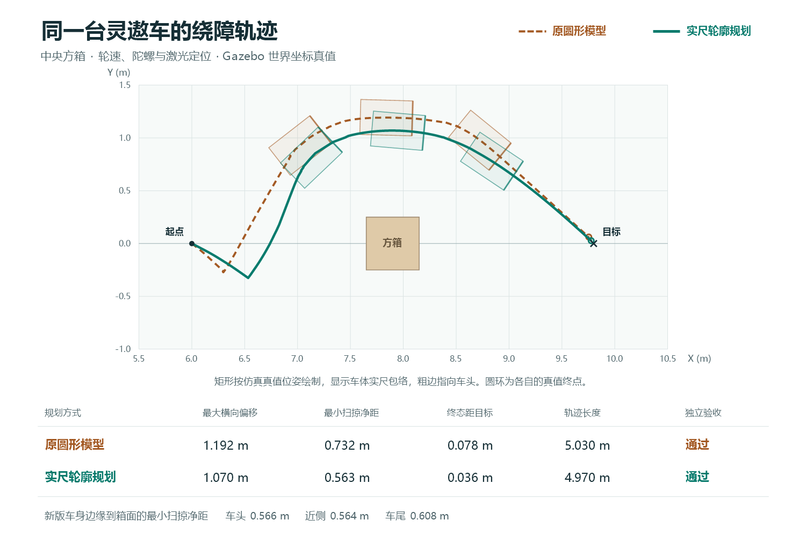

# 灵遨四轮车绕箱真值对照

同一四轮模型、同一定位，在中央箱体两侧有通行空间时，按实尺外廓规划将车心最大横向偏移缩小 **0.123 m（10.3%）**。独立世界坐标评分如下。

| 场景与算法 | 最大横向偏移 | 路长 | 车体最小扫掠净距 | 终点误差 |
|---|---:|---:|---:|---:|
| 中央箱，原圆形包络 | 1.192 m | 5.030 m | 0.732 m | 0.078 m |
| 中央箱，实尺外廓 | 1.070 m | 4.970 m | 0.563 m | 0.036 m |
| 中央箱，实尺外廓重复运行 | 1.066 m | 4.979 m | 0.563 m | 0.044 m |
| 空场，实尺外廓 | 0.001 m | — | 2.527 m | 0.045 m |

两次中央箱通过分别有 50 和 51 个可测方箱帧，全数满足距离与方位门槛。所有正式场景都无非地面接触。主组车体短暂停稳换侧，原地转向共 3.26 s；这项改动收紧了占道宽度，仍保留差速车的原地转向。[配对数据](comparison.json) · [独立复测原件](footprint-centered-repeat.tar.gz) · [各轮镜像、原始文件哈希和失败项](run-manifest.json)



早期测试暴露三个不同问题：轮速单独定位时的滑移、短表面受箱角异常点牵引、临界 TTC 单射线缺少佐证。最终版本用时间和传感器来源关联短表面，临界 TTC 立即输出零速，只有新的扫描及停稳里程计确认后才允许重新规划。14 次已录操作的 469 个可测样本全部通过回放，回放与闭环重复运行分别留证。[测距与方位回放](range-bearing-replay.json) · [临界 TTC 逐拍回放](ttc-replay.txt) · [初段换侧的激光数据](side-attribution.json)

## 对照条件

两种规划器驱动同一台 Gazebo 四轮差速车，起点为世界坐标 (6.0, 0.0)，目标为 (9.8, 0.0)。中央箱体长宽各 0.50 m，放在直线中点。另用空场检查直线行驶。两组使用同一模拟水平激光、机体坐标、轮速、陀螺与激光平移校正。世界位姿、运行时 SDF 和具名接触只供独立评分使用。现场 D435、RTK 和双 MID-360 未参与取数。

## 归档模型与适用边界

车上归档的 `lingao_mid360.urdf.xacro` 给出长 467 mm、宽 329 mm 的车身，前后轴距 240 mm、左右轮距 281 mm、轮径 150 mm。参考点取四轮中心。按该档案的安装姿态展开雷达外壳网格，前壳比车头伸出 25.35 mm。胎宽依档案暂取 50 mm，整车名义外宽为 331 mm。[归档几何复算及源文件 SHA-256](model-bounds.json)

| 从四轮中心量起 | 归档外缘 | 规划外缘 |
|---|---:|---:|
| 向前，含前雷达 | 258.852 mm | 259 mm |
| 向后 | 233.500 mm | 234 mm |
| 向左、向右，各侧 | 165.500 mm | 166 mm |

外廓采用包住已建模部件的矩形。毫米级向外取整用于表达几何精度。规划期间另行检查车体表面至少 0.55 m 的预留和 0.42 m 的原始前向激光硬停。实车的实装胎宽、相机和 RTK 支架、线束、载荷下制动与侧滑尚缺测量。仿真中轮胎横向摩擦、制动模型和顶部负载采用名义值。该配置用于本地验证。[机型配置](../../../../src/edge_gateway/config/footprints/lingao-archive-v1.json)

在中央方箱旁平行通过时，车心到原直线的几何下限为半箱宽 0.250 m 加车体半宽 0.166 m，再加规划净距 0.550 m，即 **0.966 m**。转弯时车头或车尾可能先于车侧接近箱面，实际需要的偏移随姿态改变。

## 规划与定位

旧 `GapFollow` 用 0.31 m 半径扫掠目标方向。新 `footprint_follow` 按实际朝向检查矩形四角、侧边与悬伸的连续扫掠，按轮距将候选速度换算为左右轮速度。大角度转弯时先定向，剩余小角度通过圆弧接入前进轨迹。长距离预览突然丢失时，只有在短程路径和制动段都满足净距时，才允许沿当前侧以最多 0.10 m/s 慢行。受阻时等到车辆停稳、获得多帧新观测后才允许换侧。每个任务有一份启动尺寸收据，每个规划事件引用同一机型。[规划实现](../../../../src/edge_gateway/src/footprint_gap_follow.cpp) · [单元测试](../../../../src/edge_gateway/test/local_planner_test.cpp)

测试中仅依赖轮速的一次对照出现 0.413 m 的世界终点误差，Core 当时判定到达。四轮滑移会把误差带入转向和回正。正式对照对两种规划器使用同一仿真定位源，使用轮速前进量、陀螺角速度和激光点到线匹配校正平移。扫描只能约束一轴时沿该轴校正，两轴均不可观或改变量异常时保留轮速预测。这是测试夹具中的传感器定位，实车定位链尚待验证。[仿真定位入口](../../../../tests/system/campus_wheel_gyro_odom.py)

## 复现

以下命令在 PowerShell 7 中运行。从同一程序镜像选择两个规划器即可复测，用新的输出目录保留已有运行记录。若复核两次实际运行的镜像与源文件身份，见[验收清单](run-manifest.json)。

```powershell
Set-Location D:\project\edge-agent-rover-local
$py = 'D:\project\edge-agent-ros\scripts\project-python.ps1'
$assets = 'D:\project\edge-agent-ros\artifacts\sim-assets'
$out = Join-Path '.ci-results' ('lingao-compare-' + (Get-Date -Format yyyyMMdd-HHmmss))
& $py -B tests/system/lingao_model_bounds.py --model-dir D:\project\edge-agent-ros\artifacts\visualizations\lingao-sensor-layout\model --out .ci-results/lingao-model-check.json
docker run --rm --network none edge-rover-local:lingao-g1-r3 ctest --test-dir /opt/edge/build/edge_gateway --output-on-failure --no-tests=error
foreach ($planner in 'gap_follow','footprint_follow') {
    & $py -B tests/system/campus_local_plan_acceptance.py run --image edge-rover-local:lingao-g1-r3 --assets $assets --vehicle lingao --localization wheel_gyro_scan --planner $planner --out (Join-Path $out $planner)
    if ($LASTEXITCODE) { throw "Gazebo verification failed for $planner" }
}
& $py -B tests/system/campus_compare_local_plans.py (Join-Path $out 'gap_follow/centered') (Join-Path $out 'footprint_follow/centered') --out (Join-Path $out 'comparison.json')
```

分支为 `feat/sdd-056-rover-local-plan`，位于本地 G1 工作区。平面规划器与车型配置随 Gateway 启动加载。回退按物理运行时交接，先停止接单、结算原操作、见证停车，再选择站点原先使用的规划器。本次未连接、部署或控制实车。
