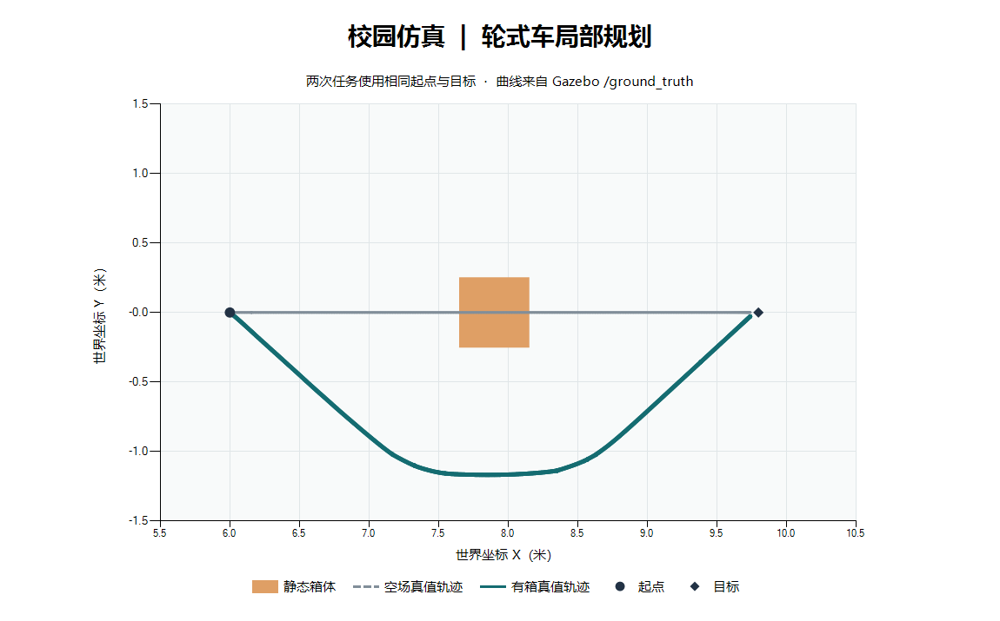

# 轮式车首次局部避障验收

2026-11-23，本地 Gazebo 校园。同一台模拟轮式车从世界坐标 (6.0, 0.0) 驶向 (9.8, 0.0)。两次任务使用相同的 Gateway 镜像与规划配置。第二次在直线路径中点 (7.9, 0.0) 放置 0.5 × 0.5 × 1.0 m 方箱。两次都通过 Core 原生 `SubmitMission` 提交单个路点，由 Gateway 的 `GapFollow` 处理途中观测。该试验覆盖从障碍测量到局部绕行、制动和 Core 独立确认到达的链路。

| 场景 | 实际轨迹 | 车体最小扫掠净距 | 世界坐标到达误差 | 非地面接触 | Core |
|---|---|---:|---:|---:|---|
| clear | 沿直线到达，避让事件 0 次 | 2.52294 m | 0.05826 m | 0 | SUCCEEDED，核验 1 个路点 |
| centered | 从方箱右侧绕行，返回目标 | 0.61449 m | 0.06545 m | 0 | SUCCEEDED，核验 1 个路点 |



曲线为车体参考点的实测轨迹。箱体只出现在 centered。两个场景各以运行时世界模型中的障碍表面到车身、两轮与脚轮碰撞体的最小距离评分。对相邻真值采样之间可能发生的平移和转动扣除余量。centered 的最小采样净距为 0.62647 m，计入扫掠余量后为 0.61449 m。验收门槛为净距 ≥0.45 m、到达误差 ≤0.12 m、非地面接触为零。两次均未触发 0.42 m 前向硬停。到达后的制动事件在原始记录中保留。

## 感知与独立复核

| 检查项 | clear | centered |
|---|---:|---:|
| 世界真值位姿样本 | 516 | 675 |
| 操作期间有对应感知报告的扫描 | 118 / 118 | 161 / 161 |
| 能独立测定箱体最近可见表面的扫描 | 无箱 | 21 / 21 达标 |
| 到该表面的最大距离误差 | — | 0.02484 m |
| 到该表面的最大方位误差 | — | 0.96044° |

独立评分使用原始 `/scan` 的束角和采样戳、同一仿真时钟的 `/ground_truth`，以及 Gazebo 运行时导出的世界几何，从全程扫描中确定应评的箱面。距离误差上限为 max(0.05 m, 真值 × 5%)，方位误差上限为 2°。第二份复核程序从原件重算得到相同的 21 个时间戳。轮地接触持续出现，具名的非地面接触为零。[独立复算](crosscheck.json)

Core 分别对 `local-clear-a6964e00e6/waypoint/1` 与 `local-centered-104ea42107/waypoint/1` 在序号 2 派发、4 收到结果、6 核验、7 结算。每个任务各有一次派发和一次路点核验。压缩包内 `core-ledger.json` 来自只读 SQLite 导出，`witness/observations.jsonl` 保留原始激光、世界位姿、具名接触、发布的感知报告和 Gateway 规划事件。[清单与 SHA-256](manifest.json) · [clear 原件](clear.tar.gz) · [centered 原件](centered.tar.gz)

## 失败记录与修复

| 原始运行 | 独立见证的结果 | 处理 |
|---|---|---|
| clear 第一次 | 到达，但没有接触传感器数据 | 修正 Gazebo 接触传感器的话题声明。检查轮地数据持续到达后，才判定碰撞结果。[原件](failures/clear-contact-topic.tar.gz) |
| centered 第一次 | 绕箱到达，部分最近表面方位误差达 85.4° | 在相差不超过激光射程分辨率 0.01 m 的候选中，优先用连续表面定位。保留所有孤立回波用于停车和通道检查。[原件](failures/centered-ambiguous-bearing.tar.gz) |
| centered 第二次 | Gateway 停车并报告 `navigation.no_safe_path`，Core 记录 FAILED | 原算法把额外追踪余量也施加到候选轨迹起点，否决了仍能维持净距的通道。修复后从当前净距评估额外余量，始终保留 0.55 m 的强制规划边际。[原件](failures/centered-conservative-corridor.tar.gz) |

## 复现与运行身份

分支 `feat/sdd-056-rover-local-plan` 基于 `19484d2a6ea56920698bff148805db0876603482`。仿真镜像为 Linux/amd64，平台 manifest 为 `sha256:39c6089c70d93e62b9e794f84c3cc991d9c247e2d2fa6d664b9522ff1c5a9b28`。构建标识 `19484d2a6ea5+local.68bb8adba5a6` 表示主线基点与本地源码摘要。本地证据观察器通过只读挂载运行。验收驱动额外导出 Core 账本，其有效文件摘要在清单的 `acceptance_sources`；Gateway、规划器及其单测另已与镜像内源码逐文件核对。[构建清单](reproduction/source.json) · [有效源码核对](reproduction/image-file-check.json)

在 PowerShell 7 中进入 G1 工作区，使用本机已核实签名的项目 Python 入口和已缓存的校园资产。每次选择新的输出目录以保留旧原件。

```powershell
Set-Location D:\project\edge-agent-rover-local
$projectPython = 'D:\project\edge-agent-ros\scripts\project-python.ps1'
$runOutput = Join-Path '.ci-results' ('rover-local-' + (Get-Date -Format yyyyMMdd-HHmmss))
docker run --rm --network none edge-rover-local:g1-dev ctest --test-dir /opt/edge/build/edge_gateway --no-tests=error --output-on-failure
& $projectPython -B tests/system/campus_local_plan_acceptance.py run --image edge-rover-local:g1-dev --assets D:\project\edge-agent-ros\artifacts\sim-assets --out $runOutput --scenario both
& $projectPython -B artifacts/verification/rover-local-plan-20261123/local/crosscheck.py $runOutput
```

无 ROS 的 `rover_local_planner_contract` 和既有 `body_authority_contract` 均通过。按原 Gateway 的 ROS watchdog 入口另核验任务互斥、重复操作、取消与停车确认、心跳超时和未知结果资源围栏。断网容器中用合成扫描核对默认模式的近障硬停、覆盖不足和时间异常等 10 个原有用例，全部通过。测试选择器 14 项通过。完整消费者回归与其余六个 Gazebo 场景属于后续发布门。[CTest 输出](reproduction/ctest.txt) · [watchdog 输出](reproduction/legacy-watchdogs.log) · [默认模式扫描回归](reproduction/legacy-scan.json)

此轮感知源为校园模拟水平激光，车体模型为这台轮式车。Jetson、D435/Livox 接入和实车运动均未测试。物理规划器回退时，先停止接单、结算原操作并见证停车，再由站点配置选回 `local_planner:=stop_on_clearance` 或原固定镜像。[接口、验收与回退约定](../../../../docs/specs/SDD-056-rover-local-plan.md)
