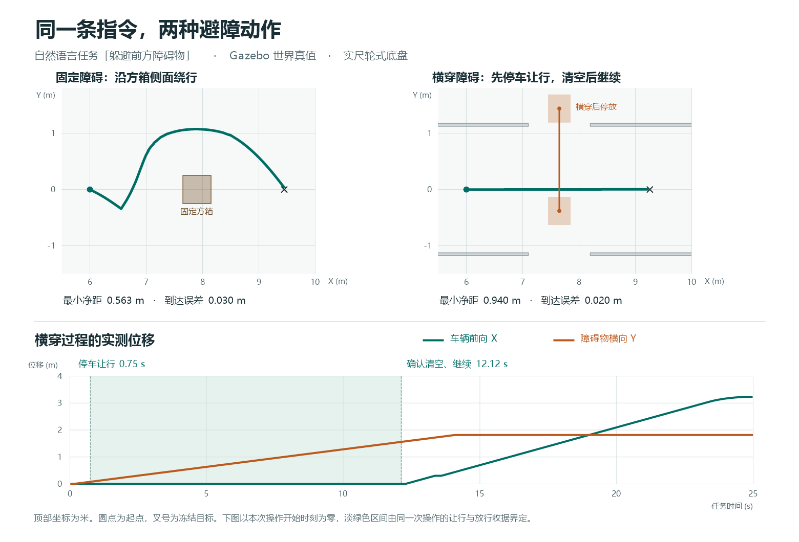

# 「躲避前方障碍物」自然语言闭环

Agent 接收一句没有目的地和数值的中文任务。站点授权与文字分开提交，绑定这台模拟车的一次有界机动。实际的 Qwen3 4B Instruct 通过 Ollama 读取当前能力目录并选择 `avoid_front_obstacle`。工具没有坐标或速度参数。执行器按新鲜前向表面距离、本体姿态及现场配置冻结短程目标；Core 和 Gateway 负责同一操作的局部运动，独立核验器检查终点和停稳，最后由 Agent 返回任务结果。

| 仿真场景 | 自然语言入口与物理结果 | 全车最小净距 | 终点误差 | 独立评分 |
|---|---|---:|---:|---:|
| 前方固定箱体 | 原句触发绕行，沿箱侧通过并停稳 | 0.563 m | 0.030 m | 39/39 |
| 箱体横穿通道 | 同一原句触发停车让行，清空后原操作继续 | 0.940 m | 0.020 m | 48/48 |

横穿物体沿世界 Y 轴移动 1.819 m，峰值速度 0.130 m/s。世界位姿显示车在进入冲突区前有连续 9.588 s 停稳。进入让行与确认清空均指向 track 4；实际有 71 帧可用横向速度和位置与真值匹配。两个任务均由 Core 核验一次到达，模拟车无非地面接触。两次未提供操作员凭据的同文请求均获 403。[逐项验收及原件哈希](acceptance.json) · [静态原件](centered.tar.gz) · [横穿原件](crossing.tar.gz)



两个场景使用同一 linux/amd64 平台镜像 `92d101f215f3…`，Qwen 权重摘要为 `0edcdef34593…`。分支开发基点是 `19484d2a`，镜像固定了这轮工作树中的实际实现。两个场景分别部署在独立 ROS domain，资源绑定各自冻结。另用两句不同措辞从现有目录选择工具，模型两次都选中相同插件，仅测试了规划。[构建清单与 CTest](build.tar.gz) · [同义句、负控与台架合成输入记录](additional-checks.tar.gz)

另在全新的 Gazebo 世界直接从 Core 复测横穿运动。车体最小净距 0.940 m，到达误差 0.018 m；同一跟踪目标触发一次让行和一次放行，74/74 个可测样本的横向速度和方向符合门槛。[独立复跑原件](core-repeat.tar.gz)

工作站上的 QEMU 以项目已有硬件 ROS 镜像为基础，在 linux/arm64 重新编译最终 Gateway 并装入同版本 Agent，得到本地镜像 `edge-rover-local:arm64-maneuver-verified`（平台摘要 `7100de77cd32…`）。2 项 CTest、8 项 Agent 与台架准入合同通过；未测试 Jetson 原生帧率、实际底盘或现场制动。只读探针另在隔离 ROS 中实测正常 TF、错误 TF 和空输入，三种结果均符合预期。[ARM64 构建和测试原件](arm64-checks.tar.gz) · [现场接入说明](../../../../docs/testing/rover-maneuver-commissioning.md)

### 调试中修复的实际失败

早期的静态绕箱在自车转向后长期等待。箱体一侧逐渐退出视野，让可见点的中心发生位移。修复后需要来自两端轮廓的独立位移证据确认横穿。另一轮在移动靶驶离后遇到一次轮廓跳变，三个点拟合出约 −0.51 m/s 的伪速度。现在可疑运动会先请求零速复核；同一目标在通道外静止、连续新传感器证实全宽通道清空时才能继续。已确认的运动目标继续使用完整驶离与清空判据。定向单测验证了真正的再次闯入。

激光另出现过一帧隔着通道的孤立假回波。表面关联现采用实际测到的连续边缘，原始近回波仍参与 TTC 与整车扫掠。18 次操作共 693 帧可测表面在原距离与方位门槛下通过回放。最终横穿用例中，71 个可评估速度样本有 11 个完整二维速度向量的误差大于 0.075 m/s，最大 0.225 m/s；横向分量最大误差为 0.066 m/s。该结果支持本次横穿让行，仍不足以验证通用二维速度预测。[保留的失败案例与原始扫描](earlier-runs.tar.gz)

## 两个场景如何判分

两个场景都启用相同的 `footprint_follow`、`scan_clusters` 和 `yield_crossing`。模拟车使用四轮灵遨外廓、水平激光、轮速、IMU 与扫描匹配定位。跟踪器只能读取扫描和里程计。在静态场景中核对绕行轨迹、车体净距和动静误判。在动态场景中，真实带碰撞几何的箱体沿滑轨横穿路线，独立见证者逐帧检查箱体实动、车在冲突区前停稳、目标离开、原操作继续以及最终到达。世界真值、接触和移动夹具的控制消息只进入核验或评分链。

评分下限沿用车体表面扫掠净距 0.45 m 和独立终点误差 0.12 m。范围、方位、横向速度和误差是在模拟传感器和独立碰撞几何之间比较。每次原句的模型回复、操作员权限拒绝对照、Agent 任务、DSH 账本、Core 账本和逐帧真值一起保存。

## 可复用的边界

- 任务选择物理能力、独占资源和有限预算；有任务正在执行、来源不明、证据不新鲜或无法核验时，系统会拒绝、停车或保留待恢复状态。
- 动态观测器通过只读 ROS 主题提供 track ID、位姿、速度、来源与支持点数。让行策略使用这些事实，其他感知或诊断插件也可独立消费。同一机体的执行权限和制动入口集中在物理层。
- 确认横穿后，目标暂时被遮挡或在通道内停住时保持制动。复核到目标移出，车辆仍停稳，连续新扫描和里程计证明通道清空，才恢复原操作。定向测试另行覆盖真正的第二次闯入。
- 本轮已验证室内、轮式、慢速横穿。沿车行驶、斜向高速目标、多人遮挡、野外及不同机型需要各自的感知、动力学配置和独立验收。车头前方空旷时是否能确认无障碍，取决于真实射线覆盖和报告给出的距离。

## 在本地复测

需要已有校园资产、包含本分支代码的本地 ROS/Gazebo 镜像、Ollama 镜像及含所选模型的本地模型卷。仿真使用独立 Compose project、ROS domain 和操作员令牌，不需连接 Jetson。模型卷按只读方式加载。每场使用新输出目录，证据文件可作独立复算。[验收入口](../../../../tests/system/campus_local_plan_acceptance.py) · [自然语言驱动](../../../../tests/system/agent_avoidance_acceptance.py) · [现场接入说明](../../../../docs/testing/rover-maneuver-commissioning.md)

```powershell
Set-Location D:\project\edge-agent-rover-local
$py = 'D:\project\edge-agent-ros\scripts\project-python.ps1'
$env:EDGE_AVOIDANCE_MODEL_VOLUME = 'p0-author-replay-model'
$assets = 'D:\project\edge-agent-ros\artifacts\sim-assets'
$out = Join-Path '.ci-results' ('natural-maneuver-' + (Get-Date -Format yyyyMMdd-HHmmss))
foreach ($scene in 'centered','crossing') {
    & $py -B tests/system/campus_local_plan_acceptance.py run --image edge-rover-local:maneuver-verified --assets $assets --vehicle lingao --localization wheel_gyro_scan --planner footprint_follow --dynamic-policy yield_crossing --mission-driver agent --scenario $scene --out $out
    if ($LASTEXITCODE) { throw "Acceptance failed for $scene" }
}
```
