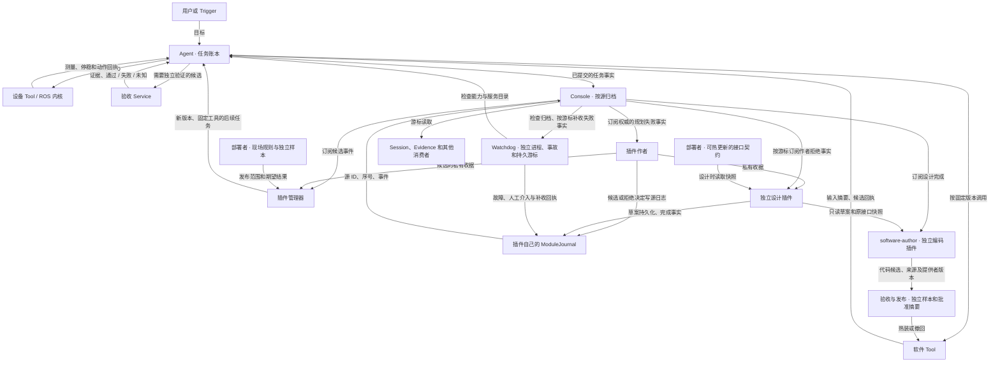

# 单台 Edge 的可观测性与插件演进

当前系统能够对特定失败完成有证据的自主恢复。现场授权哪类工具、谁持有操作账本、执行后拿什么独立证据核对，决定了可覆盖的任务范围。机器人与软件任务共用任务入口。Watchdog 提供进程外巡检，文本 Tool 已有从候选代码到隔离验收、批准和撤回的实例。开放式代码投放、设备控制权交接和主机级故障仍需各自的验证。

## 从一次失败读懂系统

用户输入“计算相邻采样间隔的最大值 [100,103,111,115]”。未装对应能力且规划失败时，原任务留下受阻事实。作者向模型提供“相邻采样间隔的最大值”以及允许的运算。若模型提出先作相邻差再求最大值，发布者用现场独立样本检验。真实输入的差为 3、8、4，负差样本可以抓出“误取绝对值”的实现。管理器将同一用户请求交给已固定版本的工具。只有原任务、发布事件、实际输入、结果 8 和原生终态对得上，才能在同一条 trace 中报告恢复。原失败记录保留，可据此比较升级前后行为。[软件计算规格](../specs/SDD-012-authored-software-tools.md)

换成“把本机前向速度换算成 km/h”，同一套作者、发布者和管理器可复用，证据换成实际里程计的时间、坐标系与原值。传感器过期要进入重试或待处置。换成“拍照并验证序列号”，则需要实际相机、图像识别提供者和清晰度等验收条件。超出声明语言的能力可以进入设计草案，经过独立实现、仿真和发布评审后再获得执行权限。[机器人恢复样本](../evidence/plugin-manager-and-eventbus.json) · [设计草案规格](../specs/SDD-013-plugin-design.md)

## EventBus 的模块契约

dsh 使用持久 Session 事实、活跃 Agent 事件和能力钩子来支持插件扩展。Edge 的故障恢复跨进程，还需向真实设备核实副作用。这里保留 dsh 的角色名称，分别为可回放事实、同步服务调用和需要授权的任务提交定义协议。[dsh 官方架构](https://github.com/deepseek-ai/deepseek-harness/blob/39163dd30f703a79079e2d2446545cff3c453738/docs/architecture.md#events)

| 交互 | 状态所有者与提交时机 | 消费、故障与恢复 |
|---|---|---|
| 任务和工具请求 | Agent 先存任务、步骤和操作身份。动作所有者保存受理或结果。 | 使用原 operation ID 对账。工具回执作为候选，需要独立验收时先持久化再验证。 |
| 插件内部事实 | 生产者在业务事务中写事实或待投递记录。每条事实具有 event_id、source、schema 与稳定错误码。 | Console 按 source_id / source_seq 逐源导入。无效行留诊断，已观察到的序号缺口留范围，健康变化关联上一次状态事件。 |
| 注册、升级和回退 | 受管发布者保存请求、目标版本与期望旧版本，记录写入意图，再回读并提交最终结果。 | 进程中断后按实际内容对账。旧绑定失效则等待原实现或人工处置。普通文件修改只能由采样或部署记录证明。 |
| 订阅与反应 | 消费者使用 archive_id / seq 续读，在自身事务中保存已处理状态。要触发新工作时经过带去重身份的任务入口。 | 订阅者离线时生产者继续提交。父事件晚到后再关联。回放本身保持只读。 |
| 可读上下文 | Session 按 task / trace 生成阅读视图，引用有来源的事实。Evidence 使用有界查询补充细节。 | 查询者可看到覆盖窗口、版本和裁剪信息。关键诊断回到原生任务、动作或发布账本取证。 |

给新插件接总线时，先标出“动作可能已经发生，但进程还没有来得及记录结果”的位置。动作有独立控制器时，重启用原操作 ID 查询。纯软件计算可以使用任务参数重算，对照固定版本和独立期望值。只有源与归档都健在时，才有条件验证记录完整度。首次观测前就损坏的源、同机所有卷同时丢失以及最后一条记录之后的未知丢失，都需要源外证据。[事件字段、接入代码与查询方法](../module-eventbus.md)

## 单机能力评价

以 2026-11-18 的单机版本为基线。Windows 上的 Docker 完成 18 个选定测试组，包含 Gazebo 和真实本地模型。在资源测试中，四个应用服务与 ROS 探针共用内存限额，ARM64 工况采用指令模拟。真机上的控制延迟、温升、单个服务的内存占用还需逐项测量。[集成验收与版本](../testing/plugin-evolution.md) · [板端实验条件](../testing/sdd-003-results.md)

| 问题 | 可复查的优势 | 当前瓶颈及影响 |
|---|---|---|
| 会丢失用户已受理的工作吗？ | 两轮实验覆盖 136 项只读任务、272 次重投。恢复输入后沿原操作身份继续，持续故障可查到人工介入事件。[持续任务实测](../specs/SDD-004-single-edge-lifecycle.md) | 物理执行器受理动作后掉电，与纯计算进程重启有不同后果。若设备无法查询原操作，后续步骤要等待核查。认证批准、通知送达与过期处理还需串通。 |
| 出现异常能找到什么？ | 可由 task 找到执行步骤、固定版本和回执。测试中源序号从 7 开始，归档报告缺口 1–6。Watchdog 在 Console 离线后补收第 49 号任务失败事实。[来源故障样本](../evidence/eventbus-coverage-sample.json) · [巡检实录](../evidence/watchdog-acceptance.json) | 访问同机归档的订阅者共用一个读取入口。高积压会推迟反应。插件漏写事实、最后一次写盘前主机失效、直接修改未受管文件，都可能让复盘只得到一段未知时间窗。覆盖率需要独立见证。 |
| 能自己增加多少能力？ | 预授权的数列工具可从一次用户任务自动生成、验收、发布和续办。事件驱动的设计与编码插件还能为只读文本工具生成清单和代码，由独立发布者批准并热装。 | 设计模型可能选错接口，实际编码仅支持已登记的文本运算。新的库、设备权限和源码依赖仍需构建与投放流程。即使候选通过验收，原请求缺少实际输入或授权时也要停下来。[设计与编码实测](../evidence/software-author-acceptance.json) · [代码插件契约](../specs/SDD-014-authored-software-provider.md) |
| 能热换任意模块吗？ | Tool、Service 和事件消费者有互相独立的入口，提供者可以用不同语言实现。旧任务固定已有版本，受管变更可以按收据查询。[扩展矩阵](../harness-extensions.md) | 规划、任务工作线程、ROS 适配与账本仍有共用的宿主代码。替换控制器还涉及在途动作、机体资源和停车确认。无可查询的交接协议时，运行中卸载可能留下未知的物理状态。[执行入口](../../agent/service.py) |

### 本轮打通的两处交接

本轮以独立服务实现设计、编码、模型失败后的有界修正，继续复用原有 Agent、ROS 执行接口与受管发布。精确的模型选择、候选代码、未通过的尝试、进程重启和版本撤回各有样本。[本轮系统验收](../testing/event-driven-evolution.md)

**从运行故障到一份可审查的设计。** 订阅者先校验归档身份、序号、筛选和覆盖范围，再提交游标。设计插件从作者的拒绝记录读取私有收据与当前接口契约，在自己的卷保存工作状态和草案。草案记录当次可选接口的内容，公开完成事件记录摘要。离线模式可生成开发简报；配置模型后再生成接口、样本和回退建议。在 Docker 实验中，设计插件和 Console 归档分别重启、换代，同一个拒绝只交付一份设计。原始 PNG 尺寸请求保持受阻，设备工具调用数为零。模型提出的建议仍需持有独立样图的一方验证，例如用 3 × 2 像素图片要求得到准确的两个整数。[订阅契约](../specs/SDD-016-event-consumer-integrity.md) · [后台设计作者](../specs/SDD-017-plugin-design-watch.md) · [可热更新的设计接口](../specs/SDD-018-design-contracts.md)

**从设计到一份源码候选。** 独立编码插件读取有来源的设计及其接口快照。当设计完整、选中 `text-transform` 且符合部署者登记的能力时，模型可定义工具描述、自然语言调用前缀和受限计算表达式。插件将这些字段做成可校验的源码包，并交付给独立验收方。验收方持有模型未见的输入与期望；批准绑定实际候选摘要。模型选错接口、返回样本类型而非期望值、遗漏回退条件都是可观测的失败。仅在真实 Agent 使用新工具完成指定输入后，才将其计入任务成功率。使用新库、替换宿主和占用设备仍各需对应的构建、执行和权限契约。[软件编码候选](../specs/SDD-019-event-driven-software-author.md) · [受限文本发布流程](../specs/SDD-014-authored-software-provider.md)

## 按风险和依赖安排迭代

以下门槛供下一轮 SDD 排期。每项采用一份独立故障清单和一次可复跑验收。先让已具备的恢复能力能被核查，再扩大允许自动处理的任务种类。

| 顺序与价值 | 交付物与负责的 Agent 角色 | 进入下一阶段前应看到的结果 |
|---|---|---|
| P0 · 让缺失的证据可见 | EventBus 维护 Agent 负责源身份、事件校验、读取故障、订阅进度与恢复记录。本轮 SDD-016 的范围和结果按其验收记录登记。 | 用独立探针制造断连、错误数据与重启。对每个已注入故障，找到对应源事实或写明所缺区间与原因。重投恢复后，每个应发生一次的逻辑结果有唯一身份，健康源继续工作。 |
| P0 · 让失败进入开发流程 | 设计 Agent 核对收据和接口快照，编码 Agent 按获准的设计接口起草候选。SDD-017 至 SDD-019 分别管理自动提出设计、设计依据和文本代码候选。 | 用一次超出声明范围的请求，经公开入口读取有来源的设计或可处理的失败。重复交付可以按原身份识别，旧草案能按旧契约解释。设计和编码阶段产生的额外正式注册、设备调用数均为 0。 |
| P1 · 打通新软件能力的交付 | 编码 Agent 从已核实的草案读取目标、允许的输入与依赖。验收 Agent 持有独立样本，发布 Agent 绑定候选摘要、权限以及旧版，记录批准与回退。先选择一类可离线验证的只读算法，如从提供的 PNG 字节读取尺寸。 | 同一套件含合法、截断、超限和不支持的输入。对可发布候选验证任务结果、换版、撤回、在途任务及原请求续办。拒绝样本或批准摘要失配时活动版本保持原值。单列模型/构建预算耗尽和人工处理原因。 |
| P1 · 上板与建立持续运行基线 | 板端验证 Agent 负责 ROS 适配和外部见证，运行维护 Agent 负责通知与留存。按 SDD-004 先跑 Docker 24 小时，再在选定板卡与受控台架跑 72 小时。提前记录板型、输入负载和机体的停车、资源与散热预算。[长稳规格](../specs/SDD-004-single-edge-lifecycle.md) · [板端验收清单](board-validation.md) | 组合断流、模型超时、掉电、磁盘水位、恢复与设备换代。每个已受理任务有可查终态或待办。对未证实的动作，误报完成和重复实物动作均为 0。记录实际运行时长、积压峰值、磁盘增长和重连后清空时间。 |
| P2 · 降低替换宿主模块的代价 | 运行时维护 Agent 优先沿已有计划输入/输出拆出第二个规划提供者。设备适配 Agent 在一个具体机型上定义交接、排空、取消和原操作对账。 | 两个规划提供者使用同一冻结任务集。进程重启、缺依赖或版本变动时，历史任务仍能读取。热换设备前查到旧控制权已释放，独立观测满足机型停车约束；结果未知时生成有责任方和步骤的介入项。 |

P1 的软件开发与台架验证可以并行。软件任务应先把候选交付后的三步串起来：验收方独立出题，发布方批准确切版本，续办方用原始输入和有来源的任务身份调用它。数列工具已有自动续办实例；目前文本候选在获批后由调用方新建带正文的任务。协调者要保留原受阻记录，避免把新任务的成功追认成旧任务的成功。可复用的最小宿主负责持久化意图、绑定版本、核查授权和写入终态。[插件生命周期约定](../plugin-development.md)

### 迭代验收时分别统计什么

已有结果中，同一小模型正确生成大写函数，却在完整单词计数上三次生成了校验器不接受的表达式。修正后的系统能向第二、第三次推理送达各自真实的错误和失败表达式；这个模型仍未改正。系统可用反馈、模型理解反馈、最终任务成功，是三个需要单独衡量的指标。另一方面，1,024 条停机积压在首轮桌面实验中，从启动 Console 到全部可查询用了约 20 秒，而消费已可查询的数据只需约 0.3–0.4 秒。下一轮应分别测归档可见延迟和订阅追赶延迟。[模型正反样本](../evidence/software-author-acceptance.json) · [积压和恢复实验](../testing/event-driven-evolution.md)

近期先排三个能独立交付的工作包。依赖顺序与评分标准如下。

1. **证据维护 Agent 与诊断 Agent。** 给磁盘水位、源卷消失、归档长期失联各建独立故障注入。冻结用例，列出哪些事实由同一进程证明、哪些需要进程外或机外见证。为积压设置现场可接受的恢复时间，并分别验证插件首次安装时回放历史和只接新任务的策略。验收需要公布每个故障的原因码、覆盖窗口、人工步骤及无法恢复的记录。
2. **编码 Agent、验收 Agent 与发布 Agent。** 在现有文本契约以外选择一项可以离线判定正确性的能力。设计阶段只拿到公开契约，编码方可拿到自己的失败诊断和开发样本，最终验收留出样本由独立角色保管。发布后续办必须引用原始输入、发布版本及授权。对同一冻结任务集分别测模型选对接口、代码通过留出样本、原任务最终恢复三个比例。
3. **设备适配 Agent 与板端验证 Agent。** 挑一个受控台架和一个可回读状态的动作做首个设备插件。规定谁持有设备、停止后用什么观测证明停稳、掉电后如何用原操作 ID 查状态。先做 24 小时 Docker 长稳，再在指定板卡做 72 小时组合故障。通过门槛是可定位全部注入故障，误报完成及重复物理动作均为零，并公布停稳延迟和资源峰值。

| 指标 | 计算方法与建议门槛 |
|---|---|
| 故障证据覆盖率 | 分母是独立探针实际施加的故障数。把“定位到根因”“仅知道缺失区间”“完全无记录”分列。每个进入发布门槛的验收用例都应对应源事实或明确标出的未知区间。 |
| 能力缺口恢复率 | 按任务类型拆分“受阻 → 设计 → 候选 → 独立验收 → 获准 → 完成”。每一步都以上一步的实际任务数为分母，另报用原始用户输入最终完成的数量。人工批准、人工改写、仅生成草案分别计数。 |
| 长程正确性 | 记录故障前后在途数、恢复耗时分布及最老积压年龄。重复物理副作用、未经授权的发布和错误成功在注入测试中的目标均为 0。真机验证由执行器外部的见证测量动作次数和停稳。 |
| 演进成本 | 对同一冻结任务集比较现行版和候选版，记录每个成功任务的模型调用数、用时、资源峰值和人工介入次数。零成功时直接报告失败总数和已耗预算。 |

## 怎样评估下一次“自进化”

两条开发路径可以放在一起比较。“求最大采样间隔”能用现场允许的算子表达，独立期望值与授权规则齐备时，系统可以自动续办。“统计正文中完整单词 robot 的出现次数”需要新的文本计算，开发插件从设计产出候选代码。独立验收用重复词、混合大小写、空正文以及 robotics 这样的反例检验结果，部署者批准后 Agent 热加载新能力。相同任务身份重投时检查已保存结果。第三类任务如“升级真实相机驱动”涉及设备访问、版本回滚和资源交接，另需现场授权与独立的真机验收。[受管软件工具](../plugin-manager.md) · [源码候选验收](../specs/SDD-014-authored-software-provider.md)

1. **冻结验收输入。** 从已有任务、外部设备测量或已知输入/输出构建样本，包括合理拒绝、需要人工介入、可自动恢复三类。独立持有期望值，把一部分输入只留给验收方。固定模型版本、资源预算、插件版本和现场策略。
2. **比较启用前后。** 在同一初始状态分别关闭和启用候选插件。统计任务完成率、错误成功次数、人工介入率、模型调用数，以及有副作用的实际执行次数。自动完成率提高时仍要单列误成功与重复动作。
3. **检验审计覆盖。** 用故障注入器的独立记录作分母，对每次故障或发布逐个核对源事件、错误码、任务/版本、可复验的终态。来源已经缺失时单列为未知。对长程任务同时记录离线多久、积压多少、重连后多久补齐及磁盘增长。
4. **检验实际价值。** AI 提出的设计可以生成合规 JSON 但给错协议，模型也可能把“最大相邻差”误解成“最大绝对差”。分别报告草案可解析率、独立样本通过率、真实任务完成率。只有最后一项有业务含义。记录中已保留这两种失败。[设计质量样本](../evidence/plugin-design-sample.json) · [计算候选拒绝样本](../evidence/authored-series-rejected.json)
