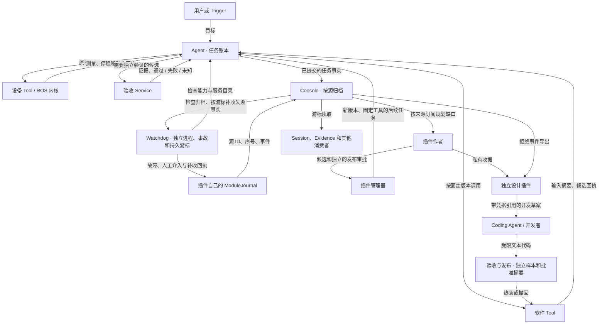

# 单台 Edge 的可观测性与插件演进

当前系统能够对特定失败完成有证据的自主恢复。现场授权哪类工具、谁持有操作账本、执行后拿什么独立证据核对，决定了可覆盖的任务范围。机器人与软件任务共用任务入口。Watchdog 提供进程外巡检，文本 Tool 已有从候选代码到隔离验收、批准和撤回的实例。开放式代码投放、设备控制权交接和主机级故障仍需各自的验证。

## 从一次失败读懂系统

用户输入“计算相邻采样间隔的最大值 [100,103,111,115]”。未装对应能力且规划失败时，原任务留下受阻事实。作者向模型提供“相邻采样间隔的最大值”以及允许的运算。若模型提出先作相邻差再求最大值，发布者用现场独立样本检验。真实输入的差为 3、8、4，负差样本可以抓出“误取绝对值”的实现。管理器将同一用户请求交给已固定版本的工具。只有原任务、发布事件、实际输入、结果 8 和原生终态对得上，才能在同一条 trace 中报告恢复。原失败记录保留，可据此比较升级前后行为。[软件计算规格](../specs/SDD-012-authored-software-tools.md)

换成“把本机前向速度换算成 km/h”，同一套作者、发布者和管理器可复用，证据换成实际里程计的时间、坐标系与原值。传感器过期要进入重试或待处置。换成“拍照并验证序列号”，则需要实际相机、图像识别提供者和清晰度等验收条件。超出声明语言的能力可以进入设计草案，经过独立实现、仿真和发布评审后再获得执行权限。[机器人恢复样本](../evidence/plugin-manager-and-eventbus.json) · [设计草案规格](../specs/SDD-013-plugin-design.md)

## EventBus 的模块契约

dsh 使用持久 Session 事实、活跃 Agent 事件和能力钩子来支持插件扩展。Edge 的故障恢复跨进程，还需向真实设备核实副作用。这里保留 dsh 的角色名称，分别为可回放事实、同步服务调用和需要授权的任务提交定义协议。[dsh 官方架构](https://github.com/deepseek-ai/deepseek-harness/blob/39163dd30f703a79079e2d2446545cff3c453738/docs/architecture.md#events)

| 交互 | 状态所有者与提交时机 | 消费、故障与恢复 |
|---|---|---|
| 任务和工具请求 | Agent 先存任务、步骤和操作身份。动作所有者保存受理或结果。 | 使用原 operation ID 对账。工具回执作为候选，需要独立验收时先持久化再验证。 |
| 插件内部事实 | 生产者在业务事务中写事实或待投递记录。每条事实具有 event_id、source、schema 与稳定错误码。 | Console 按 source_id / source_seq 逐源导入。无效行留诊断，已观察到的序号缺口留范围，健康变化关联上一次状态事件。 |
| 注册、升级和回退 | 受管发布者保存请求、目标版本与期望旧版本，记录写入意图，再回读并提交最终结果。 | 进程中断后按实际内容对账。旧绑定失效则等待原实现或人工处置。普通文件修改只能由采样或部署记录证明。 |
| 订阅与反应 | 消费者使用 archive_id / seq 续读，在自身事务中保存已处理状态。要触发新工作时经过带去重身份的任务入口。 | 订阅者离线时生产者继续提交。父事件晚到后再关联。回放本身保持只读。 |
| 可读上下文 | Session 按 task / trace 生成阅读视图，引用有来源的事实。Evidence 使用有界查询补充细节。 | 查询者可看到覆盖窗口、版本和裁剪信息。关键诊断回到原生任务、动作或发布账本取证。 |

给新插件接总线时，先标出“动作可能已经发生，但进程还没有来得及记录结果”的位置。动作有独立控制器时，重启用原操作 ID 查询。纯软件计算可以使用任务参数重算，对照固定版本和独立期望值。只有源与归档都健在时，才有条件验证记录完整度。首次观测前就损坏的源、同机所有卷同时丢失以及最后一条记录之后的未知丢失，都需要源外证据。[事件字段、接入代码与查询方法](../module-eventbus.md)

## 当前能力与下一步开发顺序

| 能力 | 当前可验证的边界 | 下一次交付如何判定有效 |
|---|---|---|
| 重启后继续任务 | 有原任务、步骤、版本和原操作 ID。部分设备结果未知时保留待核查。 | 在设备动作受理前后分别断电，统计未知结果误报成功数和重复物理动作数。两项均应为 0。 |
| 异常可定位 | 可追到已纳入协议的请求、候选、执行和验收。序号跳变、模块源读失败、恢复均有记录。有些未受管注册、临时 ROS 通知和第三方插件内部异常只有有限证据。 | 先为每类新插件登记关键转移、资源与故障注入。以独立故障清单为分母，按类统计有据可查的比例、缺口数量和发现延迟。 |
| 能力可扩展 | 可热装 Tool、替换共享 Service、独立装卸事件消费者。模型适配与 Agent loop、融合、设备接管仍有宿主代码。 | 优先提取规划和恢复策略的接口，让两种提供者通过同一套输入/输出、旧任务、断连和恢复测试。 |
| AI 自主演进 | 声明型只读能力可走自动闭环。设计插件把超范围请求写成可审查的开发输入。纯文本 Tool 支持 AI 生成受限源码、独立容器验收、批准热装和撤回。 | 用未公开给作者的任务集比较候选与基准，在扩大语言、文件或设备权限前建立相应的隔离与验收门槛。[代码插件规格](../specs/SDD-014-authored-software-provider.md) |
| 长时间运行 | 独立 Watchdog 直接巡检 Agent 与 Console，持续故障达到预算后上报人工步骤。恢复时处理自己的权威失败事件订阅，按游标补收与核对。 | 在目标板测试磁盘与内存压力、积压增长率、备份恢复、主机断电与驱动异常。每个指标附负载、设备、任务数与观测时长。[巡检运行手册](../watchdog.md) |

开发顺序按影响安排。先为新增插件提供契约测试、独立证据和撤回路径，再把已有的规划/恢复策略抽成可替换服务。开放任意代码生成之前，需要把候选的构建、测试、审批、部署、回退实现为相互独立的角色。软件候选可以先在无设备的环境验收。涉及制动、设备独占或坐标系迁移的候选，在硬件交接验收通过后接入。完整回归和证据按版本保留。[插件开发规范](../plugin-development.md) · [测试与板端边界](../testing/single-edge.md)

## 怎样评估下一次“自进化”

两条开发路径可以放在一起比较。“求最大采样间隔”能用现场允许的算子表达，独立期望值与授权规则齐备时，系统可以自动续办。“统计正文中完整单词 robot 的出现次数”需要新的文本计算，开发插件从设计产出候选代码。独立验收用重复词、混合大小写、空正文以及 robotics 这样的反例检验结果，部署者批准后 Agent 热加载新能力。相同任务身份重投时检查已保存结果。第三类任务如“升级真实相机驱动”涉及设备访问、版本回滚和资源交接，另需现场授权与独立的真机验收。[受管软件工具](../plugin-manager.md) · [源码候选验收](../specs/SDD-014-authored-software-provider.md)

1. **冻结验收输入。** 从已有任务、外部设备测量或已知输入/输出构建样本，包括合理拒绝、需要人工介入、可自动恢复三类。独立持有期望值，把一部分输入只留给验收方。固定模型版本、资源预算、插件版本和现场策略。
2. **比较启用前后。** 在同一初始状态分别关闭和启用候选插件。统计任务完成率、错误成功次数、人工介入率、模型调用数，以及有副作用的实际执行次数。自动完成率提高时仍要单列误成功与重复动作。
3. **检验审计覆盖。** 用故障注入器的独立记录作分母，对每次故障或发布逐个核对源事件、错误码、任务/版本、可复验的终态。来源已经缺失时单列为未知。对长程任务同时记录离线多久、积压多少、重连后多久补齐及磁盘增长。
4. **检验实际价值。** AI 提出的设计可以生成合规 JSON 但给错协议，模型也可能把“最大相邻差”误解成“最大绝对差”。分别报告草案可解析率、独立样本通过率、真实任务完成率。只有最后一项有业务含义。记录中已保留这两种失败。[设计质量样本](../evidence/plugin-design-sample.json) · [计算候选拒绝样本](../evidence/authored-series-rejected.json)
