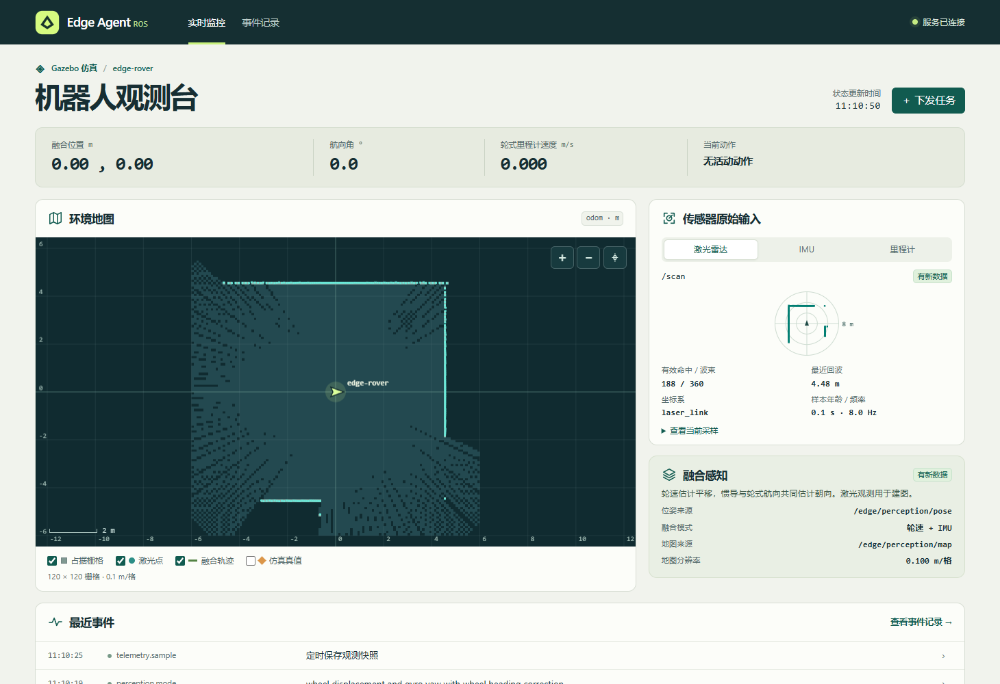
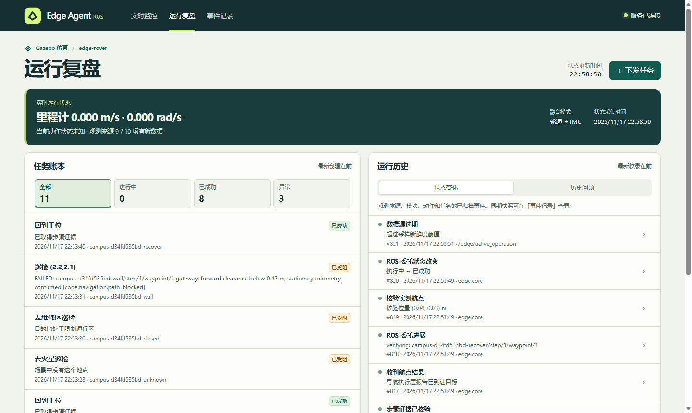

# 从一句话到机器人执行证据

首页已提供[任务会话](sessions.md)，先阅读中文任务经过，再展开证据。本文的实时监控、运行复盘和原始事件入口可用于继续检查传感器、步骤与完整时间线。

第一次使用时，先打开[本机观测台](http://127.0.0.1:8765/)，点击「下发任务」，选择示例并提交。看地图上的机器人到达第一个点、转向、到达第二个点，再从任务卡点击「查看事件」。这一个例子可以看懂三件事：系统接收了什么目标，机器人实际感知到了什么，以及为什么系统认为目标已经达成。

## 从运行复盘读懂一台机器人的工作

接班时打开[运行复盘](http://127.0.0.1:8765/#review)。先看机器人最近上报的状态和活动操作，再从任务列表打开一条用户请求。机器人可以静止而 Agent 仍在规划、等工具回执或验收结果，所以运动状态、执行中的操作和任务终态需要分别读。

| 想了解什么 | 读哪个区域 | 判断依据 |
|---|---|---|
| 现在系统在做什么？ | 实时状态、活动任务，以及最近的状态变化 | 最新观测有时间与新鲜度。看不到活动操作，只表示本次观测没有报告在途动作。 |
| 今天接手前已经做成哪些事？ | 成功任务，打开目标和步骤 | 目录来自 Agent 任务账本。按实际完成状态筛选后，再用步骤回执或独立验收检查产物。 |
| 哪个任务需要关注？ | 异常任务，看终态说明及相关事件 | 一条受阻任务可能产生网关制动、工具报错、任务阻塞三条记录；它们可以描述同一次停止。 |
| 系统本身发生过什么？ | 历史问题与状态变化 | 传感器失联、恢复和插件变化也可能发生在没有任务时。判断某故障此刻是否持续，还要看后续恢复记录和实时状态。 |

**跟读一次真实的仿真任务。** 本机任务 `campus-19ee1d1543-wall` 的目标是“巡检 (2.2,2.1)”。归档中 `#1786` 表示已受理，`#1788` 表示计划已通过检查。网关在 `#1850 action.braking` 记录前方净空约 0.395 m（字段 `front_range_m`），低于 0.42 m 的制动阈值，`#1853 action.result` 记录里程计确认停稳，工具随后在 `#1858` 返回错误，Agent 在 `#1859` 保存 `BLOCKED` 和 `navigation.path_blocked`。这样可以把停下的原因定位到导航执行，并检查停车证据。传感器能证明当时正前方的净空，无从单凭这条记录辨认障碍物种类。这些编号属于本机已有档案；新部署可以用自己的任务走同一条阅读路径。[打开本机示例](http://127.0.0.1:8765/#review?task=campus-19ee1d1543-wall)

**复盘与原始档案怎样对照？** 任务详情围绕 `task_id` 组织；同一 `trace_id` 可以包含后续恢复任务；`operation_id` 对应一次执行操作。事件里的 `session_id` 属于一次观测台进程生命周期。重启观测台不会把进行中的任务拆成两项。归档编号表示接收先后；阅读跨模块事件时同时看源发生时间与父事件。

任务步骤显示该步骤最后一次入账的状态。如果步骤记录还写着“执行中”、任务终态已经“受阻”，先读终态诊断，再从执行时间线核对制动和停车事件。点击事件可以回放当时可用的传感器快照，并从回放横幅返回本次复盘。[手机端受阻任务实测截图](../artifacts/console/run-review-mobile-task.png)

**定时快照存了什么？** `telemetry.sample` 保存当时可观察的传感器、轨迹、活动操作等投影。例如本机的 `#2639` 可回放，事件自身的 `data` 是 `{}`。任务受理、模型或工具交换、传感器变化和插件诊断各有独立的事件。AI 可以用不加 `view` 的 `/api/events` 或 `/api/export` 获取已经归档的公开事实，需要当时的状态时加 `snapshot=1` 导出。持久事件源在 Console 重连后可补收；瞬时 ROS 发布如果未采集、现场策略隐藏的内容、已清理的普通快照和两次采样之间的变化，无法从这份档案完整重建。[模块事件总线](module-eventbus.md)

## 跟踪一次巡检

| 环节 | 这个例子中的输入与输出 | 去哪里核对 |
|---|---|---|
| 受理 | 浏览器提交文本和唯一任务 ID。HTTP 202 表示已持久受理。用同 ID 重投相同文本会返回同一任务。 | 事件 `agent.accepted` |
| 规划 | “依次巡检 (0.8,0) 和 (0.8,0.7)，然后报告状态”生成两步。第一步是 `inspect`，参数包含两个有序坐标；第二步是 `status`。 | 展开 `agent.planned` 可查看提供者、能力版本、参数。 |
| 执行 | 第一步取得操作 ID `<任务ID>/step/1`。巡检内核为两个观测点分别建立 ROS Action，第二个操作 ID 以 `/waypoint/2` 结尾。 | `agent.dispatch → mission.created → step.dispatch`。以操作 ID 对齐网关日志。 |
| 验收 | 网关用新鲜里程计判断到达和停稳，内核再采集位置，写入该点证据。第二步从最新里程计读取位置、航向和速度。 | `step.result → step.verified → mission.transition`，任务末尾 `agent.verified`。点开任务卡的「参数与证据」。 |
| 独立对照 | 仿真通过独立桥提供 Gazebo 物理模型的世界位姿。测试比较实际落点与委托坐标。 | 勾选地图的「仿真真值」，或读[验收记录](../artifacts/console/missions.json)的 `world_error_m`。 |

如果点击某个早期事件后看不到地图，先检查当时是否有观测。控制台离线期间，Agent 和内核仍可留下事实；重新上线会补录它们。回放将缺少的历史遥测标出来。事件编号表示进入观察档案的顺序，源事件时间、来源序号、操作 ID 和前因编号可用于还原两个独立账本上的动作。

自然语言还有一层验收。开发时出现过真实反例：用户要拍照，模型连续查询了 16 次位置并报告成功。现在先根据请求核对必需产物，再校验模型是否选择了能交付这些产物的步骤，最后向提供者索取对应的证据字段。复测拍照和“报告位置并拍照”都在派发前发现缺少图像能力。模型方案被拒绝时，任务事件可记录失败层、模型标识、候选能力和有限长度的原提案。新领域仍应为其结果定义验收规则。[模型实验](model.md) · [产物契约](../plugins/README.md)

## 如何读传感器和地图

| 页面区域 | 数据从哪里来 | 可以据此判断什么 |
|---|---|---|
| 传感器原始输入 | `/scan` 每束激光的角度与距离、`/imu` 的惯性测量、`/odom` 的轮式位姿和速度。标签显示采样时效、坐标系与频率，可展开当前原始消息。 | 雷达无回波、采样停更、空 topic 或坐标系配置错误；机器人静止时位置不变仍可持续产生新样本。 |
| 融合感知 | 轮式里程计提供位移，陀螺测量帮助估计航向，新扫描按采样时刻插值匹配位姿。 | 比较原始里程、融合位姿及轨迹。IMU 失效可退化到轮式观测，里程中断则融合位姿会变旧。 |
| 环境地图 | 匹配成功的射线更新局部占据栅格，默认 120 × 120 格、0.1 m/格。激光点、占用格、历史轨迹与世界真值单独开关。 | 可区分已经扫描到的自由空间、障碍物和未知区域。当前巡检网关直驶已知空旷场地；该局部建图节点没有实现运动避障或全局回环定位。 |

页面每秒轮询最新快照。原始观测由 ROS 节点按传感器频率接收。历史保存状态变化和周期快照，逐帧设备数据集可另接 ROS 录包节点。真机按同一标准消息接入，可在 Compose 中设置 topic、frame 和传感器安装参数。[感知算法与标定](../perception/README.md)

要看另一台设备上的超声测距、温度或自定义 ROS 消息，可在 `observations/` 增加包含话题、已安装的消息类型和时效阈值的清单。运行中的页面会出现新的传感器入口。移除清单后停止订阅，已归档的样本还可以回放。大数组按明示的上限预览。要使新量测参与融合、执行动作或显示专用图像，需要分别接入对应模块。[新传感器配置示例](../observations/README.md)

## 为什么允许重试，以及什么时候会停

任务表保存原始文本、计划、提供者、步骤游标、重试次数、下次可运行时间与证据。派发前先提交操作 ID。代理重启后按这个 ID 向 ROS 内核查询在途或已完成的委托。外接写操作插件同样须支持按 ID 持久化幂等，包含插件自身重启的情况。

| 发生什么 | 系统会怎么做 | 开发怎么处理 |
|---|---|---|
| 底盘正忙、依赖暂不可达、HTTP 429/5xx | 保持操作 ID，按 1、2、4、8 秒递增，单次最多等 30 秒；默认允许 7 次自动重试。 | 观察 `agent.retry` 的次数和错误。可配置 `EDGE_RETRY_LIMIT`。 |
| 临时故障持续到耗尽重试 | 保存进度并停止自动尝试。环境恢复后，最近任务卡可出现「故障已处理，续办原步骤」。 | 使用该按钮，或 `POST /agent/retry` 提交原任务 ID。续办留下 `agent.retry_requested`，已验证的步骤不会重跑。 |
| 任务不具备所需能力、参数越界或规划缺失坐标 | 进入 `BLOCKED`，保留原因。 | 检查能力目录及原请求，补齐插件或调整请求。 |
| 物理动作结果未知、回执身份错误、操作长期没有终态 | 进入 `RECOVERY_REQUIRED`。待核查的底盘动作由内核保留占用。默认每次等待同一在途步骤最多 1800 秒，可通过 `EDGE_STEP_TIMEOUT` 设置。 | 先用原操作 ID 对账，核对传感器、执行器与停止状态。续办按钮仅对耗尽暂时故障重试的任务开放。 |

## 把现场交给下一位开发或诊断 Agent

1. 在「事件记录」按自然语言任务 ID 筛选，展开第一个异常，查看源模块、步骤参数、操作 ID、返回原因和前因。
2. 点击「回放」检查当时的传感器新鲜度、位姿、地图与任务状态，切回实时可以观察某个依赖是否已经恢复。
3. 导出当前筛选的 NDJSON。若需要逐事件的状态快照，使用 `GET /api/export?task_id=<任务ID>&snapshot=1`。把这份文件、镜像摘要和部署配置交给开发或诊断程序，可离线复核。诊断输入和回归入口已提供，自动修改代码和部署修复仍由开发流程决定。

三个 Docker 命名卷分别保存巡检内核 SQLite、语言任务 SQLite、控制台观察档案。常规 `down` 和 `up` 保留卷。周期遥测默认运动期间每 3 秒、空闲每 60 秒保存一次；普通样本默认保留最近 7 天且最多 10,080 条。可在 `/api/history` 查看计数、配置和 SQLite 空间。任务、健康变化、错误等重要证据持续积累；现场应按磁盘容量备份卷或定期导出任务。归档时保留来源和序号。

## 如何替换模块

| 替换目标 | 对接契约 | 替换后如何验收 |
|---|---|---|
| 任务规划器 | 已知指令先用本地快速路径。其他输入可接 Ollama，或配置 `EDGE_PLANNER_URL` 指向自己的 HTTP 规划服务。POST 输入有 `schema_version`、`request`、`capabilities` 和 `output_schema`，输出 `{"steps":[{"tool":"status","args":{}}],"reason":""}`。 | 固定请求集比较工具选择、参数、任务完整性和拒绝情况，再比较独立执行结果。模型产生的计划仍需本地验参。 |
| 机器人技能或纯软件能力 | 动态添加版本化 JSON 清单与独立 HTTP 提供者。可给内置的 `inspect`、`status` 提供相同语义和参数的新实现。计划写入能力绑定摘要，避免在途步骤被转给另一提供者。 | 在服务运行期间挂载/移除，注入 503，核对重试操作 ID、证据，以及老计划能否继续使用原提供者。 |
| 传感器驱动、感知、执行网关 | ROS 2 的消息类型、坐标系、采样时间、QoS，以及导航 Action 的目标、心跳、取消与结果契约。用 Compose 单独选启或换进程。 | 接入真实输入并复测缺测、恢复、制动和位置精度。飞行或足式运动需要各自的底层安全控制与成功证据。 |
| 观测台或外部 Brain | HTTP 状态/事件接口和任务入口；结构化巡检可直接走 ROS 服务。 | 用同 ID 重投、模拟断线恢复、比较事件导出与内核终态。默认监听本机，跨网络认证和机队协作需要独立的连接层。 |

语言入口可接收开放文本，执行范围取决于该机已注册且能验收的能力。当前自带平面巡检与状态读取，单次计划上限 16 步，巡检每步上限 8 个点。识别物体、抓取、拍照或操作某个软件，都需要相应提供者与可检查的完成条件。[插件开发契约](../plugins/README.md) · [跨平台部署](deployment.md)
