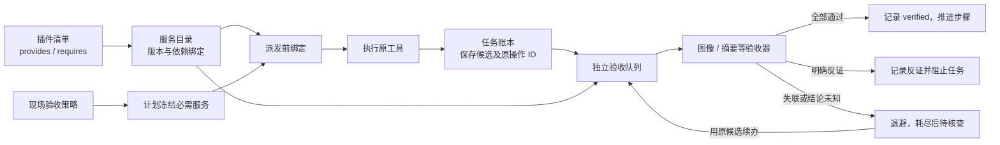

# 如何扩展端侧 Agent，并保留每次行动的来由

要让机器人学会“去庭院巡检”，需要把三个问题交给不同的模块。语言规划器从能力目录选出 `navigate_place`，场景提供者知道庭院的位置与通路，运动网关依据此刻的激光和里程计决定能否继续行驶。谁拥有这项事实，就由谁提供相应证据。替换场景插件时，既有的任务调度、运动制动和日志导出仍可复用。

## 团队共用的术语

AI 也可作为插件作者。只读衍生工具的发布路径能从未派发的失败任务进入，以独立样本验收，将新工具提供给下一次规划；任意代码型提供者继续走独立交付。实际边界和操作示例见[插件作者手册](plugin-authoring.md)。

读架构图时先分清三件事：谁要求做事，谁为这件事工作，谁能让底盘动。dsh（DeepSeek Harness）提供单个 Agent 的插件、模型、工具与会话词汇；SuperAgent 给出了多来源和多 Worker 协作的词汇。下表注明 v0.1 实现到哪一层，方便读源码时对号入座。[dsh 架构](https://github.com/deepseek-ai/deepseek-harness/blob/39163dd30f703a79079e2d2446545cff3c453738/docs/architecture.md) · [SuperAgent 领域词表](https://github.com/deepseek-ai/dsh-superagent-prototype/blob/8c32a9dc5d72c033816c6a8110b37f40cf94fba4/docs/001-domain.md)

| 想回答的问题 | 沿用的名称 | 本项目的实际契约或目标 |
|---|---|---|
| 谁发起了这件事？ | **Source / Trigger**，来源和一次触发 | 当前任务入口接收 `trigger.kind/source/id`。同一三元组重投只受理一次。普通激光采样、工具回执和日志属于 Event，记录它们不会自动新建任务。外部模块决定哪些事实值得提交为 Trigger。[任务入口](../agent/README.md) |
| 谁分工，谁完成？ | **Router / Worker** | 目标架构让云端 Brain 承担 Router 职责，Edge Agent 具备承接 Worker 工作的能力。上游 Worker 的执行会话按工单组织；一台 robot 是设备，能先后服务多项任务。v0.1 的 `agent` 服务在同一台 Edge 内规划、执行和恢复，云端 Router、跨机派工与 Worker 会话隔离属于后续能力。[上游执行模型](https://github.com/deepseek-ai/dsh-superagent-prototype/blob/8c32a9dc5d72c033816c6a8110b37f40cf94fba4/docs/003-execution.md) |
| 用户对哪件事追问？模型记得什么？ | **Thread / Session** | 上游 Thread 由来源组织相关触发，Worker 的 dsh Session 保存自己的执行上下文。当前 Edge 的 `trace_id` 只关联证据，`task_id` 用于恢复任务；同一 trace 下的子任务各自组装模型输入。跨轮对话历史、Thread 订阅和共享上下文需有独立契约。[任务账本](../agent/service.py) |
| 接受了哪项工作，交给了谁？ | **Ticket / Assignment**，工单和派工 | 上游 Ticket 表示获准的工作，Assignment 绑定一次执行者。当前语言 `task` 记录目标、计划、步骤与终态；ROS `mission_id` 标识提交给本机内核的点位委托。同一自然语言任务可能产生多个委托。未来跨机派工应显式关联工单、执行者和派工代次；现有调用方继续使用原字段。[ROS 接口](../src/edge_interfaces) |
| 模型此刻能选什么，谁实现？ | **Plugin / Tool / Model Adapter** | Plugin 提供扩展。Tool 是模型能选择的操作，如 `navigate_place(place)`；工具清单还声明作用效果、执行端点和结果证据。一个 Plugin 可提供多个 Tool。模型适配器负责计划，工具提供者负责执行。仓库中的“能力”是工具对参数、效果与结果作出的契约声明。[规划器](../agent/planning.py) · [工具清单](../plugins/README.md) |
| 同一机器人动作重试了吗，真的完成了吗？ | **operation_id / evidence**，操作标识和执行证据 | 跨轮询、重试和进程重启复用同一个 `operation_id`，以原 ID 向控制器对账。每次具体调用另有 `call_id`。evidence 保存停稳后实测坐标等结果；这两个机器人执行约束决定了何时可以安全重试、何时可以报告完成。[验收用例](../tests/semantic_acceptance.py) |

架构图还用了“队友状态投影”。它描述一个**目标设计中的操作**：收到带序号和时间的队友状态，更新本机可读的最新值；收到重复序号则跳过，超出有效时间则显示“未知”。SuperAgent 的 Subscription 决定一条来源消息发给哪些 Ticket，投影回答“我此刻能用哪个观测值”。例如 B 一分钟前说通道已空，A 仍能查到这条历史消息，但当前通行状态可以已经过期。v0.1 的单机器人账本和控制台没有跨机队友状态服务。[协作连接设计](architecture/index.html#team)

例如用户发来“去庭院巡检”。在现有 Edge 中，一次 Trigger 对应一项语言任务，规划器选 Tool `navigate_place`，场景插件生成点位，ROS 内核执行并返回实测证据。次日用户在同一聊天追问“上次停在哪儿”，这是新输入，可以引用之前的任务或证据。未来实现 Thread 时可将两条消息归到同一话题，保留每次触发的身份；直接复用旧 Trigger 会触发去重，直接复用 trace 也不会把旧消息自动送入模型。

后续设计先查上表和上游词表。行为与生命周期相同就沿用原词；项目特有的物理控制、持久化或通信语义确实需要新词时，在对应 SDD 给出最接近的已有概念、两者各自的所有者、一次能观察到差别的输入和结果。历史 API 名保留在映射表中，新同义词无需进入代码。

## 插件如何参与运行

DeepSeek Harness 使用 Cordis 将服务、事件和可撤销的注册组合成运行时。其模型适配器、工具目录、会话和循环都可由插件提供。这里借鉴的是写扩展时先定义“模块提供什么、谁消费它、卸载后如何处理依赖”。Edge Agent ROS 的运行接口是 HTTP 能力清单、ROS 2、版本化 JSON 和 Docker 服务；DeepSeek 的 Cordis 插件需要编写适配器才能接入。本项目没有实现其 SDK 兼容层。[DeepSeek 官方架构说明](https://github.com/deepseek-ai/deepseek-harness/blob/39163dd30f703a79079e2d2446545cff3c453738/docs/architecture.md)

DeepSeek Harness 将须跨会话重载保留的事实追加到 `SessionEvent` 日志，运行中的拦截与通知使用另一组事件。机器人端也需要区分持久事实、即时观测和执行授权。本项目由 Agent 和运动内核分别提交各自的事务日志，控制台从账本和 ROS 汇集观测。外部事件记录可以回放；只有受理任务并通过执行契约，才能启动对应动作。周期遥测按保留策略滚动，源端关键事件应先持久化再投递。[DeepSeek 会话与事件设计](https://github.com/deepseek-ai/deepseek-harness/blob/39163dd30f703a79079e2d2446545cff3c453738/docs/architecture.md#events) · [本项目事件契约](module-events.md)

### 新功能能否只改一个插件

以运行版本 `38fee71` 为基线，Edge 已能热注册模型可选的操作，也允许独立服务监听事件。要判断架构是否达到 dsh 那样的通用性，可以问三个问题。谁能调用这个扩展？它在流程中的哪个时刻生效？卸载时谁接手依赖和正在进行的工作？

**Tool** 是供规划器选择的一项操作契约。例如 `navigate_place(place)` 有参数、作用效果、版本和结果证据，执行端可以是独立 HTTP 服务；实现语言和是否使用面向对象的类都由提供者决定。**Plugin** 是向宿主或其他模块提供行为的扩展单元，可以公开零个、一个或多个 Tool。现有的 `plugin-author` 正是零个 Tool 的例子。它在独立进程里消费规划故障、向模型请求候选并保存决定。用户无需在计划里加一步“调用插件作者”。[工具注册与绑定](../agent/planning.py) · [监听器](../client/plugin_author_watch.py)

| 想新增什么 | 当前能做到什么 | 尚需什么扩展点 |
|---|---|---|
| 单独增强已有插件，例如给所有相机操作增加产物检查 | SDD-006 提供执行后的独立验收接口，按工具或产物类型加装；既有相机实现可保持在线。 | 调用前的权限策略、通用中间件和设备控制权交接仍有各自的契约。 |
| 让多个模块共用定位、模型或证据读取服务 | SDD-006 可登记提供与依赖的服务名，调用方按名称发现端点、版本、传递绑定及直接依赖。 | 具体服务定义自身的消息和业务语义；运行中替换有私有状态的服务还需迁移这些状态。 |
| AI 发现困难并处理 | 已知暂态故障走退避重试；作者进程能为特定的未派发任务生成只读草案；独立模块可带来源触发后续任务。 | 针对新故障自动开发、验证、投放和回滚任意代码插件，以及让多个修复策略按权限协作。 |
| 新增原始传感器、融合算法或运动策略 | 已安装的 ROS 消息类型可热加到控制台；融合算法运行在固定节点。运动策略有 C++ `PolicyPort`，默认实现在构造内核时选定。 | 运行中安全替换有状态算法，迁移坐标系或状态，并交还设备资源。新增一条传感器订阅不会自动改变融合算法。 |

**一个能看出差别的实验。** 在隔离 Docker 中，测试相机声明拍照完成必须提供 `image_uri`。第一份成功回执缺这个字段，Agent 将任务置为 `RECOVERY_REQUIRED`；第二份给出非空地址，但测试确认该文件从未创建，Agent 仍写入 `verified` 并报告 `SUCCEEDED`。实验通过真实任务 API 和本机回环 HTTP 提供者执行，没有相机或运动输入。这里的 `verified` 表示现有回执规则通过。内置巡检有额外的专用判断，网关回报到达后，内核还会等更新的里程计核对位置。今天这类验收依赖各领域的实现。[两次任务的实测记录](evidence/tool-receipt-boundary.json) · [通用回执与任务终态](../agent/service.py) · [巡检独立测量](../src/edge_core/src/core_node.cpp)

**SDD-006 把验收设在写入成功之前。** dsh 的 `tools/post-execute` 允许插件处理候选结果，`tools/result` 通知观察者已确定的工具输出，`tool/result` 将输出记入会话。Edge 使用独立进程执行只读验收。声明图像产物的工具在派发前绑定 `verify.image`；样例验收器检查操作作用域并解码 PGM。现场策略可以再挂一个摘要验收器。要判定图片里有没有指定对象，仍需实现能作该判断的服务。两种验收器都对模型公开零个 Tool。[dsh 工具执行时序](https://github.com/deepseek-ai/deepseek-harness/blob/39163dd30f703a79079e2d2446545cff3c453738/docs/tool-execution-pipeline.md) · [安装示例](../examples/result-verifiers/README.md)

部署方先启动独立服务，再原子发布 `runtime/<id>.json`。管理者通过 `GET /agent/plugins` 看清单是否可解析，消费者通过 `GET /agent/services?name=verify.image` 取端点并记住 binding。查询时带原 binding 可识别不兼容的换版。声明就绪与 HTTP 服务实际在线分开验证。停用时先处理在途依赖，再撤清单、停进程；需要回滚时恢复原版本、原端点及依赖。所有必需验收通过才会推进原任务，日志消费者可独立启停。[协议、旧任务迁移与回退](specs/SDD-006-runtime-plugins.md)

**新增插件怎样验收。** 通过配置接入第二个验收器，检查 Agent 和原工具源码能否保持不变；移除必需验收器，检查相关任务是否保留原操作、无关任务能否继续；变更传递依赖版本，检查旧候选是否仍要求原绑定；重启后核对实际工具调用次数。下一步若开放恢复策略、感知算法或硬件驱动，也需要各自的故障、资源交接与物理证据用例。[Docker 黑盒](../tests/system/runtime_plugin_acceptance.py)

## 扩展矩阵

| 要替换的模块 | 输入、输出及接入口 | 何时生效 | 应保留的证据 |
|---|---|---|---|
| 工具或技能提供者 | 宿主 `plugins/*.json` 声明 ID、版本、参数、effect、端点和所需结果。独立 HTTP 服务接收 `operation_id/version/arguments`，返回同 ID 的状态和证据。 | 文件原子改名后，下一次规划或派发读目录。移除清单会撤回后续可用性，正在执行的动作仍由原提供者负责。 | 计划保存绑定摘要；同一操作重投应返回已有结果。HTTP 503、回执 ID 错误、缺证据要分别验收。[工具契约](../plugins/README.md) |
| 模型或自训练策略 | `contracts/planner-profile.json` 选择 Ollama 或 `http-planner`。HTTP 规划器接收请求、候选能力和输出 schema，返回步骤及原因。 | 新的模型规划读取当前配置。模型文件与推理进程由模型服务管理；改 Compose 环境变量要重建受影响容器。 | 保留 provider、profile 版本/摘要、模型请求与回执。自由文本是否完成要验收其必需产物。[模型与规划接口](../agent/README.md) |
| 给模型的提示与工具描述 | `contracts/*.json` 可覆盖 `prompts.planner.system` 的版本和文本。清单的 description、parameters、outcomes 构成传给模型的能力说明。 | 提示在实际 Ollama 调用前读取。模型提供者内部自建的提示由该提供者记录；已持久化的计划不自动重编。 | 通过 `call_id` 找到模型实际看到的消息、目录与 schema，查看提示版本及摘要。交互内容有脱敏和容量边界。[提示及归档格式](../agent/README.md) |
| 诊断解释 | 工具可返回稳定错误码和结构化原因。宿主 `contracts/*.json` 的 `diagnostics.<code>` 追加现场排查提示。例如 `navigation.path_blocked` 对应前方障碍制动。 | 下一次诊断读取新提示。改变“何时制动”或“是否允许重试”属于执行策略，需要实现变更与回归。 | 保留实际观测值、阈值、原错误码及文案版本，可在不改分类的情况下更新面向用户的说明。[内置诊断目录](../agent/contracts.json) |
| 额外原始传感器 | 在 `observations/*.json` 配置已安装的 ROS 消息类型、topic、TTL 和名称，控制台按字段渲染有界预览。 | 每秒扫描清单，自动订阅或退订。ROS 消息包首次安装需要更新镜像，加入融合还需相应算法。 | 首次到达、缺测、恢复、卸载都有时间和来源；旧快照仍能查看。[测距传感器示例](../observations/README.md) |
| ROS 模块、用户询问、watchdog 或其他 Agent | ROS 模块可向 `/edge/events` 发布版本化 JSON，记录内部状态或诊断。请求执行另走 `POST /agent/tasks`，带稳定的 trigger 三元组；只询问已有任务可直接 GET。 | 新生产者在同一受信 ROS 域加入即可发布，与 HTTP 客户端启动时间独立。跨网络部署需增加认证和授权边界。 | 重投沿用原 `event_id`；后续任务用 `parent_event_id` 和 `trace_id` 接上原告警。离线期间需由生产者补投。[外部生产者接口](module-events.md) |
| 日志消费者（sink） | 通过 `GET /api/events` 按游标读取事件；示例进程将事件和读取位置一起提交到自己的 SQLite。可只取某个模块或告警等级。 | 单独启动、暂停或替换消费进程；使用同一目标卷和过滤条件可续读。 | 保存源归档身份、序号、因果 ID 及可能缺样的区间。可导出 NDJSON 给诊断 Agent。[消费者实现](../client/event_sink.py) |
| 场景与语义地图 | `scene/campus.json` 定义区域、地标、可通行连接、明确限制和版本。`scene` 服务加载布局，从融合位姿判定所在区域，通过 `/edge/semantic_map` 发布，并提供具名地点技能。 | 可换成相同 ROS/HTTP 契约的提供者。默认 Gazebo 几何和场景进程在启动时读布局；更改自带场地要协调重启两者，镜像内文件有变化则重新构建。 | 冻结路线节点、地图摘要、终点实测值和原操作 ID。同一机器人换定位坐标系时须重新对齐地图。[语义场景设计](semantic-scene.md) |
| 运动内核、底盘网关、定位融合 | 内核通过 ROS 服务接委托，网关提供 NavigateTo Action 和停止/取消回执。感知进程消费里程计、IMU 与激光。可实现同接口的机体适配器。 | 替换 ROS 节点或容器需有序交接资源与设备控制权。进程内状态、驱动与标定变更按其生命周期重启。 | 在途动作先按原 ID 对账；不确定的物理结果保持 `RECOVERY_REQUIRED`。用独立位姿或现场测量复验。[执行与制动](v1/gateway.md) |

## 读一次导航失败

1. 在新启动的仿真工位提交 `去维修区巡检`。查看任务卡的 ID 和 `trace_id`。这是可解析的自然语言，规划步骤应为 `navigate_place`，参数是用户给出的地点。内置语句模板命中时，provider 为 `local`，模型未被调用。
2. 进入事件记录按任务 ID 筛选。Agent 先持久化步骤身份，再记录工具与适配器的请求。有 `call_id` 的同一次交互可串起请求、回执或异常；用 `operation_id` 对齐多次轮询和恢复尝试。场景提供者根据标注拒绝该地标，任务终态应为 `BLOCKED`，原因是 `scene.place_inaccessible`。
3. 对照另一个故障。默认工位直接执行 `巡检 (2.2,2.1)` 会走向门侧墙，网关以激光证据触发 `navigation.path_blocked`。它和维修区限制都可使任务中止，但前者是运动阶段的现场测量，后者是场景对目标的准入判断。测试分别核对真值轨迹中的制动位置和零移动。
4. 查询 `GET /api/export?trace_id=<追踪ID>&snapshot=1` 得到可离线阅读的记录。若需重放关键输入，检查工件的留存模式与截断标志。只有请求没有回执时，用原操作 ID 查询源端，再决定恢复路径。[语义任务回归](../tests/semantic_acceptance.py) · [归档与缺测](console.md)

## 从现场回到代码，再回到验收

| 拿到的线索 | 下一步 | 得到什么 |
|---|---|---|
| 运行环境 | 查看 `console.started` 的 `source_revision`，并核对部署镜像的 `org.opencontainers.image.revision` 标签和镜像 ID。标签为 `unknown` 或带 `-dirty` 时还需部署时源码快照。 | 能定位到相应的 Git 提交，或看出当前证据不足以唯一定版。 |
| 任务 ID、`trace_id` 和稳定错误码 | 在回放中找到实际调用的能力版本与证据。运行 `git grep navigation.path_blocked <提交>` 查当时的产生方与解释目录；用 `git show <提交>:scene/campus.json` 核对当时标注。 | 能把问题分给语言规划、场景、运动或观察模块，并保留第一次失败。 |
| 复现与预期 | 查 [SDD-001](specs/SDD-001-runtime-trace.md) 的可回溯性条件和 [SDD-002](specs/SDD-002-semantic-scene.md) 的通行条件。新增功能先写 AC，再按相同输入和同一语义错误码复测。 | 规格、实现改动、测试及 PR 可相互定位。 |
| 修复候选 | 在短期分支更新规格的「变更记录」，运行 `python3 scripts/check_sdd.py --base main`、对应模块测试和 Gazebo 用例。将 Git SHA、规格编号与 CI run 写入 PR。 | GitHub 检查记录显示该版本实际覆盖的场景；历史失败仍能按原镜像和证据复查。[贡献与发布流程](../CONTRIBUTING.md) |
