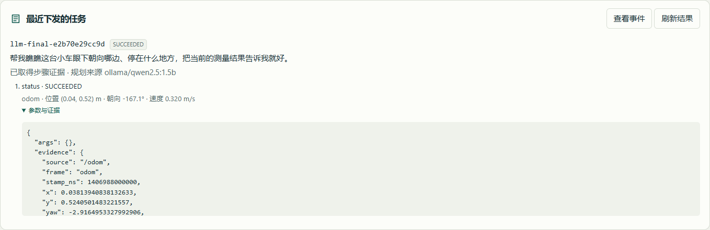

# 在 Docker 中使用本地和云端语言模型

部署本地 Qwen、接入 DeepSeek 或在运行中的 Agent 上切换模型，可使用独立的 Model Adapter。规划器、设计作者和编码作者继续使用原有 Ollama 请求格式；只有明确选择云模型的调用才进入云端。已有部署直连本地 Ollama 的方式见下文。[快速安装、切换与恢复](perception-model-quickstart.md) · [适配器协议与错误码](../model_provider/README.md) · [实际工作台验证](evidence/workbench-model-routing.json)

从工作台提交“帮我瞧瞧这台小车眼下朝向哪边、停在什么地方，把当前的测量结果告诉我就好”。Agent 将当前可用能力及参数传给模型，检查模型返回的计划，再从 ROS 话题读取实际测量值。任务详情中的 `provider` 能区分固定指令解析（`local`）和 Ollama 推理（本例是 `ollama/qwen2.5:1.5b`）。坐标、朝向和速度都应能追溯到步骤的 `evidence`。

## 部署与复启

以下命令在项目根目录执行。本机已经部署，可以直接打开工作台提交请求。[开发工作台](http://127.0.0.1:8765/)

1. 在新机器上先按部署指南启动仿真。然后启动模型容器，下载权重。Ollama 只在 Compose 网络提供服务。镜像版本固定为本次验证的 0.40.16。`EDGE_MODEL_IMAGE` 可覆盖镜像引用。[部署指南](deployment.md) · [Ollama Docker](https://docs.ollama.com/docker) · [Qwen 模型卡](https://ollama.com/library/qwen2.5:1.5b)

   ```sh
   docker compose --profile model up -d model
   docker compose exec -T model ollama pull qwen2.5:1.5b
   docker compose exec -T model ollama show qwen2.5:1.5b
   ```

2. Windows 主机能通过 VPN 访问模型仓库，而容器下载卡在 `TLS handshake timeout` 时，保留已启动的容器，改在 PowerShell 7 运行以下命令。本次验证使用了这条路径。脚本从同一官方 registry 分段下载，核对已固定的 manifest 以及各权重、模板、系统提示和许可证的 SHA-256，再导入 Docker 卷。成功后清理主机临时权重。下载、组装时请在系统临时目录留出约 2 GB，在 Docker 存储中为模型另留约 1 GB。镜像空间另计。[导入脚本](../scripts/import-qwen.ps1)

   ```powershell
   ./scripts/import-qwen.ps1
   ```

3. 在项目根目录的 `.env` 中更新以下两项，再运行 `docker compose up -d --no-deps --no-build agent`。只有 Agent 会重新创建。模型保存在名为 `models` 的 Compose 卷内。以后用 `./scripts/start.ps1 -SkipBuild` 或 `sh scripts/deploy.sh sim start` 启动系统时，脚本识别该 URL 并自动启动模型容器。已缓存的模型推理不需要访问互联网。

   ```dotenv
   EDGE_OLLAMA_URL=http://model:11434
   EDGE_OLLAMA_MODEL=qwen2.5:1.5b
   ```

4. 用工作台提交本节开头的句子。点击任务步骤查看 `status` 的证据，或用任务 ID 筛选日志。成功的状态读取应包含 `/odom`、测量时刻 `stamp_ns`、坐标系以及 `x/y`（米）、`yaw`（弧度）、`speed`（米/秒）。设备的朝向只能相对于消息的 `frame` 解释。模型请求使用 Ollama 的结构化 JSON 输出并由 Agent 校验参数。[Ollama Chat API](https://docs.ollama.com/api/chat)

## 本机的真实任务记录

下面是同一模型回答不同口语请求的结果。耗时从客户端提交算到首次轮询到终态，轮询间隔为 0.5 秒。其中包括规划、执行和取证。每条任务的原句、ID、事件时刻和步骤证据均可核对。[实验原始记录](evidence/console/model.json)

| 规划器阶段 | 用户要求 | 终态与证据 | 端到端耗时 |
| --- | --- | --- | --- |
| 首次冷加载 | 问小车朝向和位置 | `BLOCKED`，模型选了巡检，参数校验发现原句没有给坐标，未执行 | 4.19 s |
| 同一版本，模型已加载 | 明确只读，问位置、朝向和速度 | `SUCCEEDED`，产生了 3 次重复 `status` 调用，均返回 `/odom` 测量 | 2.15 s |
| 排除不满足输入条件的工具 | 重问第一句 | `SUCCEEDED`，2 次 `status`，有位姿证据 | 2.14 s |
| 同一版本，测试缺失能力 | 拍照并保存 | **错误成功**。模型重复选用 `status` 16 次，最终只有里程计记录，没有照片 | 5.16 s |
| 当前版，按产物核对目标 | 再次问小车朝向和位置 | `SUCCEEDED`，本地模型生成 1 次 `status`，得到带坐标系和时间戳的 `/odom` 证据 | 2.14 s |
| 当前版，按产物核对目标 | 同一句拍照并保存 | `BLOCKED`，能力目录缺少 `image`，规划前即报告原因，工具调用 0 次 | 0.52 s |
| 当前版，测试复合目标 | 报告位置并拍照 | `BLOCKED`，缺少 `image`，工具调用 0 次，保留整个任务的未完成状态 | 0.53 s |

前两行说明参数校验可以阻止模型猜坐标。中间两行说明“每步调用有效”不足以判定整个任务完成。当前版为可识别的目标检查所需产物。相机任务需要图像，状态查询接受带坐标系和时间戳的里程计。这里对照了三个具体请求。对于新任务类型，仍需定义相应的产物、扩展适配器并验证口语覆盖率。



## 换设备或模型时怎样验证

- 本次使用 Gazebo、Docker Desktop、CPU 推理、Qwen2.5 1.5B 的 Q4_K_M 权重，Agent 给模型的上下文上限是 4096 tokens。这个耗时不能直接作为 RK3588 或 Jetson 的性能指标。在目标板单独测首次加载、热启动延迟、内存、温度，以及满负荷推理期间 ROS 数据是否仍新鲜。
- 在硬件版 Compose 中，Agent 使用 host 网络。板上单独启动了 Ollama 时，地址可设为 `http://127.0.0.1:11434`。应以该设备上已安装的模型设置 `EDGE_OLLAMA_MODEL`（如 `qwen3:4b-instruct` 或 `qwen3:8b`）。针对 Qwen3 混合模型，Agent 默认发送 `"think": false` 并可通过 `EDGE_OLLAMA_KEEP_ALIVE=30m` 保持显存常驻；在 Jetson / GPU 服务端建议同时开启 `OLLAMA_FLASH_ATTENTION=1` 与 `OLLAMA_KV_CACHE_TYPE=q8_0`。如果换成其他规划器，可按项目的 HTTP 适配器契约接入。[硬件部署](deployment.md)
- 看任务的成功率，同时核查**结果是否匹配要求**。状态查询需要实际里程计证据。拍照需要相机图像回执，只读坐标不能证明拍到了照片。给每个模型固定一组口语改写、缺失能力、复合目标与歧义用例，统计错误成功、错误拒绝和额外调用次数，再决定模型是否足以接管相应任务。
