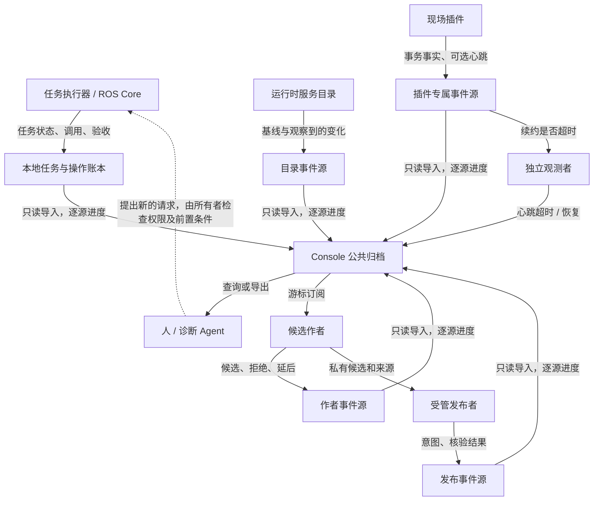

# 模块事件总线：从一次异常追到一次升级

读完本章，你可以判断一条日志究竟能证明什么，为一个新插件接入有据可查的异常和恢复事件，并从一次失败追到候选、发布和后续任务。下文以单台 Edge 为部署边界。

## 1. 为什么已有任务日志还不够

假设相机工具交回图片地址，验收器随后掉线。诊断者需要分别回答三个问题：相机是否拍过、验收器为什么没有确认、随后升级的验收器有没有被这次任务采用。任务账本能证明原操作的调用和回执；运行时服务目录能证明哪个版本可供新任务绑定；独立验收回执能证明文件是否可读。把三条记录写成一句“相机失败”会误导恢复策略，甚至导致重复拍摄。

这里的 **EventBus（事件总线）** 是模块间发布和订阅事实的共同契约。生产者在本地保存关键事实，观测台按源导入，诊断插件按归档游标订阅。执行工具依旧调用有名称、有返回值的服务。任务控制器拥有重试与取消权限，插件发布者拥有修改注册目录的权限。订阅者即使看到全部历史，也只获得读取这些事实的能力。



dsh 的 Cordis 插件可以提供服务、监听类型化事件，并在卸载时撤销注册。它区分调用期间的钩子和长期保存的会话事实，例如最终工具结果会被写入会话。Edge 借鉴这项区分，额外处理跨进程重启、设备副作用和观测台离线。这里使用本机 SQLite 和只读卷，未引入 Cordis 运行时，也未实现所有进程内拦截钩子。[dsh 架构](https://github.com/deepseek-ai/deepseek-harness/blob/39163dd30f703a79079e2d2446545cff3c453738/docs/architecture.md) · [工具执行管线](https://github.com/deepseek-ai/deepseek-harness/blob/39163dd30f703a79079e2d2446545cff3c453738/docs/tool-execution-pipeline.md)

## 2. 一次真实调用涉及哪些模块

| 提问 | 权威来源 | 用哪个标识查 | 得到的证据 |
|---|---|---|---|
| 用户想要什么，为什么选了这个工具？ | Agent 任务账本及模型交换记录 | `task_id`、`trace_id`、`call_id` | 任务、规划、模型收到的可记录上下文、工具调用或诊断；内容可按现场策略脱敏。 |
| 设备是否执行，结果是否可信？ | ROS 操作账本、提供者回执、独立验收 | `operation_id` 以及步骤验收绑定 | 区分请求已发送、工具已回复和结果已验证。丢失回执时要按原操作编号对账。 |
| 验收器升级、失效、失去依赖或退出了吗？ | `journal:runtime.registry` | `kind=plugin.registry_observed`，再看 `data.plugin_id` | 上次和本次观察到的状态、内容绑定、来源时间。同一个插件的多次变化有父事件。ready 只代表描述符和依赖可解析。 |
| 为什么出现一个新工具？ | `journal:plugin.author` | 从原任务的失败事件找相同 trace 下的 `plugin.author.*` | 候选、拒绝或延后，私有收据的来源。完整模型回执保存在作者私有目录；一个候选还没有执行权。 |
| 谁实际改了什么？ | `journal:plugin.publisher` | 发布 `change_id`、`plugin.release.*`、父事件 | 受管发布者的请求、预期旧版本、核验与处置。进程中断后依据实际内容对账。来源是受控卷和发布入口；个人身份鉴别需由部署侧提供。 |
| 进程是否还在报告？ | Console 的 `journal.watchdog` | `module.heartbeat_overdue`、`module.heartbeat_restored` | 可选心跳在约定期限内没有更新，以及何时再次收到真实续约。根因可能是进程退出、调度停顿或存储问题。 |

声明工具的 **发布** 和运行时服务插件的 **目录观察** 分属两种注册机制。发布 `derived.*` 里程计换算工具会产生发布记录；只有 `plugins/runtime/*.json` 中的服务描述符会产生目录转移记录。要确认某个任务使用了哪一版，最终应查该任务保存的工具版本或验收绑定。

## 3. 怎样读一条事件

| 字段 | 用法 |
|---|---|
| `event_id` / `parent_event_id` | 标识本次事实及其直接原因。父事件可晚于子事件收录；缺失时保留父 ID。多个前置条件可放在业务证据里，不能将时间上相邻当成因果。 |
| `trace_id` / `task_id` | 同一次工作链使用相同 trace。全局插件变更可以有独立 trace，任务为空；跨任务升级通过显式父引用衔接。 |
| `operation_id` / `call_id` | 前者用于设备操作与对账，后者定位一次模型或工具交换。同一动作重试应沿用所有者约定的幂等身份。 |
| `kind` / `code` / `level` | 分别描述事实类别、机器可判断的原因和严重度。自动化依赖稳定的 code，中文解释可以改写。 |
| `source` / `module` | 前者由接收端根据实际传输或专属挂载标注；后者是模块名。涉及后续处置时同时核对来源、权限、当前任务状态。ROS topic 允许发布者声明模块名。 |
| `utc` / `observed_at` | 前者为源报告的发生时间，后者为归档接收时间。时钟回拨、进程暂停或离线补收都可能改变差值。ROS 仿真时间留在对应的传感器或操作证据里。 |
| `source_id` / `source_seq` / `archive_id` / `seq` | 同一生产者数据库内按源序号导入。源库重建会换身份；归档重建也会换身份。归档序号用来翻页，跨模块因果看父 ID。 |
| `data` | 保存版本、诊断、结果摘要或可核实的证据引用。公开归档对内容过滤，生产者还应只发送允许公开的字段。大图、原始 prompt 和包含凭据的网络回执留在有权限的原存储。 |

归档读取示例，浏览器或 PowerShell 均可使用。先查插件历史，复制其中一个 `trace_id`，再查同条链。API 返回的 `event_id` 可以定位具体事实，`seq` 可以打开当时可用的状态回放。

```powershell
$base = 'http://127.0.0.1:8765'
$page = Invoke-RestMethod "$base/api/events?source=journal%3Aruntime.registry&limit=50"
$page.events | Select-Object utc,kind,code,event_id,parent_event_id,data
if ($page.events) {
    $trace = [uri]::EscapeDataString($page.events[0].trace_id)
    (Invoke-RestMethod "$base/api/events?trace_id=$trace&after=0&limit=100").events
}
```

## 4. 给新插件接入，保留自己的业务边界

1. 为每个受信插件分配自己的可写目录，给 Console **只读**挂载到 `/var/lib/edge-module-sources/<module>/`，数据库文件叫 `module-events.sqlite`。模块名以小写字母开头，可含数字、点、横杠和下划线。Console 会发现新目录；受管内置源保留自己的路径。仿真与硬件 Compose 都提供 `module-sources` 命名卷。给独立容器分配它自己的子目录，或通过 Compose override 指定独立绑定。
2. 在插件镜像里导入随 Edge 提供的 `agent/module_journal.py`。使用 Edge 镜像时直接沿用 `/opt/edge` 的目录布局；自建轻量镜像时也需包含共享的 `console/server/module_events.py`（信封校验和脱敏）。将关键业务状态和事实写到同一个 SQLite 事务；业务数据库独立时，像候选作者一样先在业务事务中保存待投递条目，成功复制后再确认。相同幂等键必须代表同一份业务事实。
3. 消费者沿用 `client/event_sink.py`。每个订阅使用自己的 SQLite 数据库，批次的副本和游标同事务保存。需要产生副作用的消费者还须保存自身处理状态、按来源核验权限、超时后对账。订阅者离线时其余模块继续工作。

```python
# 假设此插件目录在容器内挂载到 /state，/opt/edge/agent 在 Python 搜索路径上
from module_journal import ModuleJournal

journal = ModuleJournal("/state/module-events.sqlite")
with journal.db:
    event_id = journal.emit({
        "schema_version": 1, "module": "camera.inspector",
        "trace_id": "inspection-17", "kind": "camera.frame_rejected",
        "code": "image.decode_failed", "level": "warn",
        "operation_id": "capture-9", "data": {"decoder_version": "2.1"}
    }, key="capture-9:decode:1")
# 在需要监督的工作循环内定期续约。每个进程使用自己的连接。
with journal.db:
    journal.heartbeat(30)
journal.close()
```

心跳最后一次续约后，独立运行的 Console 用自身单调时钟判断超期。它首次读取一个源时给予一个完整窗口，重启后保留已经报告的超时，直到出现新的续约。高频心跳只替换一条源记录，归档只保存超时和恢复。未启用心跳的插件安静时没有超时结论。

## 5. 一次可审查的自进化

用户要求“用千米每小时报告前进速度”，当前没有合适能力，这是适合安全升级的只读例子。

1. 原任务在派发前进入 `BLOCKED`。作者从可订阅的失败事实读取任务，核对终态及诊断。数据或模型暂不可达时，记录延后并独立安排重试。
2. 作者可以生成候选，也可以拒绝。公开候选事实指向原失败事件；有权限的开发者用收据摘要核对私有候选，不需要在公共归档公开整段任务。
3. 发布者根据独立样本验算，例如输入 −0.5 m/s 时应得到 −1.8 km/h。从归档查询候选事件 ID，调用受管发布 CLI 时传 `--parent-event-id <候选事件ID> --trace-id <原trace>`。发布入口在写锁内校验样本和预期旧版本；拒绝时在同一事务记录请求和拒绝原因。获准后先落盘意图，再替换并回读文件，返回发布事件 ID。下一次受管操作发现未结意图时，记录能核对的现场版本和归因不确定性。
4. 用同样的自然语言发起一个**新的验收任务**，在任务回执中核对定义版本、里程计输入和结果。单独调用发布 CLI 会在发布回执处结束。启用 SDD-008 的插件管理模块后，符合现场契约的候选可以自动完成发布和这项验收。两步各有独立的证据。[作者和发布者操作命令](plugin-authoring.md) · [插件管理与自主恢复](plugin-manager.md)

## 6. 长程运行的故障边界

| 现场情况 | 当前证据和处置 | 后续需要补的能力 |
|---|---|---|
| 观测台离线、消费者重启、归档重建 | 从仍保留的源库补收；逐源游标、稳定 ID、坏行隔离、晚到父因关联；只读回放没有设备执行路径。 | 跨 Edge 可沿用相同信封与确认机制，通过认证的网络传输携带源身份；本版使用单机只读卷。 |
| 进程突然死亡、设备失联 | 可选心跳超期由独立观察者报告；在途任务按原操作 ID 查询。普通 ROS 瞬态事件可能丢失；两次目录采样间发生的修改可能看不见。 | 对每个必需驱动配置独立存活监测、启动清单与设备侧对账；首次启动前一直未出现的进程也需要外部监督。 |
| 错误事件或插件卡住 | 无效/冲突行按源位置记录隔离诊断，后续行和其他源可继续。源库打不开会发诊断，恢复后续读。 | 增加每源配额、积压/磁盘告警和压力基准，隔离持续高频或异常缓慢的生产者。 |
| 磁盘满、卷丢失、主机断电 | SQLite 提交依赖卷可靠性；受管变更需要先持久化意图。源和归档同时丢失时无法从软件重建事实。 | 独立盘或远端备份、恢复演练、容量评估、真机断电及长稳测试。 |
| AI 提议升级、升级效果变差 | 候选、受管发布和现场任务结果均可查；预授权只读声明可由独立插件管理器按样本校验、自动发布并发起验收。部署者可按当前版本回退。 | 扩展跨场景对照、灰度任务与自动回退门槛。任意代码的自主发布与硬件回滚仍需单独设计。 |

评价一轮升级，至少测四项：已提交关键事件补录率（分母由独立源清单给出）、重复副作用次数（由设备或独立提供者计数）、未知结果被误记为成功的次数、恢复后补齐积压所需时间。吞吐和延迟应在指定硬件与事件速率下测量。验收项与本次测试入口见 [SDD-007](specs/SDD-007-module-eventbus.md)。
