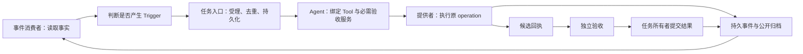

# 插件开发指南：先定义契约，再接入宿主

读完本章，你应能判断一个需求应成为 Tool、Service Provider 还是事件消费者；用已有入口接入新功能；说明插件退出时谁承担未完成工作；用测试证明变更没有破坏其他消费者。本文是新增模块的开发约定，运行时已经实现的机制与开发者仍须实现的责任会分别说明。

项目沿用 dsh 的 **Plugin、Service Definition、Service Provider、Consumer、Tool、Model Adapter** 和 SuperAgent 的 **Source / Trigger、Router / Worker、Thread / Session、Ticket / Assignment**。完整含义及当前实现差异见[术语对照与扩展矩阵](harness-extensions.md#团队共用的术语)。这里不另造一套框架，也不要求所有模块继承同一个抽象基类：HTTP 协议、ROS 接口、清单与契约测试是跨语言边界。

新增软件插件时先确定实际权限。受信的第一方 Python 实现用 `apply(ctx)` 注册服务或工具，并把资源清理交给 Fiber。外部 HTTP 服务走相同的 v2 描述符和版本绑定。读取相机原始图像、串口或请求运动时走 physical 部署入口；用独立角色提供设备授权和验收。新增现场组合时先定义 pack/profile，再核对板端解析出的版本锁。[Context 与 Fiber 的代码映射](plugin-runtime-mapping.md) · [相机接入](testing/physical-camera.md) · [板端手册](../deploy/robot/README.md)

## 1. 先决定谁需要这项能力

两个实现可以直接参考。需要从运行中的系统补收失败事实，可新增独立巡检消费者，使用自己的事故、重试预算和持久游标。需要模型处理原文，可基于受限的文本代码候选，使用原文参数契约、独立测试数据、批准及热装流程。[Watchdog 手册](watchdog.md) · [文本插件开发示例](../examples/software-provider/README.md)

**Plugin 是可独立交付的扩展单元，Tool 是模型可选择的操作。** 一个插件可以公开零个、一个或多个 Tool。函数、类、文件并不天然等于插件；只有具有明确消费者、资源和生命周期的功能，才需要独立装卸。

| 需求 | 首选接入方式 | 现有入口与责任 |
|---|---|---|
| 用户希望模型选择“读温度”“拍照”等动作 | **Tool**：语义名称、参数、effect、产物和提供者 | [工具契约](../plugins/README.md)，`plugins/*.json`，由 `agent/planning.py` 建目录，`agent/service.py` 执行和恢复 |
| 一个或多个模块需要共享能力，模型不必主动选它 | **Service Provider**：先定义协议，再声明 `provides/requires` | `plugins/runtime/*.json`、`agent/runtime_plugins.py`；参考 `verify.image`、`session.read` |
| 观察异常、导出日志、诊断或者根据事实提出后续工作 | **事件消费者**：独立读取并保存游标 | `client/event_sink.py`、[EventBus](module-eventbus.md)；触发执行另走任务入口 |
| 已有里程计字段的单位换算、阈值判断，或用户数列的只读计算 | **derived Tool**，由模型起草并组合现有算子 | [作者手册](plugin-authoring.md)、[软件工具规格](specs/SDD-012-authored-software-tools.md)、`plugins/derived/`。现场独立样本通过后受管发布。 |
| 更换模型或提示 | **Model Adapter / 配置**：保持规划输入输出契约 | `contracts/planner-profile.json`、[Agent 接口](../agent/README.md)；配置变化与部署新代码分别处理 |
| 新传感器订阅 | 已安装消息类型的观测清单 | [observations](../observations/README.md)；需要新消息包或融合算法时另行构建和验收 |

同一个插件可以兼具上述角色，但必须逐项声明。例如可设计一个诊断插件消费错误事件、提供证据查询服务，并对模型公开 `diagnose_task`（设计示例，当前没有这个内置 Tool）；它不能因为看到了告警就直接取得运动授权。已有事件消费者不必为了符合形式而伪造一个无人调用的 HTTP 服务。

### 插件边界的三个判断

1. **消费者只依赖公开契约。** Console 消费 `session.read`，不导入默认提供者的叙事算法。新插件不得读取另一个模块私有数据库来绕过接口。
2. **业务策略属于提供者。** 选择哪些事实生成摘要、如何解码图片、如何判断某类错误，放在对应插件；通用发现器不出现 `if plugin_id == ...` 的业务分支。
3. **装卸有实际行为。** 能解释停止接新工作、处理在途请求、释放资源、恢复服务和保留证据。只改模块名称或移动目录不算完成插件化。

## 2. 保持宿主小，但不要虚构已实现的热替换

当前最小稳定边界包含任务受理与账本、工具/服务身份校验、受管注册、事件信封与持久来源接口，以及 ROS 执行授权、幂等对账、停止和结果确认。它们承载不变量；修改这些共享契约需要覆盖所有消费者。新业务能力优先放到插件，避免继续把业务判断写进这些入口。

这不表示所有模块都可以无状态热插拔，但核心契约与状态所有权已经按包边界显式分层（[SDD-049](specs/SDD-049-kernel-plugin-boundaries.md)）：`edge_contracts/` 存放零外部依赖的事件、v2 描述符、导航、空间事实、语义场景子图、语义空间代价图与一致性校验契约；`agent/kernel/`（`ledger`、`worker`、`verification`、`authorization`、`catalog`、`feedback_admission`、`host`）封装任务账本与准入不变量；`agent/service.py` 负责 HTTP/ROS 装配与编排，模块间导入方向由 `tests/test_package_boundaries.py` 静态守护。若需扩展核心边界，仍须先定义状态所有者和失败语义，再按兼容接口演进。

| 当前模块 | 当前可扩展的范围 | 尚不能宣称的能力 |
|---|---|---|
| HTTP Tool、运行时服务、Session | 更新目录、独立启停进程、按版本和 binding 拒绝错误提供者 | 任意旧请求自动迁到新实现；注册即自动部署进程 |
| 模型 profile、提示、诊断文案 | 新调用按相应读取时机使用新配置 | 热加载任意代码；改配置自动重编已保存的计划 |
| 原始观测 | 对已安装 ROS 消息类型热订阅、退订 | 新消息类型不更新镜像即生效；订阅自动进入融合 |
| 定位融合、语义地图、C++ 运动内核与网关 | 通过既有 ROS/HTTP 接口更换实现，按部署流程交接 | 默认地图、融合算法和 `PolicyPort` 的任意进程内热换 |
| 云端 Router、跨 Edge Worker | 保留契约设计空间 | 当前单 Edge 运行时已经具备跨机派工、共享 Thread 或群体协作 |

涉及底盘、相机独占句柄、串口、GPU 状态或坐标系的插件，必须额外定义资源交接。运动中卸载驱动前，需要按原操作 ID 对账并确认停止；结果不确定时保留待核查状态，不能用“卸载成功”代替“机器人已停稳”。

## 3. 开发前填好这张契约表

将下表写入对应 [SDD](specs/TEMPLATE.md)。空白项不是默认支持；写明“不适用”及理由。

| 项目 | 必须回答的问题 |
|---|---|
| 消费者与所有者 | 谁调用？谁持有任务终态、私有状态、设备控制权？停用后哪些功能应仍可使用？ |
| 输入 | schema、类型、单位、坐标系、作用域、大小和时间预算；缺参、过期观测如何拒绝？ |
| 输出 | 成功、进行中、明确失败、结果未知分别是什么？哪份独立证据能证明完成？ |
| 上下文 | 最小必要任务/事件引用、版本与 binding；何时读取哪些历史？是否有截断、时效、来源限制？ |
| 副作用 | `effect` 是否准确？同一操作重投是否去重？掉电后如何按原 ID 对账、取消和继续？ |
| 依赖 | 必需服务、公开 HTTP/ROS 接口、消息包、卷和权限；缺失时阻止哪项功能？ |
| 错误 | 稳定机器码、来源、可读说明、具体观测、是否允许重试及预算；需要人工时给出操作和理由 |
| 状态与兼容 | 哪些事实不可改写、哪些投影可重建？版本升级后旧任务与旧数据还能读吗？ |
| 生命周期 | 部署、检查、发布、draining、在途完成、卸载、恢复的责任人/进程及确认信号 |
| 证据与验收 | 每项 AC 的正例、负例、故障注入、测试命令、证据路径和未覆盖范围 |

### 不同 ID 解决不同问题

| 字段 | 用途 | 不能替代什么 |
|---|---|---|
| `task_id` | 一项已受理语言任务及其计划、终态 | 不是单个设备动作编号 |
| `trace_id` | 关联原任务、后续任务、调用和诊断 | 不是模型自动拥有的共享上下文，也不赋予访问或执行权限 |
| `operation_id` | 一次逻辑执行，重试、查询和重启恢复沿用 | 不应为每次 HTTP 重投重新生成；不同执行不能共用 |
| `call_id` | 一次具体请求/响应交互 | 多次调用可以属于同一 operation |
| `event_id` / `parent_event_id` | 一条事实的身份与明确因果关系 | 时间接近不等于因果；重投同一事实保持原 ID |
| `request_id` | 按具体服务定义关联请求 | `session.read` 的阅读编号不等于插件管理器的幂等发布编号，不能统一推断 |

上下文传递只携带所需信息。Tool 的基础 HTTP 输入使用 `operation_id/version/arguments`；需要接收追踪信息时按已有 `accepts_trace` 契约实现。`session.read` 使用自己的任务/trace 范围和服务身份协议。不要擅自把全部字段塞进严格校验的现有消息；如需扩展，先写兼容方案和契约测试。

模型输入应包含目标、允许能力、必要的当前事实、关键失败与证据引用；细节按需查询。Session 是事实的可读投影，当前不是完整 dsh 对话 SessionStore。工具请求、私有模型原文、公开事实和摘要分别按现有存储与脱敏边界管理。[Session 协议](../sessions_plugin/README.md) · [证据查询](sessions.md)

### 事实、命令与最终结果分开



HTTP 200 仅代表一次协议调用成功。Tool 的 `SUCCEEDED` 可能仍是待验收候选；必需验收未知、失联或反证不能变为任务成功。副作用失败时先判断“未执行”“已执行”“无法确认”，再决定是否重试，不能所有异常一律重发动作。已有验收流程会保存原候选并续办验收，避免再次拍照或移动。[实现](../agent/runtime_plugins.py) · [验收规格](specs/SDD-006-runtime-plugins.md)

## 4. 事件留痕和数据归属

本项目 EventBus 由生产者持久事件源、Console 公开归档和可续读消费者组成，并非一个保证所有通知永久送达的内存广播器。ROS `/edge/events` 的瞬时发布本身不保证持久交付；关键事实由生产者保存后再发布，或通过已有 ModuleJournal 汇入。[完整协议与故障处理](module-eventbus.md)

- **写自己的状态。** 新插件用 `agent/module_journal.py` 记录自身事件，部署到自己的审计路径；读取其他模块用公开接口。受信任单机的共享 module-sources 卷不是多租户隔离保证。
- **记录变化而非淹没上下文。** 接受、开始、版本绑定、超时、重试决定、验收、退出和恢复需要记录；周期采样按预算和保留规则处理。保留稳定 `kind/code`、原始观测、阈值、来源和父事件，中文描述可独立改善。
- **保存游标与处理结果。** 消费者用源/归档身份和序号去重；记录归档换代、缺页、裁剪或断连，不把只读到的窗口称为全量历史。需要产生后续任务时沿用稳定 Trigger 去重身份。
- **审计不会授权动作。** 新事件类型不自动授予设备控制、插件发布或任意代码执行权限。只读查询也应留审计，但摘要应折叠查询自身事件，避免越查越多地污染模型上下文。
- **终态由所有者确认。** 一个插件发出 `agent.blocked` 同名事件，不会因此成为任务结果的权威来源；消费者同时核对 source、任务和操作身份。

私有持久状态必须写 schema 版本。升级先验证旧读者/新写者兼容性；不可兼容时给出迁移、备份和停写步骤。恢复旧清单、旧镜像不会自动恢复旧数据格式。不可变产物应保留内容摘要和操作归属；可读摘要可以重建，但不得覆写产生判断时的历史事实。

## 5. 注册和热拔插实际怎样工作

运行时清单示例，文件名必须为 `image-check.json`：

```json
{
  "schema_version": 1,
  "id": "image-check",
  "version": "1",
  "endpoint": "http://image-check:8095/verify",
  "provides": ["verify.image"],
  "requires": [],
  "draining": false
}
```

`provides/requires` 是服务名和依赖声明，不是业务消息协议。每项服务还须有独立的请求/回执契约。清单版本、受管发布回执中的内容 SHA、包含传递依赖的 `binding` 分别用于实现标识、并发修改检测和运行时身份校验，不可互换。**binding 摘要覆盖清单与依赖，不计算提供者代码或镜像的哈希。** 实现变化必须提升声明版本，并在发布证据中保存源码提交和镜像摘要。

| 阶段 | 当前机制 | 开发者/部署者还要做什么 |
|---|---|---|
| 部署 | Docker/其他部署工具启动提供者 | 配置只需的网络、卷、资源限制和健康检查；先验真实请求 |
| check / publish | `plugin-admin` 校验清单、依赖和冲突；CAS、写锁、原子发布、持久审计 | 使用正确 `--expect`；部署代码与注册是两件事 |
| ready | `ServiceSnapshot` 可解析唯一提供者及无环依赖 | **不代表端点在线或业务可用**；仍需调用契约和故障验证 |
| bind | 消费者按服务名取版本、端点、binding 与依赖，保存到工作状态 | 自己调用具体服务并校验回执；声明 `requires` 不会替你传上下文或执行依赖 |
| draining | 拒绝新的无 binding 获取；相同旧 binding 仍可解析；依赖的 draining 向消费者传播 | 消费者必须遵循绑定规则；自行确认在途工作，目录不统计、取消或等待请求 |
| remove | 受管撤回会检查是否破坏此前可解析的依赖图，不查询活跃任务、不自动排空 | 先处理依赖消费者与新任务策略，再撤注册和停进程；注册撤回不删除历史数据 |
| rollback | 以当前内容 SHA 为 `--expect`，重新发布已保存的旧描述符 | 同时恢复匹配的端点、依赖和兼容数据；用旧 operation 验证恢复 |

**当前一个服务名要求唯一提供者。** 同时注册两个 `verify.image` 会冲突。`ServiceSnapshot` 是目录解析器，不是进程管理器，也不是透明双版本路由器。替换清单后，旧 binding 不匹配会明确失败；不能把它悄悄改绑到新实现。只有改 `draining` 不改变服务身份，适合先完成旧工作再换版。若业务必须零停顿双版本并行，需要另立 SDD 定义版本路由、状态和资源交接，当前不能宣称已支持。

**在途行为由消费者协议决定。** 验收消费者可凭原 binding 续办候选；Session 消费者在回包后重新获取当前服务，如果读取期间进入 draining、卸载或换版，会以 `session.binding_changed` 拒绝本次文档，调用方稍后重新读取。不能把底层“允许按旧 binding 解析”写成“所有在途查询都会成功排空”。参见 `console/server/session_service.py`。

恢复同一个 URL 后面的代码也要更新声明版本，并遵守操作账本兼容。只保持 URL 不变不能证明实现相同。不要以“热更新”跳过映像/进程部署、健康验证或依赖消费者的测试。

## 6. 例子：给相机增加结果验收，保持相机 Tool 契约

需求不是新增一个让 LLM 自己决定要不要调用的“检查插件”步骤，而是：**凡声明图像产物的步骤，报告完成前必须验证实际产物。** 使用现有 `verify.image`；需要摘要校验时加 `verify.digest`。提供者对 LLM 暴露零个 Tool，既有相机继续产生同一操作的图像及回执。

1. 在 SDD 写 AC：损坏图像拒绝、找不到文件区分反证/存储不可读、操作归属错误拒绝、验收离线保留候选、恢复后不重复拍照。输入输出复用[可运行示例](../examples/result-verifiers/README.md)和现有验收协议。
2. 实现放在独立提供者中，只读访问该操作的产物。相机先发布不可变文件，再返回 URI；两个验收器必须读同一内容版本。能解码不等于拍到了目标，目标识别仍需独立验收能力。
3. 在**隔离测试 Compose 项目**启动提供者，确认依赖、读取权限、真实产物和限额。以下只示范在临时注册目录检查和发布清单，不启动机器人，也不证明服务在线。Compose 项目名不能隔离同一宿主 bind mount，因此明确覆盖 `EDGE_PLUGINS_DIR`，结束时恢复当前终端原配置。

```powershell
$testProject = 'edge-plugin-lab-' + [guid]::NewGuid().ToString('N').Substring(0, 8)
$sample = (Resolve-Path examples/result-verifiers/manifests).Path
$labRegistry = [IO.Directory]::CreateDirectory((Join-Path $PWD ".ci-results/$testProject/plugins")).FullName
$previousRegistry = $env:EDGE_PLUGINS_DIR
try {
    $env:EDGE_PLUGINS_DIR = $labRegistry
    $compose = @('compose', '-p', $testProject, '-f', 'compose.yaml')
    docker @compose run --rm --no-deps --volume "${sample}:/input:ro" plugin-admin check /input/image-check.json --kind runtime --root /plugins
    if ($LASTEXITCODE -ne 0) { throw '清单检查失败' }
    # 仅首次安装使用 absent；已经存在时改用上次发布回执的内容 SHA。
    docker @compose run --rm --no-deps --volume "${sample}:/input:ro" plugin-admin publish /input/image-check.json --kind runtime --root /plugins --expect absent
    if ($LASTEXITCODE -ne 0) { throw '发布失败' }
} finally {
    $env:EDGE_PLUGINS_DIR = $previousRegistry
}
```

完整实验入口是 `tests/system/runtime_plugin_acceptance.py`：由夹具启动 Agent、相机和验收提供者，使用隔离网络、清单和卷，核对真实互通；通过现有系统测试编排器运行，结束后清理夹具。上面的临时注册目录只保留发布历史，没有启动这些服务。**以下第 4、5 项描述完整夹具应验证的行为，不是接着对日常 8765 工作台手动操作。**

4. 检查 `GET /agent/plugins` 目录状态和 `GET /agent/services?name=verify.image` 绑定，再提交需要图片的任务。若增加第二个必需验收器，先部署注册，再合并发布现场验收策略，保留其他工具既有要求。
5. 停止验收进程，确认不是任务成功；恢复后核对相机操作计数没有增加。发布 draining，确认拒绝新绑定而旧候选仍可验收；等所有相关消费者完成再撤回。保留各阶段回执和任务证据。

同一思路适用于 `session.read`：部署兼容提供者、验证事实引用和覆盖预算、受管切换绑定；Console 只消费协议，不能为新算法增加专属分支。默认安装/卸载入口为 `client/register_session.py`，包装了受管发布；参考[Session 手册](sessions.md)。普通 Tool 则仍用 `plugins/*.json` 原子发布与对应安装器；例如 `client/register_evidence.py` 分别原子替换三个 Tool 清单，并不是三份清单的整体事务，也没有统一接入受管发布审计。当前 `plugin-admin --kind` 只支持 `runtime` 和 `derived`，不要编造 `--kind tool`。新需求若要求整组一致发布，应先定义兼容过渡和失败恢复契约。

## 7. 用证据界定“没有影响其他模块”

目标是限制和证明影响范围，不能承诺任何插件任意更改都零影响。每次变更先列出直接消费者、传递依赖、共享资源、在途任务与旧数据，再选择测试。一个阅读插件可能通过共享归档、CPU 或磁盘影响任务，所以仅“接口返回 200”不够。

| 测试层 | 至少覆盖 | 现有入口或可复用模式 |
|---|---|---|
| 白盒与契约 | 正常/缺参/越界；版本与 ID 错误；缺依赖、重复提供、循环；稳定错误码；绑定传播 | `tests/test_runtime_plugins.py`、`tests/planning_contract.py`、各插件 `test_*.py` |
| 注册发布 | CAS 冲突、同 request 重投、内容不同的 ID 冲突、发布中断与重启、撤回依赖、旧清单恢复 | `tests/test_plugin_manager.py`、`tests/system/plugin_manager_acceptance.py` |
| 黑盒生命周期 | 真 HTTP/ROS；安装→使用→draining→撤回→恢复；进行中换版、断连/超时/畸形回执 | `tests/system/runtime_plugin_acceptance.py`、`tests/system/session_plugin_acceptance.py` |
| 副作用与验收 | 原操作 ID 跨重试/重启不变；执行次数不增加；候选缺证据/反证/未知；取消结果未知 | `tests/agent_verification_contract.py`、`tests/console_resilience.py`、`scripts/verify.ps1` |
| 状态与事件 | 来源身份/因果、去重、游标、归档换代/裁剪、审计写失败；旧数据读取和迁移回退 | `tests/test_module_journal.py`、`tests/system/module_bus_acceptance.py` |
| 无关功能对照 | 插件关闭、正常、故障/高负载三组；同一无关任务的终态/证据/动作计数；旧归档前缀和账本不被篡改 | 隔离夹具与 `tests/system/session_evidence_acceptance.py`；按 SDD 定义基线和容差 |
| 人与模型使用 | 用户能读懂状态、理由、引用；摘要不被遥测/自审计淹没；LLM 选择与参数符合语义 | `tests/system/console_browser.mjs`、Session/Evidence 用例；真实模型实测另列 |
| 平台和物理边界 | 目标指令集、资源预算；涉及运动则测延迟/掉电/时间跳变/传感缺测/制动 | [系统测试矩阵](testing/single-edge.md)；仿真、ARM 模拟和真机结果分别记录 |

测试期望应独立于实现：不能用被测换算函数生成期望值，不能用提供者自报成功证明真实运动或图像存在。测试数量不代替需求覆盖。快照只用于稳定公共 schema/事实前缀，时间、随机 ID 等应单独比较语义；失败复现保留原始样本和原因，避免大规模刷新快照掩盖回归。

## 8. Coding Agent 的实施顺序和交付物

1. **读现状。** 从 [README](../README.md)、[AGENTS](../AGENTS.md)、本章和覆盖模块的 SDD 定位实际入口，检查正在运行的版本、未提交改动与现有证据。不从旧架构图推断当前能力。
2. **先定契约。** 按第 3 节写需求和 AC；列出受影响与应保持不变的功能，记录 hot swap、状态迁移与资源交接的边界。复用现有服务和注册器；确需新宿主扩展点时解释旧接口为何不足。
3. **先写能失败的验收。** 独立输入/期望、错误与恢复用例、卸载行为、作用域和预算。模型参与的测试与确定性协议测试分开，避免模型不稳定掩盖运行时错误。
4. **实现提供者和薄消费者。** 按已有目录风格建立插件目录、部署配置、清单/安装器、模块 README 和测试；共享核心只增加必要的通用接口。避免整仓重命名、复制第二套 EventBus、私有库越权读取。
5. **验证影响范围。** 在 `tests/test_selection.py` 同步增加新生产者/消费者依赖和选择断言。检查计划后在隔离环境运行对应验收；未知路径按完整套件处理，不用窄选测规避共享契约回归。
6. **整理证据和交付。** SDD 记录原因、实现路径、命令、实际结果、限制、迁移/回退；PR 链接 AC 与证据，提交正文带 `Spec: SDD-NNN`。未跑的平台、模型或真机明确写未验证。

以下检查从项目根目录运行，`<目标分支>` 替换为本次 PR 的真实基点：

```powershell
python scripts/check_sdd.py --base <目标分支>
python tests/repository_contract.py -v
python tests/system_suite.py --changed-since <目标分支> --plan
# 核对选择结果后，去掉 --plan 运行隔离系统测试。
git diff --check
```

系统测试原始结果保存在 `.ci-results/system/runs/<运行ID>/summary.json` 及同目录日志；将必要的可分发摘要留在 `docs/testing/`、`docs/evidence/`，并由 SDD 引用。不要提交凭据、真实现场数据库、完整私有模型提示或无关大型日志。完整交付物应让下一位开发者从需求定位代码，从失败事件定位具体版本，再用原样本复现和验证修复。[贡献流程](../CONTRIBUTING.md)

### 在本机验证只读提供者

从仓库根目录运行以下命令。它在空闲的回环端口启动 `track_distance`，按样例中的独立期望值检查回执，并在强制结束和重新启动该测试进程后，以原操作号查验结果。

```sh
python3 -m edge_contracts.conformance --manifest examples/track-distance/tool.json \
  --url http://127.0.0.1:18125/invoke --cases examples/track-distance/cases.json \
  --process python3 -B examples/track-distance/provider.py --port 18125
```

对已运行的只读提供者，省略 `--process` 可检查健康响应、同一操作的重投、错误版本、非法参数，以及调用方收到超时后的恢复。报告中的 `status=partial` 和 `checks.lifecycle.status=not_run` 表示尚未验证进程重启；托管进程通过全部检查后为 `status=passed`。协议只接受 `effect=read`，录制的启动和结束通过独立的录制验收运行。离线分析的输入与示例见[公开导出的分析工具](../analysis/README.md)。
