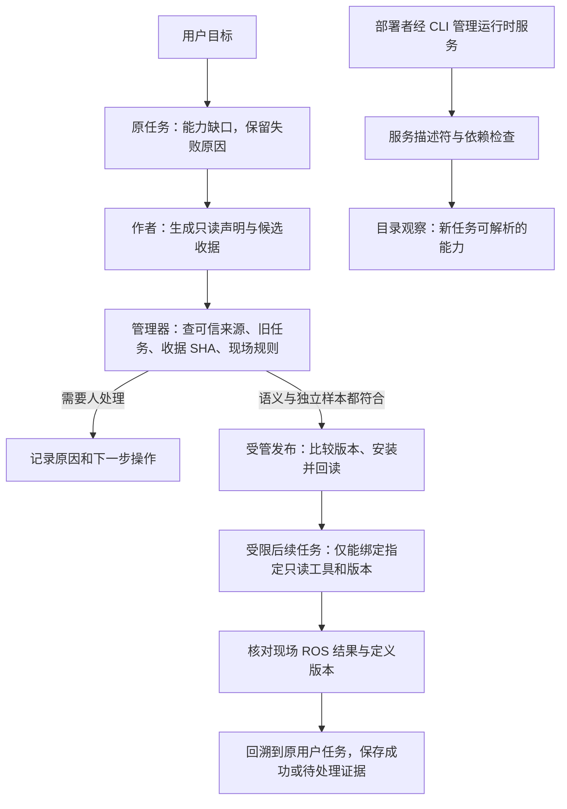

# 把插件管理本身装成插件

假设用户说“用千米每小时报告本机前向速度”。机器人有里程计，却只会以 m/s 报告速度。一个更自主的 Edge 应能判断这个缺口可以通过读取同一传感器并换算单位来解决，提出工具，在独立样本上验算，安装，再用现场里程计完成用户的工作。开发者可以单独安装或停止这一能力。

## 一项能力由谁负责

| 运行部件 | 可读写的对象 | 可以回答的问题 |
|---|---|---|
| 任务 Agent | 读取能力目录、任务和 ROS 输入；写任务账本 | 用户想要什么？现有哪些工具？结果来自哪条输入？ |
| 插件作者 `plugin-author` | 读取已确认的规划失败；写自己的私有候选与公共事件 | 现有解释器能否表达缺少的功能？模型给出了哪份声明？ |
| 自动管理进程 `plugin-manager` | 读候选、只读现场契约和任务状态；写声明工具目录和自己的处理记录 | 现场已授权什么？候选是否符合？是否能自动安装、续办并验证？ |
| 管理 CLI `plugin-admin` | 通过部署者挂载的注册根目录操作两种类型，独立执行，不需要网络 | 如何人工检查、安装、版本对照、升级或撤回一个 Tool 或服务插件？ |
| Console / EventBus | 只读挂载模块自己的账本 | 谁提出、谁批准、哪个版本生效、后续任务有没有完成？ |

自动管理进程只挂载 `/plugins/derived` 为可写，无法通过这个注册目录更改普通 HTTP Tool 或系统服务地址。管理 CLI 可修改整个受管注册根目录，适合部署者驱动的变更。ROS 执行端不需要写权限。



## 两种扩展的价值

**声明工具 `derived`** 可以暴露给语言模型。这类工具使用编译好的本地解释器读取一帧里程计。输入是字段、单位和可选比较条件，输出是值、单位、来源、时间戳和定义版本。自动管理器只对现场预先授权、通过独立期望样本的这类能力执行发布。

**运行时服务 `runtime`** 向其他模块提供能力，例如 `verify.image`，可以向模型暴露零个工具。受管注册引用已有服务端点，保存描述符内容版本，并校验服务依赖。目录中出现 ready 表示可解析，端点是否在线以及该次调用是否成功要看服务回执。Docker 进程部署与注册目录属于不同的操作。

## 开启自动处理

先启动本项目的仿真与观测台。在已有本地 Ollama 缓存的开发机上，从项目根目录执行以下命令。现场已有独立 Ollama 服务时可通过 `EDGE_OLLAMA_URL` 指向它，只需启动两个插件进程。硬件部署使用同名 profile 并指定 `-f compose.hardware.yaml`。

```powershell
docker compose --profile model --profile plugin-manager up -d model plugin-author plugin-manager
```

默认规则文件随仓库提供。它允许“用千米每小时报告本机前向速度”对应 `speed → km/h` 的只读声明，包含负速、零速、正速三种独立样本。部署者可以在启动时设置 `EDGE_RECOVERY_POLICY` 指向自己的 JSON 文件。增加规则时应同时给出意图、语义和独立期望值。缺少规则时仍可查候选及人工介入信息。实际模型也可能选择现有工具或拒绝任务；自动扩展从属于受支持范围的**规划能力缺口**开始。[现场规则](../policies/plugin-recovery.json)

通过观测台提交任务。要回看原始失败、作者和发布者，可从原任务取得 trace；自动管理器留下的处理记录可按模块查询。日常停用自动演化只需停止两项服务，已安装能力保存在注册目录中。

```powershell
$base = 'http://127.0.0.1:8765'
$job = Invoke-RestMethod "$base/agent/tasks" -Method Post -ContentType 'application/json; charset=utf-8' -Body ([Text.Encoding]::UTF8.GetBytes('{"text":"用千米每小时报告本机前向速度"}'))
(Invoke-RestMethod "$base/api/events?trace_id=$($job.trace_id)&after=0&limit=100").events
(Invoke-RestMethod "$base/api/events?module=plugin.supervisor&limit=30").events
docker compose stop plugin-manager plugin-author
```

## 部署者管理一种服务插件

从项目根目录运行。先在有权访问的网络中部署目标提供者。本例使用仓库的图像验收服务清单。管理 CLI 通过只读输入挂载获取清单，退出即销毁容器。对已存在的扩展需要提供上次发布回执的内容版本。

```powershell
$sample = (Resolve-Path examples/result-verifiers/manifests).Path
docker compose run --rm --no-deps --volume "${sample}:/input:ro" plugin-admin check /input/image-check.json --kind runtime --root /plugins
$release = docker compose run --rm --no-deps --volume "${sample}:/input:ro" plugin-admin publish /input/image-check.json --kind runtime --root /plugins --expect absent | ConvertFrom-Json
$release
```

调用者可为发布或撤回传 `--request-id`。超时后重投同一 ID、同一请求，会取回原处置结果；即使别的发布已升级到 v2，也不会因重投旧请求而恢复 v1。复用 ID 提交不同内容会留下冲突证据。回退运行时服务时，从其 `.history/<id>/<sha>.json` 取回旧清单，放到输入目录并命名为 `<id>.json`，以当前安装版本作为 `--expect` 再发布。

使用同一入口处理 `derived` 时将 `--kind` 设为 `derived`，并用 `--cases` 指向只读挂载的独立用例。版本必须来自所管理类型的发布回执；运行时服务的描述符内容版本和任务最终绑定的依赖摘要各自有含义。撤回时传扩展 ID 及预期当前版本。对已下发的设备操作仍要按原操作编号核对。[受管工具与用例](plugin-authoring.md) · [验收服务示例](../examples/result-verifiers/README.md)

## 怎样判定一次自主恢复确实成功

同一 trace 下，核对原任务终态、候选收据摘要、独立测试摘要、受管发布结果、后续任务和实际工具证据。管理器的 `verified` 直接引用后续任务的原生 `agent.verified`，并保留发布及候选引用。输入 −0.5 m/s 时应输出 −1.8 km/h；只有现场观测、工具版本与目标吻合才算完成。任务入口的 `trigger.source` 由调用者提供，归因时还要核对专属来源的管理器与发布记录。[开发与验收规格](specs/SDD-008-plugin-manager.md) · [总线与异常回溯](module-eventbus.md)

发布与任务提交之间可以发生断电或撤销授权。每次真正提交前，管理器重新核对当前策略与原发布的样本摘要，保存执行快照，再 POST。重启后先查固定任务 ID：尚未受理须通过现行策略；已经受理则用当时的快照核对真实执行，即使私有候选已删除。若曾确认受理的任务现在查不到，记录为需要复核，保留操作线索。诊断者可以据此区分“当前允许不允许做”和“当时究竟有没有做”。

## 本机实测

在代码版本 `e79e8a6` 的隔离 Docker 实例中，使用真实本地模型 `qwen2.5:1.5b` 生成候选，首次用户请求到确认只发生一次用户提交。发布器验算三组数据；后续任务收到 ROS 2 测试节点发出的 −0.5 m/s 并返回 −1.8 km/h。模型参与了候选编写，初始任务的能力缺口由测试配置确定。独立故障模式还验证了无里程计时上报 `tool.odom_stale`、停掉管理器后已安装工具仍能完成任务，以及重启恢复不产生第二个后续任务。Gazebo 导航和实际运动证据来自同一轮回归中的独立场景；ARM64 板端镜像在 AMD64 主机上模拟运行。真机传感器、制动和长时间运行须在目标硬件验收。[完整事件、回执、版本和阶段结果](evidence/plugin-manager-and-eventbus.json)
