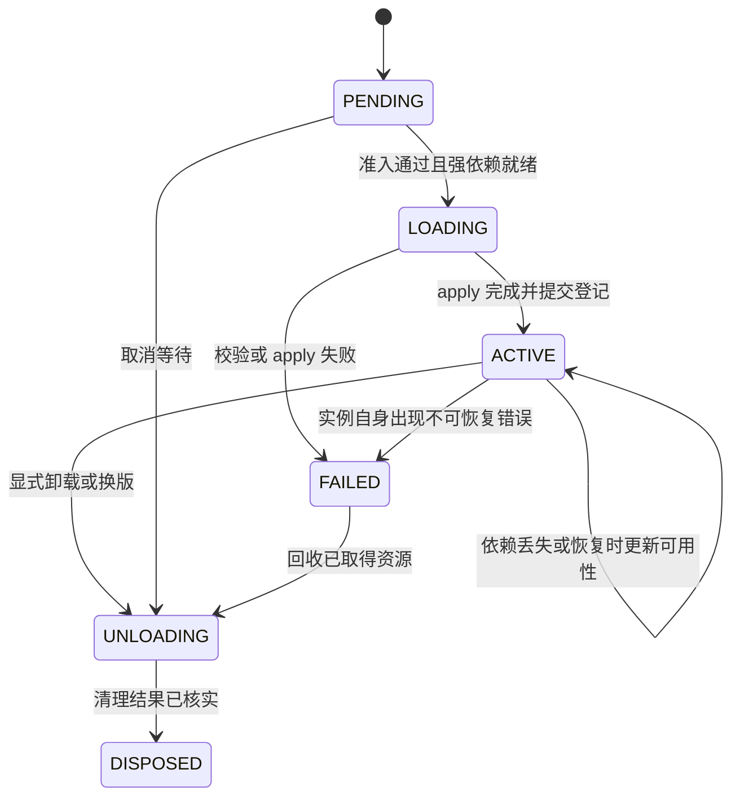

# 从 Cordis 到 Edge Agent ROS 的插件运行时

**P1 实现**将 Python Context 和 Fiber 放在独立的 soft-host 中。Agent 持有原任务，soft-admin 管理发布和持久预约，soft-host 执行受信软件。未启用 overlay 的部署继续使用 v1。下表用 `8520e434b66102b593eb8714f02b425f47187a79` 对照迁移前的入口；P2 的相机部署控制器与 P3 的板端 pack 各有独立的现场入口。[Context 与 Fiber](../agent/soft_runtime.py) · [宿主与调用边界](../agent/soft_host.py) · [SQLite 发布目录](../agent/v2_registry.py) · [隔离部署](../compose/soft-runtime.yaml)

假设两项任务同时查询本机的数据，任务 A 采用工具 v1 的输入单位，任务 B 在升级后才制定计划。系统应当能说明 A 到底按哪个单位计算，B 从什么时候开始看到 v2，失败的回执该去哪个版本对账。即使两个版本都只有十行纯 Python，直接覆盖同名函数也回答不了这些问题。运行时负责登记和撤销每一份能力，并让一次已绑定的调用始终找到自己的来源。

## 1　当前有哪些入口

| 对象 | 基线中的所有者和真实行为 | P1 的接入边界 |
| --- | --- | --- |
| 服务目录与观察器 | `agent/runtime_plugins.py` 的 `ServiceSnapshot.pin` 校验唯一提供者、依赖链、摘要和 draining。`RegistryObserver` 将采样到的目录变化、观察失败与恢复写入模块账本。`agent/service.py` 启动这一观察线程。目录只证明声明可解析，观察器还可能错过两次采样之间的变化。 | 保留为对外服务解析与证据来源。只有宿主控制的显式激活／撤销事务可以确认 Fiber 的实际生命周期。 |
| Session | `client/register_session.py` 经管理器安装 `session.default`，提供 `session.read`。`sessions_plugin/provider.py` 提供 HTTP 服务。Console 的 `session_service.py` 在响应前后核对绑定及请求范围，读途中换版会返回 `session.binding_changed`。 | soft 试点注册这一公开服务的受信适配器。保留 HTTP 消费方、前后绑定检查和回执格式。Session 继续从来源读取事实。 |
| Evidence | `client/register_evidence.py` 发布的文件名有 `evidence.` 前缀。现有模型工具 ID 为 `read_session`、`evidence_schema`、`query_evidence`。`evidence/provider.py` 通过公开接口取限定范围的事件，在受限查询窗口内执行只读 SQL。 | soft 代理为已有 HTTP 工具登记能力，保留旧 ID、操作 ID、查询预算、结果和来源游标。称作 `evidence.*` 时指这一组扩展。 |
| Derived | `agent/derived_tools.py` 校验有界 JSON 定义。规范化定义的 SHA-256 已是工具版本。`agent/planning.py` 发现声明，`agent/service.py` 根据定义选择输入。v1 单位换算／阈值比较读取里程计，v2 从请求的 `series` 参数计算。 | 首批只迁移 v2 纯数列子集，沿用定义摘要、工具名、输入及证据。v1 里程计读取继续走现有协议和时效检查。 |
| 其它名为 watch 的角色 | `client/plugin_manager_watch.py` 检查来源、发布授权、独立样本，按受限绑定发起后续只读任务。`task_recorder/cli.py` 的 `watch` 按源序号追录某个任务。`client/watchdog.py` 独立巡检，有自己的游标和事故记录。 | 保留各自状态所有者。看见一次文件变更、收到一次业务事件、判定健康异常分别触发不同处理。P1 不把独立 watchdog 收进被监控的进程。 |

两条轨道按失效后果划分。**soft** 供经过准入的纯计算、投影和协议适配器使用，撤销的是宿主登记的能力。**physical** 对传感器、执行器、驱动及其所有权实施独立隔离。进程内软适配器可以检索一项已发布的里程计事实。原设备采样、独占权、制动和停稳确认仍由对应驱动、Gateway 或 Core 处理。已有 HTTP 服务即使只读，也继续拥有原本的进程和账本。

## 2　借鉴了哪些上游行为

Cordis 的 Context 给已装载实例提供服务、监听和 effect。Fiber 是一次插件实例的生命周期句柄。DSH 将模型、工具注册表、Session 日志和 Agent 循环都作为可组合能力。此处沿用“向 Context 注册，退出时撤销”的写法。上游 DSH 版本按本仓已引用的 `39163dd` 核对，Cordis 核心按 `d6de1c0` 核对，两者是各自仓库的版本。[DSH 架构](https://github.com/deepseek-ai/deepseek-harness/blob/39163dd30f703a79079e2d2446545cff3c453738/docs/architecture.md) · [Cordis Fiber 源码](https://github.com/cordiverse/cordis/blob/d6de1c0e39c3290d07de1f6db88c28a3c31a1b6e/packages/core/src/fiber.ts)

| 观察点 | 固定版本的上游行为 | 本项目 Python 契约 |
| --- | --- | --- |
| 登记资源 | `ctx.effect(setup)` 执行 setup，收集它返回的清理函数。服务、监听等登记也随所有者撤销。 | `ctx.effect(disposer)` 直接登记已经取得资源的清理函数。桥接代码要转换调用形式。 |
| 清理顺序 | 独立 async disposer 按注册逆序启动，可能并发完成。 | 在同一 Fiber 里逆序逐个 await，使“退订完成，再关闭连接”可验证。 |
| 依赖变化 | 所需服务缺失会阻止首次激活。运行中失去强依赖可以触发卸载，依赖恢复后重新装载。 | 首次缺失保持 PENDING。ACTIVE 实例后来失去强依赖，保留实例，记录 unavailable，阻止受影响的新调用，并向调用者返回缺失依赖。 |
| 热替换 | DSH HMR 按配置变更卸载／装载。不同 profile 的启用策略不同。 | 受管的 soft 更新需要冻结旧行为、排空、显式卸载，再激活新版本。涉及真实设备时另走 physical 交接。 |

核对入口分别为生命周期、依赖装载、HMR 教程及核心卸载实现。上游文档中的 Python 客户端会启动 DSH 运行时，本设计复用原 Agent 的规划和持久任务账本，第一方 apply(ctx) 装入一个无设备、无执行器网络的 Python 进程；通过受限协议接入这个逻辑宿主。[DSH 生命周期与异步清理](https://github.com/deepseek-ai/deepseek-harness/blob/39163dd30f703a79079e2d2446545cff3c453738/docs/cordis-tutorial/02-lifecycle-and-effects.md) · [DSH 服务依赖](https://github.com/deepseek-ai/deepseek-harness/blob/39163dd30f703a79079e2d2446545cff3c453738/docs/cordis-tutorial/03-services.md) · [DSH 热替换](https://github.com/deepseek-ai/deepseek-harness/blob/39163dd30f703a79079e2d2446545cff3c453738/docs/cordis-tutorial/06-composition-and-hmr.md) · [Cordis 清理顺序](https://github.com/cordiverse/cordis/blob/d6de1c0e39c3290d07de1f6db88c28a3c31a1b6e/packages/core/src/fiber.ts#L453-L474)

## 3　一个 Context，六种操作

宿主为每个已批准的插件实例建立独立 Context。实例身份包含插件 ID、版本和本次装载的实例标识。同一版本卸载再装载也要能区分。一次业务调用带上原有的 `task_id`、`trace_id`、`operation_id` 和期限等必要字段。用户聊天历史、设备句柄和数据库连接不因插件拿到 Context 而传入。

| Python 接口 | 输入、可见结果 | 所有权、失败及撤销 |
| --- | --- | --- |
| `ctx.effect(disposer)` | 接受无参同步或异步清理函数，登记成功表示本实例承担清理责任。例如，取得 HTTP 客户端后登记关闭函数。 | 获取资源后立即登记。重复 dispose 共享同一次清理结果。失败记录对应登记项、原因和未释放资源。卸载开始后禁止再登记。 |
| `ctx.on(event, handler)` | 接受已声明事件及处理函数。注册成功后按现有事件契约接收授权范围内的事实。 | 监听器属于本实例。卸载关闭新投递，已启动回调计入在途引用。需要重放的消费者仍按持久源身份与游标续读。 |
| `ctx.provide(name, handler)` | 将一个函数挂到描述符预先声明的 service 名称。handler 接受一个参数对象，可同步或异步返回。 | 只能在 LOADING 阶段登记，激活后供消费者发现。卸载或失败只撤销本实例的登记。 |
| `ctx.require(name)` | 读取 requires 中明确声明的服务，返回异步函数。在已冻结的调用内执行 `await service(arguments)`。 | 首次激活前缺服务时等待。运行中失去依赖时拒绝调用并保留消费者，原任务继续按冻结身份对账。 |
| `ctx.tools.register(name, handler)` | 在 LOADING 阶段登记已声明的 tool 名。调用方传入含 operation_id、arguments、version 等字段的 wire 对象，handler 返回带原操作号的回执。 | 新模型目录在激活后更新。输入及成功回执的 evidence 分别接受 parameters 和 outcomes 校验；旧计划持有原 schema 和 binding。 |
| `ctx.config(schema=None)` | 可选 schema 用于额外校验，返回配置的深复制。在调用内取得这次预约冻结的快照；在 apply 内读取当前配置。 | 宿主先验证新配置，成功后为新计划提供新修订；旧调用的快照保持原值。热配置应在 handler 中读取，需要配置变化才生效的资源应由插件明确管理。 |

监听注册、服务发布、工具登记都是自动纳入 Fiber 的 effect。插件作者只为宿主看不见的资源手工登记 disposer。局部事件回调只在当前进程有效。需要重启后仍可解释的发布、失败和退订结果，写入现有 ModuleJournal ／ EventBus。事件发布不授予执行权。

### 新工具怎样获得第一份调用

全新工具 `text.length` 无需 v1 的 `profile.legacy`。宿主从 `provides`、版本、效果和 `parameters` 生成模型看到的条目。把可读的工具说明放入输入 schema 的 `description`；当前 Agent 规划器可以向新工具传递 string、number、boolean 参数。一次成功回执中的 `evidence` 必须符合 `outcomes`。以下程序可在仓库根目录保存为临时 Python 脚本并运行。它用单元测试的虚拟站点准备一次性授权，复用与实际 soft-host 相同的适配器，然后提交一项调用并排空。正式发布仍由站点维护者使用独立的只读信任目录。[站点安装与发布步骤](plugin-descriptor-v2.md#p1-现场安装)

```python
import asyncio, hashlib, json, sys, tempfile
from pathlib import Path

sys.path[:0] = [str(Path.cwd() / "agent"), str(Path.cwd() / "tests")]
from test_plugin_descriptor import descriptor_fixture
from plugin_descriptor import compute_content_digest, validate_descriptor
from soft_host import adapter
from soft_runtime import SoftRuntime

source = b'''def apply(ctx):
    def length(wire):
        return {"operation_id": wire["operation_id"], "state": "SUCCEEDED",
                "evidence": {"count": len(wire["arguments"]["text"])}}
    ctx.tools.register("text.length", length)
'''

async def demo(site):
    trust = site / "trust"
    item = descriptor_fixture(trust, plugin_id="text.length")
    item["parameters"] = {"type":"object", "description":"Count characters in text",
                          "properties":{"text":{"type":"string"}}, "required":["text"], "additionalProperties":False}
    item["outcomes"] = {"type":"object", "properties":{"count":{"type":"integer","minimum":0}}, "required":["count"]}
    catalog_file = trust / "catalog.json"
    catalog = json.loads(catalog_file.read_bytes())
    record = catalog["implementations"].pop(item["provenance"]["code_digest"])[0]
    record["artifact"] = "text_length.py"
    record["entrypoint"] = item["entrypoint"] = "text_length:apply"
    (trust / record["artifact"]).write_bytes(source)
    (trust / "input.json").write_text(json.dumps(item["parameters"]), encoding="utf-8")
    digest = "sha256:" + hashlib.sha256(source).hexdigest()
    item["provenance"]["code_digest"] = digest
    catalog["implementations"][digest] = [record]
    catalog_file.write_text(json.dumps(catalog), encoding="utf-8")
    item["content_digest"] = compute_content_digest(item, trust)
    validate_descriptor(item, trust)
    events = []
    rt = SoftRuntime(events.append)
    await rt.install(item, adapter(item, site, {}))
    pin = await rt.freeze("text.length", "text.length", "demo-1")
    wire = {"operation_id":"demo-1", "version":item["version"], "arguments":{"text":"robot"}}
    receipt = await rt.call(pin, wire)
    assert receipt["evidence"] == {"count":5}
    await rt.release("demo-1")
    await rt.drain("text.length")
    await rt.remove("text.length")
    print(receipt, [event["type"] for event in events])

with tempfile.TemporaryDirectory() as directory:
    asyncio.run(demo(Path(directory)))
```

## 4　实例存活与依赖可用性



要区分三个读数。Fiber 状态回答“这份实例装到哪一步”。依赖可用性回答“它现在能否完成一次新调用”。`draining` 回答“是否允许新的任务绑定”。例如 Evidence 上游断线时，一个 ACTIVE 的代理仍可报告诊断，依赖该上游的新查询显式失败。相同合格绑定恢复后清掉 unavailable 并登记恢复事实，恢复本身无需再跑一次 apply。若提供者身份已经变化，冻结的旧调用仍然需要原提供者或显式结束，新的计划才按新绑定准入。

卸载先撤销新准入，再等待在途工作释放引用，最后按 effect 登记逆序逐个 await。某项抛错要标明失败并继续回收可独立释放的资源。仍可能被占用的资源及其依赖保留隔离，登记未释放明细。加载失败时也回收已取得的部分。多次或并发 dispose 共用一份结果。遇到不可确认的资源状态，禁止把实例标成已干净退出。

## 5　换版时谁可以继续调用

| 顺序 | 宿主动作 | 开发者应能看到的事实 |
| --- | --- | --- |
| ① 制定计划 | 在一个可串行化的准入边界内，按目录快照校验 schema，把旧版本、binding、发布身份及步骤的预约持久化。派发将预约转为活动引用。计划取消或完成释放预约，调用对账后释放活动引用。 | A 固定到旧版本。排空计入“已承诺尚未派发”及“正在执行”的旧引用。模型仅浏览目录或缓存一份 JSON schema 不产生预约。 |
| ② 提交升级 | 校验候选与配置。对同一插件的并发发布按预期 revision 比较并串行化。先关闭旧版本的新准入，再等已冻结的旧使用者完成，或按约定明确结束。 | 临界点有唯一胜者。在此点之前获准者拿旧绑定，之后的请求在预算内等待或收到 draining。其它插件继续工作。 |
| ③ 交接 | 在途数归零后显式 dispose 旧 Fiber，逐项核实清理。以新实例执行 apply，成功后一次性公开新 Service 与工具 schema。 | 新计划 B 看到新版。旧计划如已失去原实现，返回原绑定不可用，沿原操作对账。只有另行授权的后续任务才可以拥有独立的新计划。不能伪造旧回执。新版激活失败可重新加载已验证的旧制品，恢复结果另记。 |
| ④ 崩溃或超时 | 持久化发布意图、版本、阶段、受影响的冻结引用及操作回执。进程重启先与实际注册、外部提供者／动作所有者对账。内存引用计数归零不能证明没有遗留操作。 | 同一 `operation_id` 只有一次可核实的外部效果。结果不明保留既有恢复流程。物理设备若支持双版本，必须固定节点、提供者版本和控制所有权，并有经验证的交接／停车证据。 |

**期限用同一份预算。** 任务、装载、排空和清理各由部署策略给出上限。在单进程以单调时钟维护绝对期限，调用下游时传递剩余预算，不能跨机器比较裸单调时钟值，也不能每一次重试都重置预算。超限时记录阶段、已耗时、等待引用及责任方。关掉新准入，给合规的只读调用返回有界错误，对未确认动作按原操作号核验。超时不构成强杀线程、回收驱动所有权或再次下发运动的依据。

以长任务为例，任务仍在接收未来的新目标时，仅为已经提交的具体步骤预约版本。旧步骤迟迟不能开始时，预算耗尽应报告原绑定不可用。经任务所有者明确取消、证实从未派发，才可释放预约。后续另行授权的新任务拥有独立计划和因果关联。已经发出但没有取得回执的步骤进入对账。部署人员通过引用清单能区分“还有一个计划没下发”和“车已经收到了命令”。

## 6　Derived 试点与验收

第一版验证两种输入的信任来源。宿主只装载项目版本锁定且部署策略授权的 Python 适配器，再由该适配器解释经既有发布流程校验的只读声明。脚本来源、制品身份、发布准入和能力范围都需要独立核对。一份定义自称 `effect=read`，或有人知道它的 SHA-256，都不能授权导入新 Python。由 AI 编写的声明可继续通过 `client/plugin_manager_watch.py` 与 `agent/plugin_manager.py` 的既有授权、独立样本和审计路径。P1 解释已准入的声明，使用现有受信实现处理数列。动态下载或生成的 Python 不进入该进程。

历史定义里的 `schema_version=1` 指格式。它使用带 `source`、`frame`、正 `stamp_ns` 的里程计测量，并需要验证现场新鲜度。试点采用的 `schema_version=2` 则使用调用者提供的数列。二者的格式号和第一版宿主的信任决策相互独立。若以后把里程计换算接入 soft，可让受信输入服务先发布经过时钟和坐标系检查的标准事实，再将纯转换单独登记。

| 验收情形 | 判据与证据 |
| --- | --- |
| 首次缺依赖、运行中断连与恢复 | 首次 PENDING 没有监听或工具泄漏。运行中保持同一 Fiber，调用方拿到 `plugin.dependency_unavailable`，恢复后同一实例重新可调用。事件包含原服务绑定和前后状态。 |
| apply 中途失败、异步清理与并发 dispose | A、B、C 三个 effect 中 C 需等待。日志中 C 完成后 B 才开始，B 完成后 A 才开始。两次并发卸载同一资源最多释放一次。异常和预算耗尽必须列出未完成项。 |
| 两个请求恰逢换版、同一 revision 上并发发布 | A 一直使用旧 schema。准入关闭后的请求有明确结果。仅一个发布胜出。负载下每个操作都能关联实际 provider，一次旧清理不会撤销新登记。 |
| 在登记意图、外部回执、卸载之间分别崩溃 | 重启能区分“已受理”“已产生外部效果”“清理未证实”。按原操作号对账，原任务、未受影响任务和独立 Watchdog 均可查询。 |
| 回归三个试点 | 用相同输入比对既有 Evidence 的权限和查询覆盖范围、Session 的换版拒绝行为、v2 Derived 的数列结果和定义摘要。v1 里程计陈旧或缺样仍显式失败。以 `tests/system/session_plugin_acceptance.py`、`tests/system/derived_tool_acceptance.py`、`tests/system/session_evidence_acceptance.py` 为基线，再补并发及超时故障注入。 |

真实设备的控制权移交与上述 soft 装卸分别验收。[physical 交接协议](architecture/plugin-physical-handoff.md) · [双轨测试计划](testing/plugin-tracks.md)
