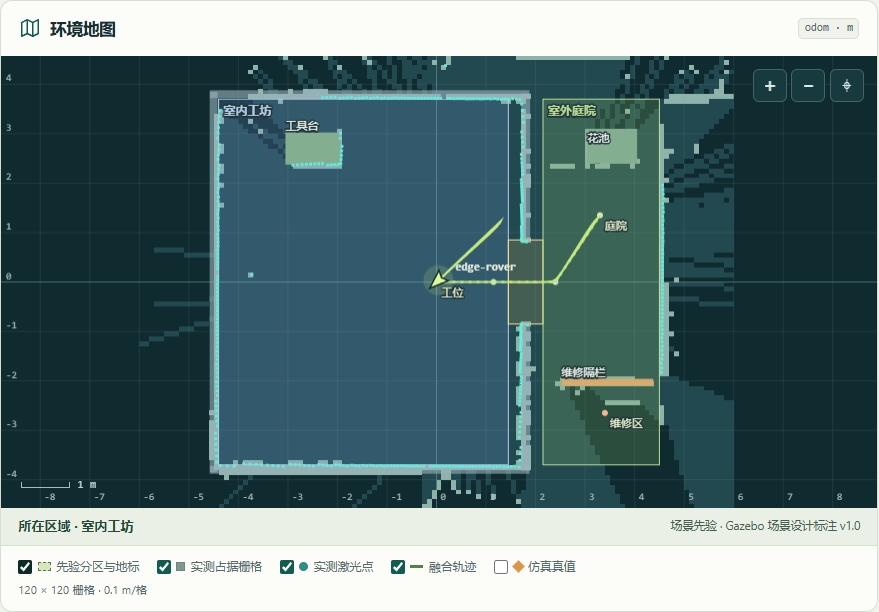

# 从室内工坊穿过门廊到室外庭院

点击工作台「下发任务」，输入 **去庭院巡检**。机器人从工位起步，按门内、门外和庭院之间的连接前进。右侧激光显示实际回波，左侧地图可分别开关场景标注、占用格、轨迹和独立仿真真值。完成后可输入 **回到工位**。另一个只读任务 **查询场景地图** 会返回地点、连接、来源与地图版本。

## 机器人凭什么知道这里是庭院

| 信息 | 实际来源 | 能用于什么 |
|---|---|---|
| 室内、室外、工位、庭院、维修隔栏、可通行连接 | 有版本的场景标注，含坐标系、几何形状、访问标记和布局 SHA-256 | 按名字找地点、生成候选路线、在任务历史中定位当时使用的地图 |
| 当前所在区域 | 用同一 `odom` 坐标系中的新鲜融合位姿与区域边界相交 | 确定从哪个区域接入路线，定位过期时返回待定位 |
| 自由、占用和未知格，前方净空 | 实际仿真雷达扫描，经标定和时间匹配进入地图。网关独立订阅激光检查前方扇区 | 对照门和墙的位置；遇障或扫描失效时制动 |
| 最终到达、穿过门口 | ROS 内核保存停稳后的里程证据，独立验收另取 Gazebo 世界位姿 | 检查到达误差与穿门轨迹，发现坐标系或世界几何错误 |

激光能看到墙的轮廓。工坊和庭院的名字来自现场模型；新增地图推理或视觉分类插件时，应一并发布识别来源、采集时间、置信程度以及适用坐标系，避免把单次猜测用作长期标注。

## 从地点名到可核对的动作

1. 语义能力 `navigate_place(place)` 可由自然语言规划器选择，登记过的短语也支持离线输入。每个新操作沿用 Agent 提供的 `operation_id`。
2. 提供者解析名称和别名，拒绝未知或限制通行的目标。从当前区域选取可见的接入点，在有净空间隙的连接图上求最短路径。每条线段与按机器人间隙扩大的静态矩形求交。
3. 派发前将地点、版本、布局摘要、节点顺序及目标坐标写进 `scene-state` 卷。重启和重试时查询同一 ROS 委托。对正在执行的路线热换标注需要保留旧提供者并核实当前位置。
4. 网关在实际前进方向检查新鲜扫描，前方 0.42 m 内出现障碍将制动并报告 `navigation.path_blocked`。现场底盘须有自己的传感器覆盖、制动距离和安全控制。此实现演示停障与溯源，绕行重规划需要相应导航提供者。

## 验证与替换

在空闲的默认仿真运行 `python tests/semantic_acceptance.py`。脚本通过公开 HTTP 入口往返巡检，检查门中真值样本和最终误差，再对未知地点、维修区和墙面做负向测试。最后返回工位。报告包含逐次真值样本、任务 ID 与稳定错误码。[黑盒测试](../tests/semantic_acceptance.py) · [几何与 SDF 一致性测试](../tests/test_scene_layout.py)

区域、地标、障碍物和门的连接都在 [campus.json](../scene/campus.json)。仿真在启动时用它生成场地，语义服务用同一份布局做查询。换场地应把新文件挂载到 `sim` 与 `scene` 容器中的相同位置，设置 `EDGE_SCENE_FILE`，并在空闲时重新启动。若单独使用旧空场，可启动原 `sim/world.sdf` 并移除语义能力。硬件部署按自己的定位和地图接入 `/edge/semantic_map` 和语义技能，默认不载入本仿真场地。
