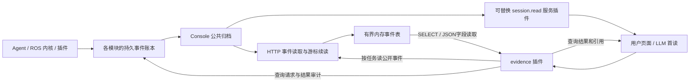

# 从可读任务会话到精确证据

打开[本机任务会话](http://127.0.0.1:8765/#sessions)，先读用户要做什么、Agent 记录的计划、执行反馈与当前结果。每条叙述旁边的「查看证据」可以展开引用，再打开原事件或回放当时的机器人观测。点击「下载 Markdown」可以把同一份内容交给诊断模型。

一项自然语言任务对应一个可读会话，用 task_id 定位。一次后续修复可以生成另一项任务，相关任务通过 trace_id 和显式父任务连接。Console 事件中的 session_id 是观测进程一次启动的身份。任务会话跨 Console 重启仍可读取。

## 先看结论，再决定需要什么细节

假设用户要求巡检一个点。会话先展示计划与结果，遇到路径受阻时展示源事件记录的前方净空、制动和停车回执。要判断具体怎么停车，展开相应引用；要统计一共重试几次，调用证据插件进行聚合查询。轮询请求、相同操作的重复结果和周期快照继续保存在公开归档，默认阅读区呈现关键事实。

主诊断采用任务所有者记录的终态。例如执行失败后，插件作者又报告“无法生成修复候选”，会话把这个后续事实单独呈现。已经成功的任务仍可显示曾发生的故障，但当前结果继续以任务账本为依据。

默认 `session.default` 插件使用规则投影，每条叙述都能追到任务账本或归档事件。它展示已记录的事实和诊断建议，不包含未记录的模型内部推理。目标、步骤和结果可以在没有 LLM 服务时读取。对未知插件，通用告警、code 和 detail 仍能作为事实进入阅读区。

## EventBus 在当前项目中的实际形式



生产者和消费者通过公共事件契约协作。Console 按源身份与序号导入持久账本；消费者用 HTTP 读取归档，保存自己的游标。底层账本当前采用 SQLite。证据插件只依赖公共读取协议，源存储迁移时可以继续使用相同接口。ROS 瞬时消息和未持久化的事实仍受采集时机影响。

## Session 也按插件管理

沿用 dsh 的三个角色：服务定义规定输入输出，提供者实现行为，消费者按服务名调用。当前 `session.read` 是服务，`session.default` 是默认提供者，Console 和证据工具是消费者。它可以提供零个模型工具；Plugin 的范围包含工具、会话投影和后台消费者。[dsh 的服务与插件设计](https://github.com/deepseek-ai/deepseek-harness/blob/39163dd30f703a79079e2d2446545cff3c453738/docs/architecture.md)

Session 在独立 Docker 服务中运行。它通过只读 HTTP 获取任务上下文和 EventBus 事实，自己选择摘要规则，不挂载任务或原始事件数据库。Console 的会话入口只负责服务发现、调用、响应校验和显示。安装或替换一个兼容提供者时，机器人执行器和 Console 业务源码无需随之修改。

| 角色 | 契约与实现 |
|---|---|
| 服务定义 | `session.read` 接收一个 task_id 或 trace_id、请求 ID 和提供者版本绑定，返回带事实引用的会话文档。 |
| 默认提供者 | `sessions_plugin/` 提供有预算的公开读取、规则投影、查询审计。安装入口是 `client/register_session.py`。 |
| 服务注册 | `plugins/runtime/session.default.json` 沿用已有 provides/requires/version/draining 清单，通过现有插件管理器发布并留存变更事件。 |
| 消费者 | Console 解析服务，核对请求身份与响应范围，并在完成前再次核对绑定。页面显示当前提供者及版本。 |
| 原始事实 | 任务状态仍由任务所有者提交，事件仍由各生产者记录。Session 插件的叙述不赋予动作或恢复权限。 |

插件未安装、停止接单或失联时，页面明确显示不可用，仍可进入任务时间线和原始事件。Console 不偷偷切换到另一份内置摘要规则；恢复注册后，下一次读取就可使用提供者。替换中途返回的旧绑定不会被当成新实现的结果。读取期间任务和归档各有自己的快照，跨来源并非一个原子事务；覆盖信息会注明窗口、截止位置和历史清理。

本页的 Session 是任务事实阅读视图。dsh 的 SessionStore 还承载模型历史、turn/step 与继续对话；本次未把这些能力全部移植进来。后续对话历史、压缩策略或诊断模型也应以同一服务契约和插件装卸方式扩展，分别说明谁持有事实、卸载影响哪些消费者、如何保存恢复证据。

## 三项可热挂载的查询能力

| 工具 | 模型在什么情况下调用 | 返回什么 |
|---|---|---|
| read_session | 首次了解某任务 | 简短 Markdown、范围与引用 |
| evidence_schema | 需要知道能查哪些字段或查询被拒绝 | 字段、允许的函数、例子、资源限制 |
| query_evidence | 需要具体调用、参数、故障或数值 | SQL 查询结果、引用、覆盖范围、截断与续页信息 |

工具是既有 Agent 可发现的 read 能力，也可由外部 Agent 直接调用 HTTP。本地自然语言入口支持 `复盘任务 <task_id>`。外部模型可以读一次摘要，决定下一条查询，再依据结果继续查证。当前任务规划器仍按已生成的步骤计划执行；本次增加的是可供模型使用的取证工具和可读上下文。

查询语言为 SQLite SELECT。插件把本次读取到的公开事件放入内存表 events，查询结束即关闭该表。任务源数据库与文件系统不作为查询参数。来源、父事件、调用与操作 ID，以及 data_json 中公开字段都可以查询。

先发现实际事件类型，避免模型凭词义猜类型名。

```sql
SELECT kind, count(*) AS occurrences
FROM events
GROUP BY kind
ORDER BY occurrences DESC;
```

再查询制动时的实际距离。task_id 已由插件从 HTTP 参数限定；底层 ROS 委托的 task_id 列可能为空，插件依靠 Console 已记录的委托关联把它们带进该任务范围。

```sql
SELECT seq, event_id, operation_id,
       json_extract(data_json, '$.front_range_m') AS distance_m
FROM events
WHERE kind = 'action.braking'
ORDER BY seq;
```

关联前因时，可以把同窗口中父事件的 detail 一起查出。

```sql
SELECT child.seq, child.code, child.detail,
       parent.seq AS parent_seq, parent.detail AS parent_detail
FROM events AS child
LEFT JOIN events AS parent ON parent.event_id = child.parent_event_id
WHERE child.level IN ('warn', 'error');
```

父事件未加载进本窗口时，关联结果可能为空。应按源窗口继续读取或回查更早的事件。模型生成的 SQL 结果可能包含计算值，引用用于回查原事实。判断机器人状态时，还需核对归档事实的发生时间与当前任务状态。

## 调用与续读

默认仿真部署把证据服务绑定在本机 8125 端口，使用 EDGE_EVIDENCE_PORT 可以修改。模型客户端先获取 `GET /schema`。提供者接受 `POST /invoke?tool=read_session`、`evidence_schema` 或 `query_evidence`，支持既有 operation_id 回执协议。

```json
{
  "operation_id": "review-001/query-1",
  "version": "1",
  "arguments": {
    "task_id": "inspection-example",
    "sql": "SELECT seq, kind, code, detail FROM events WHERE level IN ('warn','error')",
    "after_seq": 0,
    "limit": 10,
    "archive_id": ""
  }
}
```

每次最多加载 500 条源事件，返回最多 50 行，完整回执限制约 12 KiB，并设有运行时间和 SQL 指令预算。coverage.has_more 为真时，按 coverage.next_after 与 archive_id 发起新查询。COUNT 等聚合只覆盖当前加载窗口。结果行被输出预算截断时，缩小所选字段或按 seq 缩小同一窗口，不能直接跳到下一个源窗口。

同一 operation_id 与同一输入返回已经保存的回执。想刷新实时进度或修改 SQL，使用新 operation_id。暂时的上游不可用可以沿原 ID 重试。更换了输入却沿用原操作 ID，会返回明确冲突。

查询审计记录请求摘要哈希、目标任务、覆盖范围、耗时、返回行数、成功或失败及 query_id。源 SQL 的具体字面量和结果正文不会复制到公开审计事件。调用方仍应保存自己实际发出的查询与回执，以便完整重现诊断过程。插件自己的审计采用 ModuleJournal 保存并进入 EventBus，session 首读会折叠这些取证活动。[提供者协议与限制](../evidence/README.md)

## 部署、安装与卸载

常规启动脚本会启动 Session 和 Evidence 两个服务，并分别安装服务清单与工具清单。也可以独立安装或撤销。

```powershell
docker compose up -d --no-build session evidence
docker compose run --rm --no-deps -T session-admin
docker compose run --rm --no-deps -T evidence-admin
# 只撤回会话服务；原始证据查询仍能使用
docker compose run --rm --no-deps -T session-admin --remove
# 只撤回三项模型查询工具
docker compose run --rm --no-deps -T evidence-admin --remove
```

Linux 实机使用相同命令并添加 `-f compose.hardware.yaml`。硬件清单指向本机 8125，仿真清单指向 Compose 的 evidence 服务。模板在 evidence/tools，运行现场生成的文件在 plugins/evidence.*.json。原子替换单个清单后，下一次规划即可发现该能力；正在执行的旧计划继续按既有版本绑定要求核对提供者。

源码和模板受 Git 管理，生成的现场清单由安装命令重建。查询审计保存在 module-sources 卷的 evidence.query 子目录。停用服务时可单独执行 `docker compose stop evidence`。

Session 审计保存在同卷的 session.default 子目录；清单变更由 runtime/.history 中的管理器记录，经现有 EventBus 汇集。停用 Session 可执行 `docker compose stop session`。修改 Docker 服务环境变量仍需重新创建该服务；注册清单的安装、撤回和 draining 会在下一次请求生效。

## 验证入口

按 [SDD-010](specs/SDD-010-session-evidence.md) 对照摘要语义、源事件归属、查询预算和故障处理。独立仿真先生成成功及受阻任务，再运行浏览器与证据插件验收。

```sh
python tests/system_suite.py --changed-since 7f7223d --ollama-cache-volume edge-agent-ros_models
```

真实模型实验使用 tests/system/evidence_model_acceptance.py。它让本地模型先查询事件类型，再生成测量查询，最后按回执给出事件引用和值，与原事件逐项对照。实验提供了字段名和任务范围，衡量这条检索链的执行能力；更广的诊断质量还需要任务集和故障集共同评估。

2026-11-18 的 `qwen2.5:1.5b` 实验**未通过**：模型正确发现制动事件类型，但自行增加未经证实的模块筛选，并遗漏引用序号，连续三次返回空行。插件按约执行了查询；模型尚未完成诊断，也没有据此触发机器人恢复。[完整实验记录](evidence/session-query-model.json)保留每次提示、模型输出、工具回执和失败理由。后续更换模型或提示时应复跑同样的样例，并扩充未知故障、无证据和跨页任务，分别统计查询可执行率、证据命中率、引用与数值正确率、错误结论率及调用成本。
