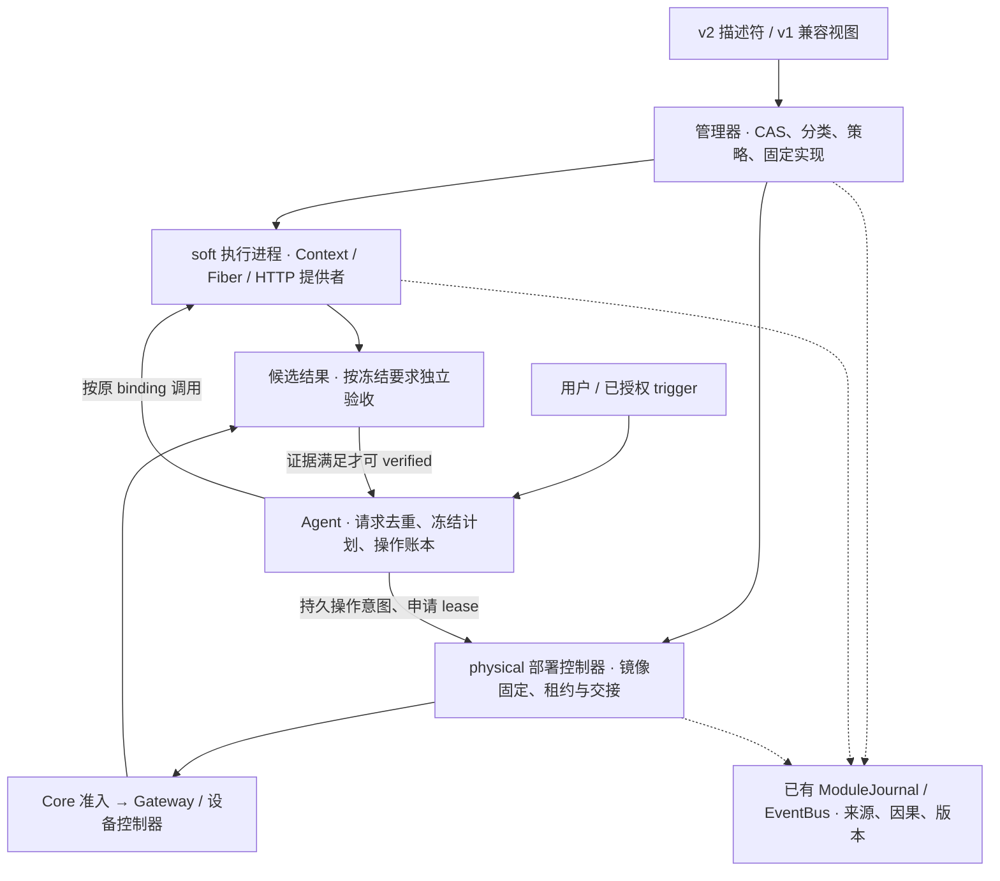

# SDD-045 插件描述符 v2 与 soft / physical 双轨工作流

**阶段状态见文末验收记录。** P0 的设计基线为 `8520e434b66102b593eb8714f02b425f47187a79`。P1 引入可热更新的软件宿主，P2 实现相机部署与交接，P3 负责组合和板端发布。实物工位单独记账。

## 背景与价值

“复盘任务 A”和“前往庭院”都能成为一次工具调用，但升级失败的代价不同。前者可以从公开账本重读，后者的 HTTP 超时可能发生在车已经开始移动之后。现有 `scene/plugins/navigate-place.json` 的 `effect=idempotent` 指按同一操作号可对账；它没有说明底盘控制权、能否替换进程或何时安全交接。目标是让同一套注册、版本与证据机制服务两类插件，同时让执行授权符合实际风险。

| 当前源码入口（基线根目录） | 已有保证 | 本提案补足的行为 |
|---|---|---|
| `agent/planning.py::registry/catalog/binding`，`client/register_evidence.py` | 普通 HTTP Tool 使用顶层 JSON、加载优先级与清单字段哈希；Evidence 的三份清单逐一原子替换 | 单个 v2 描述符作为一组导出的发布单元，受管 CAS、实现摘要与拒绝事件 |
| `agent/runtime_plugins.py::ServiceSnapshot/RegistryObserver`，`agent/plugin_manager.py` | 单提供者、传递依赖绑定、draining、发布与观察事件；受管 CLI 目前支持 runtime 和 derived | 每代实例健康、实际冻结引用/在途数、卸载清理结果；部署执行层验证清单与权限 |
| `agent/service.py::Journal/worker/prepare_verification/verify_candidate/finish_step`，`agent/derived_tools.py` | 请求去重，先保存计划与派发意图，候选持久化后可仅续验；纯数列与里程计派生工具已有独立定义 | 在现有规划/派发边界钉住实现、schema 和配置；保持权威账本与终态判定 |
| `client/*_watch.py`、`sessions_plugin/`、`evidence/`、`examples/result-verifiers/` | 消费者自持游标，Session 查询公开事实，验收器独立读取产物 | 给运行单元补统一身份和生命周期证据；消费者仍按原订阅和验收协议工作 |
| `scripts/release_robot.py`，`tests/test_selection.py` | 从已提交源码白名单生成部署树，按生产者选择消费者回归 | P3 才把 pack、配置及运行时纳入投影，逐项验证可重建与 observe |

## 设计与契约

### 一个逻辑宿主，两条执行轨道

Agent 持有任务账本，Core 和设备控制器持有运动准入和执行终态，独立验收者持有观测结论。管理器持有活动发布修订；受控宿主持有 Fiber 及资源，物理端持有设备实际控制权。使用同一个描述符协议和证据格式不要求把以上权限放进同一进程。先在现有目录、管理器和派发点加薄适配，再按试点证明边界。EventBus 传播事实；设备命令只走获得租约的控制路径。

| 维度 | soft（纯软件） | physical（设备与物理作用） |
|---|---|---|
| 运行位置 | 第一方受信代码可在隔离的软插件进程内 inproc，第三方走 HTTP sidecar | 独立进程或容器 |
| 安装 | 受管运行时安装 | 部署期安装与现场授权 |
| 代码热更 | 关闭新准入，排空旧引用，显式 dispose 后加载新版 | 禁止运行时热替换代码 |
| 配置热更 | 通过 schema，仅影响获准范围 | 仅限不改变设备语义的白名单配置 |
| 依赖 | inject 等待；依赖失去后保留实例，拒绝依赖它的调用 | 设备 lease、健康检查、末端控制权和交接 |
| 效果 | read 或 idempotent | 允许 actuation；读取原始设备即使只读也走此轨 |
| 验收 | 契约与独立样例，保留原操作与回执 | 仿真、台架、独立验收及停稳／停采证据 |
| 版本 | SemVer、内容摘要、冻结 binding | 镜像摘要、部署提交和不可变版本 |
| 回退 | 排空后卸载或恢复原版 | 交接后重新部署原版本与已验镜像 |
| 权限 | 无设备与执行器网络，只开放批准的事实与软件服务 | 最小设备挂载、网络白名单和可信准入 |

### 新人怎样判断应走哪条轨

1. 进程能控制执行器、委托运动或持有设备句柄吗？满足一项就按 physical 安装。
2. 读取相机、激光、串口、GPIO 等设备原始数据吗？只读驱动和原始订阅也走 physical。
3. 输入已是有来源、受限的事实，功能只读、算、转、存、查或展示吗？可以走 soft。无法证明权限边界时先按 physical 核查，契约不全则拒绝发布与加载。

例：导航请求能委托运动；只读路线预览需要与可执行导航端点隔离后才能以 soft 运行。同一个 Python 服务同时暴露预览与运动接口时，给清单改名不能使整个进程获得 soft 资格。录制器的离线渲染和事件查询可属 soft；直接读取 ROS 原始相机帧的采集进程属 physical。将现有录制服务纳入双轨属于后续迁移，P0 仅用它说明分类。

### 不能改变的任务语义

- 以已有 trigger 去重，冲突请求显式拒绝。Journal 是 Agent 任务终态的唯一写入者。模型、插件、观察器均不能凭自身输出标记任务成功。
- 持久化已验证计划时保留版本、binding、schema 及相关语义配置；首次派发前持久化 `operation_id`、意图、验收 pin 与所需物理授权。未派发的已冻结步骤也持有版本引用。其后重启、重试、排空、配置变更均按同一计划和操作续办，不能静默重新规划。
- 到点回执、调用成功、物理证据和业务验收各有所有者。按已冻结要求先持久化候选，再只读验收；有反证则拒绝，证据暂缺则等待原验收器。派发后结果无法判定时保留原绑定及 `RECOVERY_REQUIRED`，禁止更换实现后再做一次。无独立验收要求的既有 v1 纯软件步骤保留原协议。
- 新绑定与开始排空必须在同一准入边界串行化，统计冻结计划、活动调用以及待验候选。引用不明确时保持关闭新准入。恢复后重建引用，先验证实际版本、设备控制权和原操作账本，再决定能否继续。

### 描述符、生命周期和开发入口

[描述符字段、完整结构示例、摘要及管理命令](../plugin-descriptor-v2.md) · [六个 Context 接口、Fiber 与 Cordis 的语义映射](../plugin-runtime-mapping.md) · [以 navigate_place 为例的物理交接](../architecture/plugin-physical-handoff.md)

原生 v2 由 `plugin-admin validate|check|publish|drain|remove` 管理，legacy 保留 v1 读取路径与输出。soft 从 PENDING 等待依赖，LOADING 执行受信 `apply(ctx)` 或登记 HTTP 实现，ACTIVE 开放合规调用。正常卸载为 ACTIVE → UNLOADING → DISPOSED；加载或执行宿主故障可进 FAILED，再有序清理。强依赖运行中丢失时实例仍是 ACTIVE，availability 变为 unavailable，拒绝相关调用；恢复须核对原依赖与已冻结绑定。每次注册都登记可撤销的 effect，串行等待逆序 disposer。代码或输入 schema 换版时先排空旧代并显式 dispose，再加载新代；新请求在窗口内等待或得到可诊断拒绝。失败不能伪装为已释放。

physical 仅在部署期安装与升级。按原 op 取得设备租约与单调代次，经 Core 准入后才派发；共享同一个底盘的不同版本不能同时取得写权限。旧代承接已冻结任务，新版只为新任务准备，设备交接前相关新步骤保持等待。卸载必须依序完成 **drain → 获得停稳／停采的独立证据 → 解除设备租约并封闭旧代命令 → 才允许停止进程**。失联、TTL 到期、进程已死均不能独自证明设备已停稳。

### 迁移矩阵

| 既有扩展点 | 如何表达为 v2 | 首次采用和保留范围 |
|---|---|---|
| Tool，含普通 HTTP 与受管 derived | kind=tool，一份发布可导出多个有类型的操作，按实现及实际权限分类 | P1 为 Evidence 的 `read_session`、`evidence_schema`、`query_evidence` 保留原名和 HTTP 契约。受信数列解释器消费调用者传入的数据，示范 derived 的 inproc 路径。历史里程计派生声明继续由原路径读取 |
| Service | kind=service，按 typed provides/requires 解析原服务名 | P1 迁移 `session.default`，保留 `session.read` 和 Console 原有回包前后绑定检查。独立验收器仍是 Service，保持原候选／判定契约 |
| Consumer | kind=consumer，声明订阅来源、游标与受管清理 | 先适配观察、诊断类消费者。具备发布或设备控制权限的 watcher 按实际权限隔离；普通事件消费者不会因此获得发布权 |
| Observation | 原始采集器为 physical/process，标准事实转换为 soft 服务或 consumer，界面为 view | `observations/*.json` 作为兼容观测定义；QoS、frame、时戳和采集权绑定于输入端。正式新增驱动在 P2/P3 做台架验收 |
| Contract | 作为 typed schema、配置、策略或 pack 中不可执行的数据引用；仅当存在实际提供者才登记运行实例 | 提示、诊断文案、模型 API 配置保留来源和修订。改变硬件限位、停止证据、授权、租约等须重新部署或走受控审批 |

不迁移的能力包括内建 `inspect`、`status`、任务去重和终态、Core/Gateway 运动授权、PolicyPort、驱动控制回路与已有安全停止路径。保留既有已授权 v1 行为和冻结记录；v2 发布器不得用同名定义替换上述核心。v1 Tool 历史上可合法绑定原端点的记录，仍按其已保存版本和 binding 对账。

### 错误码与证据

现有码原样返回，新的分类码属于拟定稳定接口。每个拒绝都指明阶段、字段或资源、可重试性、证据引用和下一步。有效实例的生命周期事件含 plugin_id、version、content_digest、代次、from/to、request_id、trace_id、parent_event_id、来源序号与时间，按需关联 task_id / operation_id。拒绝装载未知清单时保留原始输入摘要与未验证身份。事件入已有模块账本，需可按幂等键回放；审计持久化失败时停止有副作用的发布。

| 码（或沿用的契约） | 触发条件 | 对调用者／维护者的影响 |
|---|---|---|
| `plugin.manifest_invalid`（已有）、`plugin.digest_mismatch` | 字段、schema 引用或实际工件不匹配 | 拒绝发布和加载，保留原活动版本 |
| `plugin.class_violation`、`plugin.permission_denied` | soft 要求设备/运动、非受信 inproc、实际挂载或对端超过授权 | 拒绝准入并记录生效权限差异 |
| `plugin.physical_contract_missing`、`plugin.verifier_invalid` | 缺 lease、stop_protocol、operation_ledger、必须验收器或验收器与提供者不独立 | 发布与加载双重拒绝，标出缺项，设备零调用 |
| `plugin.physical_hot_reload_forbidden`、`plugin.config_invalid` | 运行时试图改 physical 代码、改设备语义或配置未通过 schema | 保留上一修订和原 pin，提示部署流程或修正字段 |
| `plugin.service_missing`、`plugin.service_conflict`、`plugin.draining`、`plugin.dependency_unavailable`、`plugin.dependency_cycle`（已有；扩展到活动 Fiber） | 找不到唯一就绪依赖、拒新或活动依赖丢失 | 阻止新绑定或相关调用；保留消费者和原任务引用 |
| `version_conflict`（已有 CAS）、`tool.binding_unavailable`、`verification.binding_unavailable`（已有） | 发布修订冲突、冻结的工具或验收绑定已不可用 | 不覆盖新版本；仅对账／恢复原实现 |
| `plugin.cleanup_incomplete`、`plugin.handoff_unconfirmed` | 清理预算用尽，或无法确认交接完成 | 保持禁入并列出未释放资源；不得记为 DISPOSED 或安全接管 |
| `plugin.lease_conflict`、`plugin.fence_rejected`、`plugin.stop_unconfirmed` | 设备已被占用、代次过期、停车证据不足 | 末端拒绝命令，保留原操作及 Core/Gateway 诊断；未知结果进入待核查 |

## 验收与证据

| 验收 | 归属阶段 | 决定通过的独立事实 |
|---|---|---|
| AC-1 描述符与 v1 兼容 | P1，P2 扩大到物理声明 | 所有字段和交叉约束覆盖；用固定输入、时钟与身份对照升级前保存的字节样本 |
| AC-2 soft 热生命周期 | P1 | Agent PID/启动标识连续；老计划仍用原实现，同一 op 的副作用计数不增 |
| AC-3 physical 准入 | P2 | 缺停稳、租约或独立验收时，发布和启动两道入口均拒绝，稳定码可查 |
| AC-4 依赖断开 | P1/P2 | 强依赖断连时保留消费者实例，原绑定不可用可见，无静默换绑 |
| AC-5 分类和系统隔离 | P1/P2 | 声明拒绝与实际容器无设备、无执行通路分别有证据 |
| AC-6 事件与目录 | P1/P2 | 每次状态变化可追到对应版本、摘要和健康来源，重启后可按序回放 |
| AC-7 回归 | 各实现 PR 与最终集成 | 原有系统套件与冻结任务集通过，独立测得误报成功 0、重复物理动作 0；缺样或零分母不能宣告通过 |
| AC-8 文档与板端 | P0 文档；P3 完整验收 | 源码、SDD、README 和手册一致；干净检出按白名单重建部署、构建并进入 observe |

逐项正例、负例、故障注入、冻结算法、测试入口、实际测量源与证据目录见[验收计划](../testing/plugin-tracks.md)。既有 SDD-006、008、014、041 的证据作为基线。P0 检查仅覆盖文档和选测；新运行时的八条产品验收均不可据此记为通过。

## 迁移与回退

| PR | 交付边界与顺序 | 独立回退与保留项 |
|---|---|---|
| P0，本 PR | 固定审核口径、接口、错误码、试点与冻结集；维护者确认后开始 P1 | 单独 revert 文档提交；没有数据迁移 |
| P1，soft 切片 | 先保留 v1 黄金输出，再做校验器和受限软宿主、三个试点、受管发布、只读目录与事件。P1 对 physical 识别后一律拒装，待 P2 准入可用 | 关新 v2 准入，排空旧 pin，恢复已验证 v1 实现并保留旧账本；旧执行器不能读取尚活动的 v2 步骤 |
| P2，physical 切片 | 以 `capture_camera_frame` 验证设备租约、独立停采、原操作账本、拒绝陈旧命令。导航按既有 Gazebo/真值契约单独回归。台架由现场操作员验收 | 先完成旧版交接，再部署上一组固定镜像。原操作不明时保留资源隔离并请求现场核查 |
| P3，pack 与部署 | `capabilities/<pack>/pack.json` 列出 plugin ID/version/digest、config、policy。profile 选择 pack，站点覆盖仅能以经 schema 校验的字段收紧策略，不能替换 digest、class 或放宽设备权限。发布前生成不可变解析清单 | 用上次经验证的 pack 锁定清单、部署树和镜像，重复准入。P3 同步维护生成白名单、`tests/test_robot_release.py`、选测规则、CHANGELOG 和现场手册 |

合并单位为每阶段一条可独立回滚的 PR，正文带 `Spec: SDD-045`。升级验收通过后再推送研发引用和由 `scripts/release_robot.py` 生成的部署分支；核对远端 SHA、`ROBOT_SOURCE` 及镜像 digest。保留失败样本与旧任务原件。升级录像安排在验收之后。

发布责任人在隔离的干净检出中固定通过全套与工位门槛的研发 SHA，使用 `python scripts/release_robot.py <已验研发提交>` 生成部署树，复核 `git show refs/heads/deploy/robot:ROBOT_SOURCE` 与实际构建镜像的来源。纯文档版本允许生成器复用前次相同运行树。推送前核对两个远端旧引用和快进关系，对明确命名的研发分支与 `refs/heads/deploy/robot` 先执行 `git push --atomic --dry-run`，再执行相同 refspec 的正式推送并用 `git ls-remote --heads origin` 回读。分支保护、历史分叉或审批不满足时保留现场与本地证据，按 PR 流程解决；发布脚本不得强推。P0 等候设计确认，远端发布门槛仍未到达。

## 变更记录

P0 文档门槛实测：SDD 校验通过；仓库契约 5 项、文档契约 3 项通过；六个变更文件均为 Markdown，README 与 SDD 的双轨表逐字一致，AC-1 至 AC-8 都有证据位置。基线差异选测只命中 `repository`。Windows 首轮运行 `20261119T032415Z-ceccb5e0` 在既有 `test_recording_trace_view.py` 因 `task_recorder` 导入失败；在同一工作树显式设置 PowerShell `$env:PYTHONPATH=(Get-Location).Path` 后，全套所选阶段于 `20261119T032557Z-e7440b6d` 通过。两次原始 summary 和日志位于本地 `.ci-results/sdd-045/p0/suite/<运行号>/`。这两次均未启动机器人任务。全量模型、Gazebo、真机台架和部署验证属于后续门槛。

2026-11-19，P0。基于 `8520e43` 核对现有入口，确定以普通 HTTP 取证、Session 服务与数列派生工具验证 soft，以场景导航验证 physical。P0 审核涉及文档，不产生跨模块运行依赖；各实现 PR 必须同步更新 `tests/test_selection.py` 的规则和断言。本阶段结束后等待维护者确认。

P1 已获准从 f0f7dbf 实施。以独立 soft 宿主运行受信 apply(ctx)，用既有 Task Journal 关联冻结计划，以隔离进程的运行测量验收。旧代码按现存 CLI、部署入口、旧计划和恢复调用逐条核实后清理。可复测条件见 [P1 实施与验证](../testing/soft-runtime.md)。

P1 软件切片采用独立网络内的 Python 宿主，落实 v2 CAS、三组试点、显式 dispose、持久计划与跨重启配置快照。Agent 在接受原操作前写入计划意图，结算和独立验收分别留痕。关键单测、故障样本及六次真实容器任务见 [P1 验证记录](../testing/soft-runtime.md)。

P2 采用相机采集试点。场地真实设备由独立驱动提供原始 ROS Image 和源端见证。部署用户在独占通道安装固定制品，Agent 经独立 Unix socket 预约步骤；采集和验收各有独立凭据与可写卷。开始读取前在持久账本取得相机资源的 fence，停止时先关闭新预约、证明停止采集、释放租约，最后准许退出。原始帧或独立见证丢失必须保持待核查；物理底盘与已有 Core 运动准入保留原来所有者。验收覆盖同一 operation 重试、旧 fence、失联、换版争用，操作员仍需实物工位实测。

P3。从相机提交 `e728cac` 开始。板端 profile 把受审软件和可选相机绑定到各自的 site 及不可变内容；现场授权锁由外部提供。软件宿主只注册 soft，physical 交给部署控制器。验收读取实际 Git 部署树、Docker 平台镜像和运行容器配置，现场 observe 只启动感知和控制台。生成器投影必须排除仿真源、原始台账和测试数据。回滚使用上一份锁、部署提交、站点批准与镜像，并先完成原设备交接。
