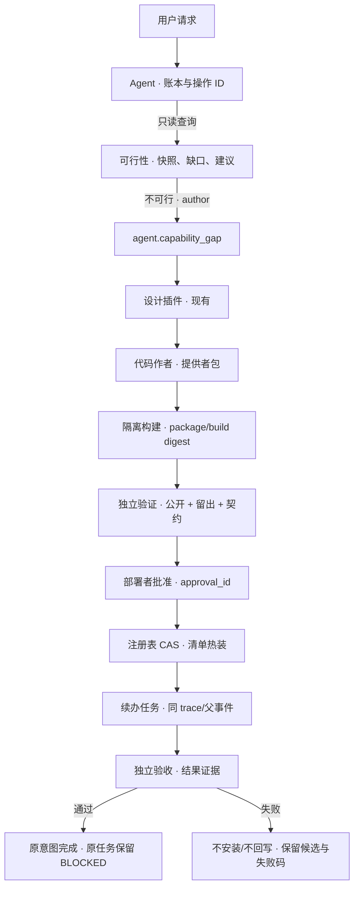

# SDD-047 从能力边界到可部署提供者的受控自进化

**阶段状态见文末变更记录。** 本文是 P0–P3 的实施前规格，截至 2026-11-19 无实现，全部 AC 待验。基线为 `feat/sdd-046-recording-showcase` 工作树；最近一次全量通过记录为 `87631f2e`（`sdd-045/release/20261119T044218Z-93c42ab7`，21 阶段）。本文只写计划，不把计划写成验收结果。

## 背景与价值

当前 Agent 已经能在“预授权、单步、只读、可机械验证”的范围内自己补能力：`plugin-author` 从 `planner.capability_missing` 的受阻任务生成派生声明，`plugin-manager` 在策略逐字匹配时发布并续办（[SDD-012](SDD-012-authored-software-tools.md)、[SDD-014](SDD-014-authored-software-provider.md)、[SDD-017](SDD-017-plugin-design-watch.md)）；文本作者能从设计草稿生成一个受限 Python 表达式，经部署者批准后热装（[software_author_watch.py](../../client/software_author_watch.py#L18-L37)）。这条链路证明“发现缺口→验收→发布→续办”是可行的，但产物形态只有两种：JSON 声明和单表达式，无法交付一个带依赖、入口、健康探测和独立验收的新提供者。

一个可复现的输入：

```
用户请求：检查这组采样时间戳的重复与回拨：[100,110,110,95,110,140]
当前结果：BLOCKED / planner.capability_missing。
          derived 的字段换算与 series 的 diff/abs/sort/unique 都无法表达
          “重复计数 + 回拨计数 + 最大正向间隔”。
期望结果：系统识别缺口，生成并验收一个只读提供者，安装后沿原 trace 续办，
          得到 duplicate_count=2、backward_count=1、max_forward_gap_ms=30。
          任一步失败：原任务保持 BLOCKED，不安装任何东西，保留失败候选。
```

现在要完成同样的事，必须由人把 [timestamp-audit](../../examples/timestamp-audit/README.md) 这类样板手工部署。也就是说，**系统能“补声明”，不能“交付代码”**；这正是上一轮结论里“自进化的瓶颈不是生成，而是构建、独立验收和授权”的具体表现。

| 当前入口 | 已有保证 | 本提案补足的行为 |
|---|---|---|
| `client/plugin_author_watch.py`、`agent/author_tool.py` | 只对 `agent.blocked` 且错误码为 `planner.capability_missing`/`planner.not_configured` 的未派发任务生成派生声明；候选写入私有卷 | 缺口事件携带目标、产物和候选接口，供“代码型提供者”路径复用；不改变原派生路径 |
| `client/software_author_watch.py`、`client/software_release.py` | 从设计生成一个受限表达式；`publish` 必须带 `--approve <artifact_id>` | 提供者包成为独立、可构建、可复现的交付单元；批准绑定包、构建和留出样本三个摘要 |
| `agent/plugin_descriptor.py`、`agent/v2_registry.py`、`agent/runtime_plugins.py` | 描述符、CAS 发布、draining、旧 binding 保留 | 复用同一注册与生命周期，不新建插件框架；新增“包校验”和“模型覆盖”两个薄层 |
| `agent/service.py::worker`、`agent/planning.py::catalog` | 计划冻结、操作 ID、验证后置条件、按原 binding 派发 | 新增只读可行性查询和目标记录，使缺口在派发前可解释；不改动运动内核与终态写入者 |
| `console/server/*`、`sessions_plugin/`、`evidence/` | 按游标读取事实，Session/Evidence 独立只读 | 新增 gap/build/verify/approve/install 事件，沿用既有归档与来源校验 |

**本次不解决什么。** 目标级重规划、修复策略插件、替代能力选择属于后续 SDD-048；物理动作与运行中代码热替换仍按 [SDD-045](SDD-045-plugin-tracks.md) 的 physical 轨道，不在本规格内；开放式任意代码、多轮澄清对话、跨机器人调度和 provider 市场也不在范围内。先做“代码型提供者的受控交付链”，是因为没有它，目标循环只能在既有工具之间重排，无法真正扩大能力边界。

## 设计与契约

### 边界：什么可以插件化，什么不能

| 可插件化（本规格新增或沿用） | 不可插件化（保留在内核） |
|---|---|
| 能力模型（站点覆盖）、提供者包、验证器、修复策略（后续）、会话/证据/视图 | 任务账本与操作 ID、效果与授权判定、验证裁决、批准与注册表 CAS、事件归档、运动准入与急停 |
| 提供者的实现语言、依赖和运行方式 | 谁可以写注册表、谁可以批准、谁可以宣告任务成功 |

模型、提供者和验证器都可以换；**“谁有权说完成”和“谁有权安装”不能随提供者一起换**。这条边界沿用 [SDD-045](SDD-045-plugin-tracks.md) 的双轨结论，不在本规格里重新设计。

### 扩展点与所有者

| 项目 | 本次设计 |
|---|---|
| 扩展入口 | 沿用 `plugin-author`/`plugin-manager` 的缺口事件、现有注册目录与 `plugin-admin`；新增“提供者包”工件和“能力模型”数据文件。不新增插件框架，不改 `plugins/*.json` 的 v1 读取路径。 |
| Definition | 能力模型（`contracts/capabilities/<id>.json`，站点所有；`contracts/` 已由部署生成器整体投影，不需新增白名单）；提供者包（`provider.json` + `impl/` + `tests/` + `deps.lock`，作者所有）；可行性结果（`schema_version=1`，只读）。三者都有稳定字段、内容摘要和错误码。 |
| Provider | 包由隔离构建器产出 `package_digest`；有 `Dockerfile` 时另记镜像摘要，无 `Dockerfile` 时用固定基础镜像只读挂载包运行；默认无网络、无设备挂载、只读根文件系统、受限 CPU/内存/pids；入口由 `provider.json` 固定。 |
| Consumer | `agent/capability_catalog.py`（新，只读）、`agent/planning.py`、`agent/service.py::worker`、`client/plugin_author_watch.py`、`client/software_author_watch.py`、`client/plugin_manager_watch.py`、`plugin-admin`、Console 事件读取。缺失模型或包时各自返回稳定码，不静默回退。 |
| 状态所有者 | Agent 持有任务、目标记录和操作 ID；部署者持有批准与注册表写权限；构建器持有构建记录；提供者持有自己的操作账本。能力模型由站点维护，作者不能写。 |
| 上下文与证据 | 事件携带 `task_id`、`trace_id`、`goal_id`、`gap_id`、`package_digest`、`build_digest`、`approval_id`、`snapshot`、`parent_event_id`；拒绝时保留原始候选摘要和未验证身份。 |
| 宿主变更 | 最小改动：Agent 增加只读目录门面、目标记录列（additive）和 `POST /agent/feasibility`；注册表增加包校验和批准字段（additive）；`worker` 只在续办任务上复用既有派发路径。不改 Core/Gateway 的运动授权、Console 写路径和既有 v1 计划格式。 |

五个决定：

1. **能力模型是站点覆盖，不是描述符 v3。** 现有描述符读取器对未知字段严格拒绝（[plugin_descriptor.py](../../agent/plugin_descriptor.py#L19-L22)），改描述符会要求“先升级所有读者”。模型单独成文件，按 `(id, version, content_digest)` 绑定，避免这个升级顺序问题；同时把“风险”留在站点侧，防止提供者自报低风险。
2. **提供者包不是新插件类型。** 它最终仍导出 v1/v2 能识别的 Tool 清单，复用现有注册、binding、draining 和事件；新增的只是构建与批准工件。
3. **本规格生成的提供者只允许 `effect=read`。** `idempotent` 需要提供者自己的持久操作账本，`actuation` 需要设备租约和停稳证据，两者都走人工部署，不进入自动路径。
4. **批准不能自批。** 作者、构建器、验证器、批准者四个角色中，验证器与批准者不能由作者或构建器兼任，且验证器与批准者彼此独立；Agent 对注册表只读。
5. **目标记录只做“缺口与续办”的载体。** 本规格记录 `outcomes/constraints/budget` 并在续办时核对，但不做 replan、替代选择和修复策略；这些留给 SDD-048。

### 能力模型（P0）

站点文件，按能力标识和内容摘要绑定；`contracts/` 已由部署生成器整体投影，站点可用 `EDGE_CONTRACTS_DIR` 指向自己的 `capabilities/` 子目录，模型不写入镜像：

```json
{
  "schema_version": 1,
  "capability": {"id": "timestamp.audit", "version": "1.0.0", "content_digest": "sha256:<64 hex>"},
  "owner": "deployment",
  "requires": [{"fact": "arguments.timestamps_ms", "ttl_ms": 0}],
  "outcomes": ["timestamp_audit"],
  "postconditions": [{"outcome": "timestamp_audit", "verifier": "timestamp.verify", "schema_ref": "timestamp/result@1"}],
  "cost": {"p50_ms": 20, "max_ms": 200},
  "risk": {"level": 0, "reversible": true, "approval": "site"},
  "tags": ["time", "read-only"]
}
```

- **缺失模型**：记录为 `model_missing`。`effect=read` 的旧工具仍可被规划，但可行性结果标为 `unknown` 并给出警告；`idempotent`/`actuation` 在缺失模型时拒绝。
- **模型变更**：只影响下一次规划；已冻结计划继续使用原 `model_sha256`。模型摘要进入计划证据，便于回放。
- **站点收紧**：模型只能收紧描述符声明的 `requires`，不能扩大；扩大由描述符版本变更完成，需重新发布。
- **风险等级**：0=只读，1=幂等，2=可逆动作，3=不可逆动作。本规格的自动路径只接受 0；其他等级需要站点批准记录。

### 可行性边界（P0）

只读接口，供用户、规划器和外部 Agent 在派发前查询：

```
POST /agent/feasibility
{"schema_version":1,"text":"检查这组采样时间戳的重复与回拨：[100,110,110,95,110,140]",
 "outcomes":["timestamp_audit"],"constraints":{"max_risk":0,"deadline_ms":120000}}
```

```json
{"schema_version":1,"snapshot":"catalog-<utc>-<short>","goal":{"goal_id":"...","outcomes":["timestamp_audit"]},
 "feasible":false,
 "gaps":[{"kind":"capability","code":"planner.capability_missing","missing":["timestamp_audit"],
          "suggested_action":"author","candidates":[]}],
 "blockers":[],"alternatives":[],"questions":[]}
```

- **缺口类型**：`capability`、`health`、`policy`、`information`、`resource`、`conflict`。每类只对应一个稳定码，见错误码表。
- **建议动作**：`derive`（现有派生路径）、`author`（本规格的提供者包）、`deploy`（需人工部署）、`human`（无自动路径）、`none`。建议不构成授权。
- **确定性**：候选按 `id` 排序，同一快照、同一输入产生相同结果；响应带 `snapshot`，后续派发必须核对快照或重新查询。
- **无副作用**：接口不写任务、不派发、不消耗 `operation_id`；只读目录和健康状态，超时返回 `goal.infeasible` 而不是部分结果。
- **边界声明**：响应中的 `questions` 只提出歧义，不开启多轮对话；本规格不做交互式澄清。
- **事件**：每次不可行查询写 `agent.capability_gap`，包含 `goal_id`、缺失产物、`suggested_action` 和快照；`plugin-author` 可订阅它，但订阅不等于授权。
- **性能**：参考工作站、200 个能力的目录，p95 目标 ≤200 ms；实测值写入证据，不达标不宣告通过。

### 提供者包（P1）

```
provider.json
impl/                 # 入口与源码，只读挂载
tests/cases.json      # 公开样本，作者可见
tests/cases.sha256    # 公开样本摘要
deps.lock             # 依赖锁定；标准库为空
Dockerfile            # 可选；基础镜像按 digest 固定
```

```json
{
  "schema_version": 1,
  "id": "timestamp.audit",
  "version": "1.0.0",
  "description": "检查一组采样时间戳的重复与回拨",
  "effect": "read",
  "parameters": {"timestamps_ms": {"type": "string", "maxLength": 4096}},
  "outcomes": {"timestamp_audit": "timestamp/result@1"},
  "entrypoint": ["python3", "-B", "impl/provider.py", "--bind", "127.0.0.1"],
  "health": {"path": "/health", "ttl_ms": 5000},
  "resources": {"cpu": 0.25, "memory_mb": 128, "pids": 16},
  "network": "none",
  "mounts": [],
  "dependencies": [],
  "verifier": "timestamp.verify"
}
```

包级约束（构建前静态校验，违反即拒绝，不启动构建）：

- `effect` 只能是 `read`；`network` 只能是 `none`；`mounts` 只能为空；不得声明设备、GPU、特权或宿主路径。
- 依赖只允许标准库或站点白名单内的锁定包；`deps.lock` 必须覆盖全部依赖摘要。
- 禁止 `subprocess`、`os.system`、`eval`、`exec`、`ctypes`、动态导入、写 `/tmp` 以外的文件；`/health` 必须无副作用。
- 不得声明自己的验证器为唯一验收方；`verifier` 只是建议，实际验收器由站点在批准时绑定。
- 包内不得包含留出样本、批准凭据、注册表写权限或主机 socket。
- 包内的 `outcomes` 只在构建、验证和批准阶段使用；安装时由 `plugin-admin` 或部署脚本转换成现有清单的 `outcomes` 字段，模型仍然只看到既有的 Tool 描述。

### 隔离构建与独立验收（P1/P2）

1. **构建**：隔离容器、无网络、源只读、固定基础镜像 digest；记录文件清单、文件哈希、基础镜像 digest、构建器版本和 `package_digest`；有 `Dockerfile` 时另记镜像摘要。同源两次构建必须得到相同 `package_digest` 与清单；不可复现即 `provider.build_unreproducible`。
2. **公开样本**：作者可见，用于开发；构建后由构建器执行，失败即 `provider.cases_failed`，不入批准队列。
3. **留出样本**：批准者持有，不进入包、不挂载给作者/构建器；在独立验证器中执行，失败即 `provider.holdout_failed`，不生成批准。
4. **契约探针**：同一 `operation_id` 重投幂等；版本不匹配拒绝；非法参数返回稳定码；进程崩溃重启后不重复副作用；超时进入 `RECOVERY_REQUIRED`/`tool.outcome_unknown` 而不是成功。沿用 [provider_contract.py](../../tests/system/provider_contract.py) 的检查项。
5. **批准记录**：`approval_id = sha256(canonical_json({package_digest, build_digest, holdout_digest, approver, policy_version}))`；批准者核对实际包、构建记录、留出结果与旧版本差异，写入注册表历史。任一摘要不匹配即 `provider.approval_mismatch`。
6. **安装**：批准后才允许把提供者清单原子写入 `plugins/<id>.json`（或站点 `EDGE_PLUGINS_DIR` 的等价位置），包代码由 `package_digest` 或镜像摘要固定，不在插件目录展开；注册表 CAS；安装事件含三个摘要和批准者。作者身份不能写注册表或批准记录。

### 端到端流程（P3）



1. 原任务进入 `BLOCKED`，记录 `goal_id`、缺失产物和快照；**不生成操作 ID**。
2. 可行性查询写 `agent.capability_gap`，`suggested_action=author`；`plugin-author` 只处理带来源的 gap，不接受用户直接注入。
3. 设计插件按已安装契约产出草案；代码作者把草案转换成提供者包，**不直接写注册表**。
4. 构建器产出 `package_digest`/`build_digest` 和公开样本结果；验证器在独立环境跑留出样本与契约探针。
5. 批准者绑定三个摘要和策略版本；注册表 CAS 安装；清单原子替换。
6. `plugin-manager` 用原 trace、`parent_task_id`/`parent_event_id` 提交续办任务，触发来源固定为 `plugin.supervisor`，并固定新工具版本。
7. 续办任务按正常规划/派发/验收执行；成功只证明**新任务**完成，原任务保留原失败记录；失败不回滚已批准版本，但禁止继续续办，保留证据。

### 生命周期与旧行为

| 场景 | 新请求 | 已受理/在途工作 | 证据、资源与责任方 |
|---|---|---|---|
| 安装 / 首次发现 | 批准前不可见；安装后下一次规划可见 | 在途计划继续用旧 binding；不追改已冻结步骤 | 安装事件含包/构建/留出/批准摘要；注册表只由部署者写 |
| 依赖缺失 / 冲突 / 断连 | 包校验或健康探测失败即拒绝准入，返回稳定码 | 已安装的旧版本继续服务；不静默换绑 | 校验器记录缺失项；提供者健康 TTL 与最后一次成功探测 |
| draining / 卸载 | 新目标得到 `provider.draining`，不进入候选 | 已有引用等待归零；超时保留 `cleanup_incomplete` | 排空计数、最后引用、清理结果；未释放资源不得记为已卸载 |
| 换版 / 旧 binding | 新版本只服务新计划；旧计划保留原版本与摘要 | 旧版本在途完成后才可排空；不允许同名覆盖 | CAS 冲突码；回退用上一份包/镜像摘要与批准记录 |
| 超时 / 崩溃 / 重启 | 构建、验证、批准均按 `request_id` 幂等重放 | 已提交操作按 `operation_id` 对账；未知结果不重做 | 构建记录、批准记录、提供者操作账本；崩溃窗口保留原请求 |

快照与绑定：规划使用一次目录快照；派发时重新核对 `version + binding`。安装、draining、模型变更只影响下一次规划，不改变已冻结计划。旧任务没有 `goal_id` 时按原路径执行，`goal_id=null`，不补写、不改写历史。

### 错误码与证据

| 码 | 触发 | 对调用者/维护者的影响 |
|---|---|---|
| `goal.infeasible` | 无可行路径，或可行性查询超时 | 任务 BLOCKED；给出缺口、建议动作和快照；不派发 |
| `capability.model_missing` | 候选没有站点模型 | 只读旧工具可带警告使用；幂等/动作拒绝 |
| `capability.draining`、`capability.missing` | 候选正在排空或不存在 | 不进入候选；给出替代或建议动作 |
| `health.stale`、`policy.denied`、`goal.ambiguous`、`resource.exhausted` | 事实过期、风险超限、歧义、预算不足 | 分别阻断并给出可核对原因；不合成为“不可用” |
| `catalog.conflict` | 同一 ID 多来源且无优先级 | 拒绝该候选，保留来源清单，交部署者裁决 |
| `provider.schema_invalid`、`provider.import_forbidden` | 包字段/导入/网络/挂载/验证器不合规 | 构建前拒绝；零容器启动 |
| `provider.build_failed`、`provider.build_unreproducible` | 构建失败或两次摘要不同 | 不入批准队列；保留构建日志与源摘要 |
| `provider.cases_failed`、`provider.holdout_failed`、`provider.contract_failed` | 公开、留出或契约探针失败 | 不生成批准；原任务不变；候选留档 |
| `provider.approval_mismatch`、`provider.registry_conflict` | 摘要不匹配或 CAS 冲突 | 拒绝安装；保留原活动版本与批准记录 |
| `provider.runtime_unavailable` | 提供者不可达/健康失败 | 续办任务按原操作对账；未知结果进入待核查 |

所有事件沿用 ModuleJournal 的 `schema_version/event_id/parent_event_id/trace_id/source`，写入既有归档；证据目录按 `artifacts/verification/self-extension/<run-id>/` 保存 gap、包、构建记录、留出结果、批准记录、续办任务和回退记录。

## 验收与证据

| AC | 输入 / 故障 | 可独立观察的预期 | 测试入口 | 实测结果 / 证据 |
|---|---|---|---|---|
| AC-1 | v1 Tool、v1 Service、derived、v2 soft、physical 相机各一个；一份完整模型、一份缺失模型 | 目录返回统一记录；缺失模型显式标 `model_missing`，不伪造默认风险；同 ID 冲突返回 `catalog.conflict` | 待实现：`tests/test_capability_catalog.py` | 待验 |
| AC-2 | 提交“检查这组采样时间戳的重复与回拨：[100,110,110,95,110,140]”，目录无对应能力 | `feasible=false`，gap 为 `capability`，`suggested_action=author`，带 `goal_id`；任务 BLOCKED，无 `operation_id`，提供者调用数 0 | 待实现：`tests/test_feasibility.py`、`tests/system/feasibility_acceptance.py` | 待验 |
| AC-3 | 里程计过期、请求动作超风险、输入“去那边”、磁盘水位超限 | 分别返回 `health.stale`、`policy.denied`、`goal.ambiguous`（questions 非空）、`resource.exhausted`；四类均不派发 | 待实现：`tests/test_feasibility.py` | 待验 |
| AC-4 | 可行性查询与 200 个能力的目录 | 无写副作用、无操作 ID；同快照同输入结果一致；参考工作站 p95 ≤200 ms，超时返回 `goal.infeasible` 而非部分结果 | 待实现：`tests/test_feasibility.py` | 待验 |
| AC-5 | 缺字段、未知 effect、含 `subprocess`/`eval`/网络/设备/自验证器、依赖未锁定 | 构建前拒绝，码为 `provider.schema_invalid`/`provider.import_forbidden`；容器启动数 0 | 待实现：`tests/test_provider_package.py` | 待验 |
| AC-6 | 同一源构建两次；构建器无网络 | `package_digest` 与文件清单一致；记录含基础镜像 digest、文件哈希、构建器版本；两次不一致返回 `provider.build_unreproducible` | 待实现：`tests/system/provider_build_acceptance.py` | 待验 |
| AC-7 | 公开样本通过、留出样本失败 | 不生成 `approval_id`，不写注册表，原任务状态与证据不变；留出样本摘要与公开样本摘要分开保存 | 待实现：`tests/system/provider_holdout_acceptance.py` | 待验 |
| AC-8 | 重复 operation ID、版本不匹配、非法参数、进程崩溃重启、超时 | 幂等、稳定拒绝码、无重复副作用；超时进入 `RECOVERY_REQUIRED`/`tool.outcome_unknown` 而非成功 | 待实现：`tests/system/provider_contract.py` 扩展 | 待验 |
| AC-9 | 篡改包/构建/留出任一摘要；作者尝试写批准；并发安装 | 返回 `provider.approval_mismatch`/`provider.registry_conflict`；作者无写权限；原活动版本不变 | 待实现：`tests/test_provider_registry.py` | 待验 |
| AC-10 | 安装后新任务与在途任务并存；draining；卸载 | 新任务下一次规划可见；在途计划保留原 binding；draining 拒绝新绑定；卸载后旧任务证据可读 | 待实现：`tests/system/provider_install_acceptance.py` | 待验 |
| AC-11 | 缺口触发续办；提供者成功完成原意图 | 续办任务与原任务同 `trace_id`，有 `parent_task_id`/`parent_event_id`；原任务保留 BLOCKED；提供者调用计数不重复 | 待实现：`tests/system/self_extension_acceptance.py` | 待验 |
| AC-12 | 撤下新版本、恢复上一版、重启 | 恢复后旧任务与证据可读；重启不自动重装被撤下的包；回退记录含操作者、时间与三个摘要 | 待实现：`tests/system/provider_rollback_acceptance.py` | 待验 |
| AC-13 | 现有 derived/text/Evidence/Session 工具、旧任务、旧描述符 | 行为不变；旧任务可打开；`compose.hardware.yaml config --quiet` 通过；相关系统阶段通过 | 待实现：现有套件 + `tests/test_selection.py` 新规则 | 待验 |
| AC-14 | 完整链路后按 task/trace/goal 查询与导出 | 每个阶段都有事件和稳定码；从归档可重建决策输入；NDJSON 导出可读；缺失区间显式标注 | 待实现：`tests/system/self_extension_acceptance.py` | 待验 |

测试入口为计划，不代表已存在。实现 PR 必须同时更新 `tests/test_selection.py` 的规则与断言，至少覆盖 `agent/capability_catalog.py`、`agent/feasibility.py`、`client/provider_build.py`、`client/provider_verify.py`、`agent/provider_registry.py`；新增系统阶段建议命名为 `capability-model`、`provider-build`、`provider-install`、`self-extension`。仿真、指令集模拟、真实模型、物理板卡分别标通过/失败/跳过/待验；本规格不产生物理动作，也不以仿真结果推断真机能力。

评估指标必须分开统计，不能用“安装成功”代替任务成功：原任务最终完成数、续办任务完成数、留出样本通过率、真实任务成功率、人工介入次数、提供者调用计数、误报成功数（目标为 0）、从缺口到安装的耗时。零成功时报告失败总数和已耗预算，不报告比例。

## 迁移与回退

| 阶段 | 交付边界与开关 | 数据与兼容 | 独立回退 |
|---|---|---|---|
| P0 能力模型与可行性 | 新增 `contracts/capabilities/` 模型目录、只读目录门面、`POST /agent/feasibility`、gap 事件；`EDGE_CAPABILITY_MODEL=1`，默认 0 | 无数据库迁移；模型按摘要绑定；旧 `/agent/capabilities` 响应保持原字段 | 关闭开关即回旧路径；模型文件可整体移除，不影响既有工具 |
| P1 提供者包与构建 | 新增包 schema、静态校验、隔离构建器、公开样本执行；`EDGE_PROVIDER_BUILD=1`，默认 0 | 构建工作目录在部署状态卷，构建记录与证据写入 `artifacts/verification/self-extension/<run-id>/`；不写注册表、不改运行服务 | 停用构建器并删除构建记录；现有插件与任务不受影响 |
| P2 独立验收与批准 | 留出样本、契约探针、批准记录、注册表包校验；`EDGE_PROVIDER_INSTALL=1`，默认 0，硬件部署默认 0 | 注册表新增表/列均为 additive；旧版本与旧任务保留；批准记录不可改写 | 撤下包并恢复上一版摘要；保留批准与失败记录；旧任务仍可读 |
| P3 续办与评估 | 续办任务、评估集、回退演练；`EDGE_SELF_EXTENSION=1`，默认 0 | 续办沿用现有 `plugin.supervisor` 触发规则与 trace 约束；原任务不改写 | 关闭开关；在途任务按原计划完成；新缺口保持 BLOCKED，等待人工 |

**上线顺序**：目录读者 → 可行性 → 构建器 → 独立验证器 → 批准与注册表校验 → 安装 → 续办。任何时候 `EDGE_PROVIDER_INSTALL=1` 之前必须已有 `provider.approval_mismatch` 的拒绝路径；作者、构建器、验证器不得共享可写注册表或批准凭据。

**安全边界**：构建与运行默认无网络、无设备挂载、只读根文件系统、受限 CPU/内存/pids；留出样本从不出现在作者或构建器可见的路径；批准者使用独立身份与存储；包、构建、留出、批准四个摘要写入事件和任务计划；注册表写操作只接受部署者身份。

**旧行为**：没有 `goal_id` 的旧任务按原路径执行；旧派生工具、文本工具、Evidence/Session 服务不改协议；旧描述符继续按 v1/v2 读取；本规格不改变 `core`、`gateway`、`console` 的终态写入与运动授权。回退后不自动重装已撤下的包，也不把失败候选提升为活动版本。

## 变更记录

2026-11-19，规格草案。原因：上一轮结论确认现有自进化只能产出派生声明与单表达式，无法交付新提供者；瓶颈在构建、独立验收和授权，而不是生成。路径：本文件。AC：AC-1 至 AC-14 全部为计划，实测列均为“待验”。基线：`87631f2e` 的 21 阶段全绿记录；本工作树在 `feat/sdd-046-recording-showcase`。本次只新增规格，未改代码、未启动容器、未运行机器人任务。同日用本地 Python 3.11.18 运行 `python scripts/check_sdd.py --base HEAD`（通过）、`python tests/document_contract.py -v`（3 项通过）、`python tests/repository_contract.py -v`（5 项通过）、`git diff --check`（无输出）；新文件为未跟踪 Markdown，尚未进入 CI。实现 PR 仍需以目标分支为基点重跑这些检查。下一步：维护者确认 P0 范围后，按 P0→P3 各开独立 PR；P0 不通过不进入 P1。
