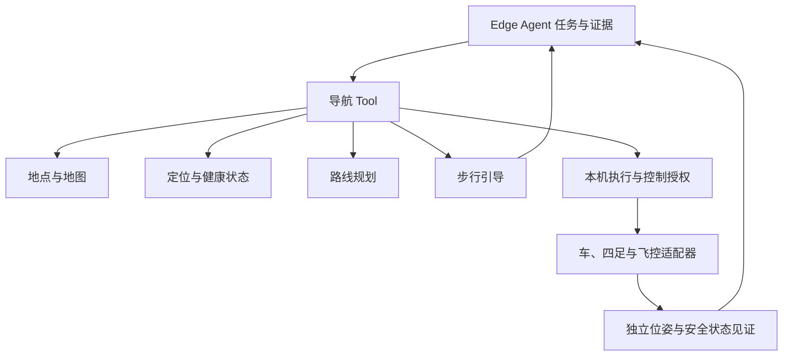

# SDD-051 多机体导航插件与控制交接

状态为部分实现。研发基线为 `4f48706`。Jetson 只读 Agent 运行 `41bfb88`，可选 CameraInfo 读者与多源网关运行 `9b5e667`。地面执行交接使用独立回放夹具。覆盖范围见下方验收表。

## 背景与价值

同一个 Edge Agent 需要在无人车、无人机、四足机器人及人携带的终端上受理导航任务。输入「去办公区附近」时，导航能力先解析地图中的地点，再按执行主体选可达入口和到达条件。车可选择可通行入口，四足可选择已验证的地面路线，无人机可选择经批准的室外观测区域，人的终端可给出步行指引。目的地名称相同也需要各自的目标几何、约束和回执。本文的「人」指携带手机或可穿戴终端的自然人。未来若接人形机器人，使用独立的运动 profile。

目前 [SDD-030](SDD-030-campus-robot-forms.md) 已验证一个校园 Agent 向独立机体 Agent 分派任务。Crazyflie 夹具覆盖竖直运动，四足与双足覆盖固定机体上的受控关节动作。现有仿真地面导航用预标注场景和局部坐标路点，Core 逐点验收 [到达](../../src/edge_core/src/core_node.cpp)。现有 Action 仅带操作号和 `x/y`，路点每轴限 ±4 m。Jetson 的双 MID‑360 投影、静止局部建图和 Nav2 路径试算已分别验证，真实运动未进入该验收。

导航域可以独立重构。把地点、地图、定位、计划和执行组织成可换的 Provider，复用现有 Agent 的任务受理、事件、冻结绑定、独立验收与回放。Legacy 导航保留为仿真和旧任务的兼容入口。跨 Edge 派工在单机契约通过后实施。

## 设计与契约

### 扩展点与所有者

| 项目 | 本次设计 |
| --- | --- |
| 扩展入口 | 复用 `Tool`、`Service Definition`、事件和 `pack/profile`。一个模型可见的 Tool 导出只有一个所有者。不同机体或算法用唯一 Service 名注册，由导航 Tool 按站点 profile 和健康快照绑定。保持 [v2 目录唯一性](../plugin-descriptor-v2.md)。 |
| Definition | 新增版本化导航输入、证据和生命周期契约。工具返回概括性结果与证据引用。正交的 Service 分别提供地点、地图、定位、规划、执行与验收。每次调用有期限、资源和结果大小上限。上限由站点 profile 声明和验收。 |
| Provider | 提案目录为 `navigation/`，公开契约投影到 `contracts/navigation/`。首个提供者对接 LingAo 的 ROS 2 Humble Nav2。后续加入四足、飞控和步行引导。处理实时 ROS、设备与机体控制的提供者用独立进程，隔离发行版和硬件依赖。 |
| Consumer | Agent 规划器消费能力、前置事实和输出条件。Agent 执行器保留 `operation_id` 和 binding。Console、Recorder 和过程验收器通过公开事实与事件读取。父 Agent 只消费子 Agent 的公开结果。 |
| 状态所有者 | Agent 持有任务与计划版本。地图服务持有不可变地图与命名地点。定位服务发布当前定位事实及连续性。机体本地执行网关持有操作账本、控制授权和资源交接。验收器持有独立判定与关键证据。 |
| 上下文与证据 | 沿用 `task_id`、`trace_id`、`operation_id`、`request_id` 和父事件关联。追加目标、机体、地图与路线引用，记录控制器原始状态和时间来源。原始点云、图像和轨迹通过有访问控制的工件引用留存。人端默认只保留指引状态和经同意的确认，保留期由站点配置。 |
| 宿主变更 | P0 使用现有目录和只读 Tool。P1 增加通用的受管物理执行接入和独立核验，保留 Core 停止与查账不变量。P2 增加任务目标、结果依赖及未派发步骤重规划。宿主按契约、效果与资源判断，机体算法由 Provider 选择。 |

### 能力与数据

| 调用 | 核心入参 | 结果与效果 |
| --- | --- | --- |
| `nav_locate` / `nav_resolve` | 主体、场地、可选地图引用或地点名 | 定位事实或地点候选，包括来源、有效性和歧义。消费已授权事实时为 `read`。 |
| `nav_plan` | 目标、主体、活动地图或地理基准、约束与时限 | 不可变路线引用、适用的定位与配置版本、预期到达条件或不可达原因。只读试算需要证明执行器不可达。 |
| `nav_execute` | 已核验的路线引用或版本化目标、主体、预算与站点授权引用 | `actuation`，返回可查询的原操作号、进度及候选结果，由独立验收器裁决。 |
| `nav_guide` | 路线引用、本人授权的会话或设备、呈现偏好 | 在本地端显示或播报指引。若创建会话则以操作号去重。回执 `guidance_delivered`，本人确认另记 `arrival_acknowledged`。 |
| 查询、取消 | 原 `operation_id` 和调用身份 | 查询是只读。撤销只影响原操作，返回取消受理、机体安全状态已确认或结果未知。取消入口在排空期间仍可用。 |

P0 兼容 [现有规划参数](../../agent/planning.py)，模型只传受作用域校验的标量引用，如 `actor_ref`、`destination_ref` 与 `route_ref`。Provider 以版本化 schema 解引用结构化目标。路线引用绑定主体、地图、定位代次及约束摘要，来自其他站点、主体或过期的引用拒绝。预留原生结构化参数为单独版本。带副作用的执行显式提供提交、查询与取消协议。

- **目标是带类型的值。** 支持地点 ID、受约束区域、平面位姿、三维位姿和地理目标。按类型校验必需字段。平面位姿含 `frame_id` 和时间，可约束朝向。三维目标表达空间位置及机体所需的姿态、方向或进入条件。地理目标采用确定的坐标基准，若使用高度则必须声明垂直基准。保留原始 SI 单位、ENU/NED 约定和转换凭证。不得把缺失高度解读为零。 [ROS REP‑103](https://github.com/ros-infrastructure/rep/blob/master/rep-0103.rst) · [ROS REP‑105](https://github.com/ros-infrastructure/rep/blob/master/rep-0105.rst)
- **地图与定位分别绑定。** 地图引用包含 `site_id`、`map_id`、`revision`、内容摘要及坐标基准。地图包可附二维栅格、地形或三维占据层、楼层拓扑、地点与区域约束。地理航行可绑定独立的地理基准和约束快照。定位事实含主体、来源、位姿、不确定性、采集时钟和连续性代次。重定位、坐标重置或数据源失去连续性时更新代次。普通障碍更新可触发同一上下文内的路线修订。
- **地图切换由本地所有者显式交接。** 每台机体只激活一个定位绑定及其 TF 权威。路线、地点和观测都引用对应地图版本。地图文件加载完成、TF 连通、定位可用是不同事实。常规换图先结清在途执行并确认机体安全状态，再加载、重定位和恢复准入。跨楼层、室内外及起降等跨域过程必须经过已建模的入口或转换，由支持该转换的提供者执行。 [Nav2 地图加载接口](https://github.com/ros-navigation/navigation2/blob/1.1.20/nav2_msgs/srv/LoadMap.srv)
- **传感器用站点配置组合。** 每个来源声明消息、采样时间及其时钟、安装外参、标定版本、质量和有效期。融合 Provider 选择已验收的组合与降级条件。灵遨首版可用单 MID‑360 和轮速定位，另一台雷达及 D435 先用于障碍观测验证，室外 RTK 单独提供全局参考。两台 MID‑360 的时钟同步、逐点时间与双雷达外参通过录包和实测后再启用紧耦合融合。

### 机体配置与验收证据

| 主体 | 规划与执行候选 | 控制所有者及验收 |
| --- | --- | --- |
| 无人车 | LingAo Humble Nav2。二维占据栅格、车体尺寸、运动学和现场禁行区。 | 底盘监督链独占速度输出。到达以任务地图中的新鲜位姿为准，停稳由独立观测确认。 |
| 四足机器人 | 平地可复用经型号验收的 ROS 规划。台阶、坡面与越障要求独立地形能力及厂商步态控制器。 | 本机控制器拥有步态。验收到点和稳定站姿，失联后以机体批准的安全状态作为交接条件。 |
| 无人机 | 首个候选为 PX4 多旋翼仿真。走空间路径、明确高度基准和批准的区域约束。其他飞行器另做 profile。 | 飞控拥有航迹执行及失联处置。验收三维位置及要求的悬停、返航或降落状态。悬停到点后飞控仍保有控制，释放资源还需要安全交接。 |
| 人携带 Edge | 使用室内拓扑、步行路线和无障碍约束，按本人授权提供指引。 | 本人决定行动。验收指引送达，另记录本人确认。可选定位佐证必须有单独授权，撤销授权后停止个体定位读取。首版终端通过公开 API 访问携带或附近的 Linux Edge。手机直接运行 Agent 需另行提供无 ROS 的入口。 |

机体 `profile` 由部署方持有，记录可实现的目标几何、所需传感器、适用地图、资源范围、允许的效果、机体安全状态和可接受的证据。运行健康快照另记录当下可用的定位、地图、依赖、资源及采样时效。普通工具声明仅用于发现。执行前由信任的网关重新核对 profile、目的地、绑定和授权。仿真通过只激活仿真 profile。 [Nav2 Humble Action](https://github.com/ros-navigation/navigation2/blob/1.1.20/nav2_msgs/action/NavigateToPose.action) · [PX4 多旋翼任务](https://docs.px4.io/main/en/flight_modes_mc/mission) · [PX4 失联处置](https://docs.px4.io/main/en/config/safety)

### 任务组合、控制授权与 AI 修复

任务表达想得到的结果、可用主体、时限、约束和可接受的降级。Agent 按已验证事实选择能力。空地图时可选择探索和制图，有合格地图时可直接解析地点和试算。用户要求「抵达」时，仅送达指引不会判定同一结果成功。在途步骤保持冻结，重规划只改变尚未派发的步骤。已确认停止后可用新操作执行不同方案，并保留对应的因果关系。

任务层与机体执行层各有独立的账本。不同主体可并行，软件查询与对应机体的运动也可并行。排他键使用实际机体及执行器资源。两种导航提供者指向同一个底盘时争用同一把锁。跨设备分派沿用 [校园父子任务](SDD-030-campus-robot-forms.md) 的可复用部分，补稳定 assignment 与公开结果协议。重启后通过原 assignment 查询原机体。失联或结果未知时，原机体的控制权保持待对账。换机执行须在原动作已结清且任务授权允许时另建子操作。

混合计划的软与物理绑定都接纳之前，禁止派发，冻结途中重启按同一计划续查。永久拒绝时清理该计划尚未派发的预约，并保留原拒绝证据。此要求扩展当前 [跨轨冻结](../../agent/plugin_tracks.py) 的故障边界。

物理派发前持久化 `operation_id`、请求摘要、路线及定位绑定、提供者版本、profile 摘要和控制器关联号。相同 ID、相同请求查询原结果，异内容拒绝。收到完成回执时，由独立验收方核对原操作、主体、目标地图及定位代次，并取动作后有效位置以及机体要求的安全状态。主体已在目标内时可由新鲜独立证据确认零运动完成。任务完成、取消已受理、控制权释放是三个不同事实。结果未知保留 `RECOVERY_REQUIRED`。底盘、步态控制器及飞控各自持有最后控制权和独立安全机制。 [底盘仿真交接](SDD-050-body-runtime.md) · [物理交接协议](../architecture/plugin-physical-handoff.md)

Agent 可依据证据自动恢复只读依赖、建议替代算法、查找仓库并修改候选代码。构建与回放在隔离环境，固定来源、依赖、目标架构及产物摘要，由独立验收通过后按站点许可发布。软插件允许按授权热换。运动代码和现场配置走部署批准与机体交接。候选作者没有注册表写权限或设备权限。[受控自扩展](SDD-047-bounded-self-extension.md)

### 生命周期与旧行为

| 场景 | 新请求 | 已受理与在途任务 | 接纳或释放证据 |
| --- | --- | --- | --- |
| 安装与发现 | 核对镜像、合约、profile 和健康后才发布 | 保持原 binding | 进程就绪、依赖有效、角色和镜像批准记录 |
| 依赖缺失或地图/定位冲突 | 返回可解释阻塞，如 `navigation.localization_stale` 或 `navigation.map_mismatch` | 原拥有者按机体策略取消或进入安全状态，持续查原操作 | 源身份、后端状态、停止或保留控制权的见证 |
| 排空与卸载 | 关闭新准入 | 读取和取消继续可用。软件等冻结引用释放，物理确认安全状态和旧授权撤销 | 原版本活跃数归零。旧进程退出和末端拒绝旧代命令分别取证 |
| 版本切换与回退 | 新请求绑定已批准的新版或上一个版本 | 原记录可回读。无法联系原提供者时留待对账 | 内容和镜像摘要、目录修订、依赖版本、机体交接回执 |
| 超时、崩溃及重启 | 受影响资源保持阻塞，其他工具继续 | 原操作号按账本查询。取消未确认和丢回执进入原结果对账 | 独立核对派发次数和当前控制者。未知结果期间不发第二个运动命令 |

现有 `observe`、`bench`、v1 API、仿真导航和旧任务按原入口继续。新 Tool 由明确的部署 profile 启用。当前 physical 控制器及 pack 验收以相机为试点，P1 需新增通用运动准入和原操作账本接入，并保持相机契约与默认权限不变。 [现有物理控制器](../../agent/physical_controller.py) · [描述符规范](../plugin-descriptor-v2.md)

## 验收与证据

| AC | 输入或故障 | 可独立观察的预期 | 测试入口 | 实测 |
| --- | --- | --- | --- | --- |
| AC-1 | 同一个地点目标，四种主体 profile | 根据已发布能力选择候选。地面、空间与步行路线类型不同，缺能力明确阻塞。同名地点歧义可见。 | 公开目录与路线测试 | 四种回放主体、地面栅格、空间与步行图通过。 |
| AC-2 | 两站同名 `map`、地图换版、定位重置、无垂直基准 | 旧路线被拒，同图实时障碍变化能重新试算。地图换版后只有新定位通过才可用。仿真探针看到错误目标的动作次数为零。 | 地图身份、路线和定位测试 | 跨场地、地图换版、错误定位代次及缺维拒绝通过。地理基准转换与动态切图待验。 |
| AC-3 | LingAo 仿真从 A 到 B、取消 ACK、假完成和失联 | 独立位姿和机体见证分别验证到达及停止。假完成不会成功。停止未知保留排他权。 | 地面回放物理协议 | 假到达、取消与独立停稳见证通过。LingAo 动力学与驱动待验。 |
| AC-4 | 重复任务、同 ID 异参数、执行与取消窗口重启、延迟旧命令 | 同一逻辑动作至多派发一次，差异请求拒绝。旧授权不能恢复运动，原操作与历史可回放。 | 地面回放与物理账本 | 原号重试、丢回执、旧租约故障夹具通过。实车端末级授权待验。 |
| AC-5 | 插件换版排空期间查询、复盘和在途动作同时发生 | 软件插件切换保留冻结版本和旧回执。物理替换需要交接。无关任务及相机旧契约可用。 | 软宿主与物理轨回归 | 冻结后排空、恢复和独立查询通过。板端在线加入可选传感器，Agent 实例保持。物理换版另行验收。 |
| AC-6 | 同一目标在空地图、有地图、定位中断三种条件下执行 | 以结果选择探索、复用或阻塞。已完成或未知步骤不重复派发。允许主体范围、预算和地图绑定有持久证据。 | P2 公开任务 API，录包、模拟服务和 Agent 重启测试 | 待验 |
| AC-7 | 四足地形能力缺失、无人机悬停与降落、用户撤销位置同意 | 四足只接已支持地形。飞控回执区分安全状态和资源释放。人端停止位置读取，历史保留期遵循配置，送达和确认分开。 | P2 至 P3 四足仿真、PX4 SITL、人端黑盒夹具 | 待验 |
| AC-8 | 两个机体同时执行，父 Agent 在子任务受理后重启 | 独立主体并行，单主体独占。按原 assignment 恢复，无再次派工。父任务成功引用独立验收结果。 | P3 双实例隔离 Compose 和独立见证 | 待验 |
| AC-9 | 未批准候选、不同架构或留出样本失败、已发布软插件回退 | 不合格候选无法发布。获准版本可撤回并回读旧任务，同一能力缺口可受预算地续办。 | 依赖 SDD-047 的隔离构建与发布准入验收 | 待验 |
| AC-10 | 软轨冻结后进程中断，物理轨永久拒绝 | 该计划零派发。未派发预约可回收。重启按原计划对账，其他任务可以继续。 | 混合冻结故障注入与 SQLite 重启 | 独立软宿主、物理账本与 Agent 账本夹具通过。已派发或结果未知的预约保持。 |

同一套协议测试与机体验证分开保存。分别标记模拟输入、ROS/Gazebo、PX4 SITL、实车、实飞和人端同意验证。新增消费者在 `tests/test_selection.py` 配置选测。现场放行按机型开展，已有 Jetson 只读证据用于 P0 参考。

## 迁移与回退

1. **P0 只读。** 整理 LingAo 的可重建 Humble 配置与依赖，单独部署 ROS 提供者，避免 Agent 宿主 ROS 发行版限制。先接定位、地图目录、语义解析和路线试算。加入两张地图和人端引导夹具。按旧版与新版双出口核对结果。
2. **P1 新导航执行。** 为目标、查询、取消和验收增加版本化接口。LingAo/Nav2 适配器登记原操作与 Action 标识，Core 的原任务锁、停止与对账约束迁移到通用执行入口。先完成隔离仿真和失联验收，随后由现场负责人对批准的实车 profile 验收。旧 `/edge/navigate_to` 仍供旧仿真和旧任务。
3. **P2 通用目标循环与第二机体。** 增加结果依赖和预算内重新规划，用同一接口接四足或 PX4 仿真的第二种运动提供者，继续验证人端引导。完成这一步才宣称协议跨机体可用。
4. **P3 多实例与机型验收。** 接入余下机体，逐个通过独立资格验证。将校园分派扩展成可恢复的 assignment，验证多主体并行和断连。自修复发布走 SDD-047，独立验证对账、回放和回退。

板端检查沿用 `sh scripts/robot.sh observe`、`sh scripts/robot.sh preflight` 与现有 `plugin-admin` 版本比较并交换。新导航 profile 及命令需要随对应实现交付。回退时关闭新准入，按原操作完成或确认安全，再由部署者恢复上一组合、原地图快照和批准的提供者，申请新的控制代次。保留原状态卷、地图、操作和取证记录。重启后检查原任务回执、旧版能力、无关任务和末端授权。

## 变更记录

S7，用户通过 Agent 提交一条日常物体测距请求。按固定模型识别物体，以同一彩色坐标系中的可见表面为测点，核验对齐深度、内参、时间差和来源摘要。返回整物体框、局部测点、光轴深度和从光心到测点的直线距离。无匹配、歧义、叶片归属或深度不充分时应说明原因。录像从原始 HTTP 提交开始，保留工具选择、取样、二维证据、三维结果与原操作的对应关系。部署仅增加只读软件能力，不取得机体运动、相机调姿或现有控制节点的权限。

2026-11-20，S7 在调整相机角度后的 Jetson Orin NX 上通过。用户直接提交定位盆栽的请求；同机模型识别与对齐深度回执给出 1.573 m 的可见叶面斜距。板端 CPU 运行时依赖的共享库以系统 alternatives 链接解析；启动器保留只读库链接和私有 Unix socket，实际模型进程在此环境完成推理。复测入口包括 `tests/test_object_grounding.py`、`tests/test_object_site.py` 和 `tests/test_direct_target_demo.py`。[现场任务与部署](../testing/navigation-plugins.md)

S7，用户直接提出查找日常物体的中文请求。新的只读 DSH Tool 将目标文字交给对象定位 Service。模型接收任务所选的同一张彩色图。目标区域、对齐深度、内参、模型摘要与坐标系共同约束回执。缺少模型、检测、可确认的前景表面或对应深度时应返回阻塞。新增工具可单独接纳，原静止融合和定位工具的发布版本、配置和回执继续可读。录像从 Agent 原生的用户请求开始。

**静态场景与只读工具的受控扩展。** S4，采样时间窗必须由同机体连续轮速和位姿见证覆盖。以部署外参把两路点云投到车体坐标并报告观测交集，缺证据时阻塞。S5，从原始彩色、对齐深度和内参按目标描述输出可核验的像素区域、光学坐标和来源，保留未知类别与深度失效。S6，记录无工具的原生受阻任务、板端组合候选、独立验收、预授权摘要、增量接纳及原文续办。候选仅能将已安装的只读服务公开为工具。续办冻结批准的软件绑定，保留父任务、发布事件、原 trace 和操作号。录制依据源回执画出结果。现有工作不会因新增工具而重新执行。

2026-11-20，S1–S3 在 Jetson 端保留了六路来源与实采视频。S4 由十次轮速观测见证静止，双雷达产生 103 个观测栅格。S5 在 D435 的 640×480 实拍中返回目标框和有深度支持的掩膜表面点。S6 在同机的新 Agent 实例只提交一次自然语言请求，受阻、验收、接纳和原文续办历时 4.659 秒。再次运行同一监督器保留验证文件、发布事件和终态回执，原操作派发总数保持一次。算法由开发者交付，现场自动产物为对已安装服务的工具发布提案。本次未在现场生成感知算法源码。相关命令、几何边界与回退见[现场测试](../testing/navigation-plugins.md)，发布身份和各阶段统计见[实测摘要](../../artifacts/verification/navigation-plugins/jetson-perception.json)。

本轮扩展现场观测验收。S1，以新的自然语言任务取得实时彩色像素、两路独立点云及里程计，任务中的每个工件引用能找到匹配摘要的字节。来源采样时钟、原坐标系和缺样原因保留。S2，分别留存任务原文、派发、插件回执、任务终态和同一时间段的现场帧，视频能区分连续观测和任务实际选中的帧。S3，图像与点云缓存有上限，负例覆盖过期、损坏或缺失证据，现场控制进程保持既有所有权。

### 本次开发的交付边界

| 提供者 | 拥有的数据和职责 | 可复用的消费者 |
| --- | --- | --- |
| 现场采集适配器 | 在部署授权的 ROS 话题上订阅，保留来源、帧、采样时间和协方差；只向事实出口写数据。 | 导航、巡检、诊断、记录均可订阅同一份事实。 |
| 观测与定位 Service | 读取已发布或回放的观测，按配置选择来源、检验时钟和标定、计算定位事实。 | 位置查询、制图和试算通过各自冻结的依赖调用。 |
| 地图目录和路线规划 | 解释机体与地点引用，按地图、通行条件和算法产生带摘要的路线。规划只持有读取权限。 | Agent 可单独查询观测、定位、地点或试算，也可将路线交给获准的执行器。 |
| 本地机体执行器 | 持有唯一资源、原操作、租约和交接，独立见证核验到点和安全状态。 | 本轮实现软件夹具；现场部署仅批准观测和试算。 |

本轮核验四项可观察行为。N1，两个独立定位来源和单来源均可按各自 profile 处理，缺样、错帧和过期应拒绝。N2，两个不同地图模型、不同机体与算法可以生成带绑定的路线，禁行或过期绑定被拒。N3，软件轨通过实际注册、冻结、调用和排空，物理夹具按原操作对账。N4，边缘 Agent 在实机只读传感器上完成任务，保留原任务、数据来源、路线或定位回执和可回放的记录。用例与现场结果在实现后补入。

2026-11-20 首稿以 `4f48706` 为基线，定义 AC-1 至 AC-10。本次实现采用已有 Agent 的工具发现、冻结、任务账本、Service 注入与软轨排空。物理回放沿用设备资源、原操作、独立见证和停稳交接。

N1、N2 和 N3 的软件证据来自 `tests/test_spatial_facts.py`、`tests/test_spatial_gateway.py`、`tests/test_navigation_planner.py`、`tests/test_navigation_pack.py`、`tests/test_navigation_physical.py`、`tests/test_soft_host.py`。两项板端录制已结束并通过导出核验，分别为只读路线试算和双传感器查询。[现场测试与回退](../testing/navigation-plugins.md) · [实机摘要](../../artifacts/verification/navigation-plugins/jetson-readonly.json)

首次现场接入发现 ROS 固定长度数组返回 NumPy 浮点标量，已在采集边界转换为 JSON 数值并增加回归。真实轮速提供起点，D435 提供可追查的内参工件。路线为合成栅格试算。相机断流降级和多位置源融合在隔离测试中验证。真实建图、双 MID‑360 时钟标定、RTK、动态避障和各机型实际运动须分别验收。
