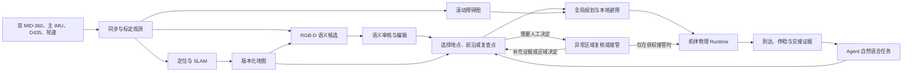

# SDD-058 轮式机器人室内外建图与语义导航

## 背景与价值

目标是在灵遨轮式车上标定两台 MID-360、一台 RealSense D435 和定位使用的 MID-360 内置 IMU。Edge Agent 从许可区域内的未知地图自主探索、补观测、标注和发布地图。操作员只处理需要判断或接管的异常。地图发布后，用户可以说「前往教学楼门外北侧等候点」，机器人用真实地图定位、绕开局部障碍，并在核验过的停靠位停稳。地图保留可编辑的语义和可选的三维纹理。

当前 `af959ca` 的 [SDD-051](SDD-051-unified-navigation.md) 已提供观测、定位、路线和物理交接契约。现场证据覆盖静止双雷达投影、相机内参和只读路线试算。试算使用合成栅格，D435 到车体外参和运动中的融合仍待实测。现有 [工装验收](SDD-038-rover-factory-calibration.md) 按单雷达配置采样和核验。[前沿选点](SDD-039-frontier-mapping.md) 和[累计地图](SDD-048-exploration-map.md) 已在 Gazebo 验证。当前地名解析读取站点定义的名称和别名。[Jetson 只读验收](../testing/navigation-plugins.md) · [现有地名解析](../../scene/layout.py)

`feat/sdd-056-rover-local-plan@dece488` 已含轮式局部规划和 SDD-057 场景图层契约。该工作树的后续开发还含 Gazebo 双机位 RGB 融合及 Jetson 单曝光纹理证据。实施时按可复现源码和证据逐项集成。校园任务台已有只读路径预览和隔离仿真执行入口，须按各自来源核验。车端 `nav_bringup` 的安装包来源、源码、ROS 发行版及执行链须在接入前盘点。

## 设计与契约

### 标定、同步和定位

1. **采集与身份。** 站点配置绑定设备序列号、角色、ROS 话题、安装版本、单位、采样时间来源与坐标系。保存两路带逐点时间的雷达、主 IMU、D435 彩色、原始和对齐深度、CameraInfo、轮速 `odom`、TF 和诊断。验证每台雷达的消息身份和不同的坐标帧。检测样本复用、乱序、掉帧或时钟重置。双雷达优先验证同一 PTP 主时钟，并从设备诊断验证锁定、偏移及漂移。D435 视频时钟单独测量与参考时钟的偏差和抖动。根据车速、角速度和目标距离为偏差设预算，运动时以 `(v + r·|ω|)·Δt` 估算时差带来的最坏位置误差。
2. **离线求解。** 将现有工装扩为多雷达、单定位 IMU 的版本化配置，兼容旧档案。用不同距离和朝向的靶板或空间基准测量 `base_link` 到 MID-360 A、B 及 D435 彩色光学帧的刚体变换。两台雷达共同视野有限时，用位置已测的多面工装连接两套观测。检查 RealSense 出厂内参、RGB 深度对齐、深度倍率和已知距离。以主 MID-360 的原厂 IMU 坐标和杆臂为先验，核对驱动应用的变换、重力方向、陀螺偏置与噪声。完整加速度计偏置及所有外参自由度需要足够的独立姿态和运动激励。可记录第二台 IMU 辅助诊断。
3. **独立复核并发布。** 留出靶位、测量标尺和受控运动片段，分别核对两台雷达的平面重合、激光到图像的重投影、RGB-D 深度尺度，以及缓慢转弯时去畸变后的墙面重影。标定包包含序列号、矩阵方向、有效配置、时间偏移、残差、数据摘要及审批。在线估计可监测漂移和提出候选版本，启用新外参要在停稳和复核后重新定位。标定录包只用于测量和验收，现场地图在自主探索任务中从空图建立。
4. **逐级融合。** 首选主 MID-360 与其 IMU 提供激光惯导里程计，轮速用于辅助估计或交叉核验。第二雷达和 D435 按各自采样时刻变换到车体，用于盲区覆盖、局部障碍和语义。跨雷达紧耦合和视觉紧耦合待录包对比后按机体配置启用。实时里程计拥有 `odom → base_link`，SLAM 或重定位服务拥有 `map → odom`，同一地图会话每段 TF 只有一个发布者。每点、每帧按采样时刻去畸变和转换。主定位失效或必要视野丢失时，机体进入等待或停车。只有经过覆盖验证的配置才允许降级运行。

[Livox MID-360 时钟与数据协议](https://livox-wiki-en.readthedocs.io/en/latest/tutorials/new_product/mid360/mid360.html) · [RealSense D400 数据手册](https://www.intelrealsense.com/wp-content/uploads/2024/10/Intel-RealSense-D400-Series-Datasheet-October-2024.pdf) · [FAST-LIVO2 与离线标定工具](https://github.com/hku-mars/FAST-LIVO2) · [ROS REP-105](https://www.ros.org/reps/rep-0105.html)

### 地图表达和标注

| 层 | 首版产物与消费者 | 版本和行为 |
|---|---|---|
| 定位与轮式通行 | 带位姿图或子图的定位资产，附 2D 占用栅格供全局规划和探索。保留原始观测引用和稀疏三维几何，支持重定位、回环和增量建图。 | 发布不可变 `map_ref`，含站点、楼层、版本、摘要、坐标系、标定版本。更新定位图后重新验收定位和目标。 |
| 实时局部环境 | 两路雷达与深度按高度、时间和来源形成滚动障碍图。滤除车体回波，保留占用、自由、未知和有效期，按实际扫掠轮廓生成轮式 2D costmap。 | 由观测更新。行人和临时物体可在短时跟踪层保留，不覆盖静态地图。无有效回波的区域保留未知。 |
| 三维与纹理 | 同一关键帧记录 XYZ、相机标定与 RGB。提供带色点云或按需网格，供查看与精细操作。未来飞行查询部署显式自由、占用、未知的三维体素或八叉树。 | 每层独立 Provider，保留采样来源和配准证明。纹理缺失时可继续使用已验证的通行图。无人机使用具备有效高度基准和三维净空的专用规划器。 |
| 语义 | 房间、门、地标和临时观测使用稳定实体 ID。房间范围、门牌锚点和可停靠的入口位姿是三个字段。 | 有独立的 `semantic_revision`，绑定对应 `map_ref`。保留名称、别名、候选/已确认状态、置信度、证据与编辑者。 |

自动标注用 OCR/检测在 D435 画面生成候选，从同步深度与激光几何取得三维位置，经多视角关联和同地图配准后显示在地图。以校园教学楼门厅为例，站点策略允许名称唯一、证据一致、入口可达且净空与权限合格时自动发布标签和停车位。遇到近似门牌、深度冲突或入口不可达，先自主补观测，仍有歧义才请人复核。编辑器允许在二维或三维地图核对证据、重命名、合并、拖动锚点、增删别名和修改停靠位，使用基于修订号的并发控制和撤销记录。语义修改进入语义版本，停靠位仍由当前几何和物理权限校验。回环或重新建图后，按关键帧锚点重投影并重新验证入口，旧任务可回读当时的版本。[Nav2 体素图层](https://ros-navigation.github.io/mkdocs.nav2.org/jazzy/configuration_and_development/configuration_guide/core_servers/costmap_2d/costmap_plugins/voxel/) · [OctoMap](https://octomap.github.io/)

### 建图、规划和执行

| 模块 | 提供与消费 |
|---|---|
| 建图会话 | 自主建图从空图及可定位的起点开始。任务绑定许可范围、禁区、速度、时间与距离预算。前沿插件在已知自由区内生成观测目标，通过同一个物理导航入口执行。每次到达后核对新观测和覆盖增益。会话保存地图检查点、定位代次、目标尝试和原操作号，支持增量续办。 |
| 全局规划 | 从已确认的房间入口解析目标。以 `map_ref`、定位代次、机体包络和区域限制为输入，生成可执行的走廊或路径。首选把可复现的 Nav2 接入现有导航契约。按实际底盘运动学选择栅格、Hybrid-A* 或 State Lattice 插件。 |
| 局部避障 | 从全局路线取滚动局部目标，以车身实际轮廓、速度、曲率和加减速约束求短时可行轨迹。静态障碍有净距才绕行，平滑后复检扫掠轮廓。行人横穿或遮挡时先减速或等待。久堵再由运行时申请全局重规划。SDD-056 的轮式方案在同一录包做对照，可按实测结果选择。 |
| 物理执行与复核 | 沿用 SDD-050/051 的机体独占授权和 operation_id。驱动输出只经持权网关，保留独立的障碍监测、失联看门狗和现场急停。从台架与低速试验测得延迟、制动距离和车身净距，写入机体 profile。到达需要核对同一地图入口位姿、持续停稳和控制权交还。停止状态未知时保留排他并对账。 |

建图阶段可用当前 ROS 2 链路跑二维回环基线，最终以可复现的 LIO、回环和重定位组合核对运动地图。现场验收包含重新启动后在已发布地图上定位。若复用 Nav2，先记录 `nav_bringup` 的容器镜像、包和参数、TF 发布者及输出链路。将计算路径、导航 Action 和反馈纳入适配器，跨区域长程目标走地图坐标中的受管动作。旧的逐轴 ±4 米路点接口可继续服务已有仿真用例。独立的软件碰撞监控可限速或阻挡输出，实际安全边界依靠实测制动与物理保护。[Nav2 规划插件](https://api.nav2.org/nav2-jazzy/html/md_nav2_smac_planner_README.html) · [Collision Monitor](https://docs.nav2.org/rolling/tutorials/general_tutorials/using_collision_monitor/)

### 自主补救与人工介入

| 观测或状态 | Agent 和 Runtime 的处置 |
|---|---|
| 前沿可达，定位与观测健康 | 结合覆盖增益、到达成本、目标关联和重定位机会选择下一观测点。按任务需要在探索、复查、地点查找和交付地图之间选择，单段结果由机体 Runtime 回执。 |
| 局部感知异常，仍可安全移动 | 对玻璃、深度空洞、点云与图像不一致、重复无增益或临时堵塞，在预算内换角度复查、等待或换前沿。疑似区域保留未知或待复核标记及证据，继续其它可达区域。 |
| 局部异常影响目标或覆盖，自动复查仍未解决 | 在前端标出受影响区域，给出原始观测、原因和已尝试方案。操作员可确认跳过、修正语义、标记禁行或指定补观测位置。许可范围内的补观测仍由 Agent 生成并执行，原任务继续维护同一建图会话。 |
| 定位失效、关键传感器失联、控制或停稳状态不明 | 本机停车并阻断后续运动。先按原操作号恢复事实。只有当前位姿、地图、必要观测及运动授权重新有效，才计算新目标。停稳状态无法核对时保留排他并请求人工处理。 |
| 操作员主动接管 | 取消当前动作并独立核对停稳后交接排他租约。释放接管后重新定位、读最新地图并选择下一目标，保留已建地图和任务 ID。未核验的旧动作进入对账。 |

覆盖以许可范围和实际观测为准。跳过、不可达和未观测部分保持未知或待复核。可达前沿耗尽、预算用尽或只能等候现场处理时，交付带未完成范围和原因的部分地图。

### Agent 与 DSH 的关系

- **原子事实服务。** 复用 `sensing.observations`、`localization.position`、地图与场景查询。校准仓、语义仓和地图仓分别管理本模块发布的版本。Agent 可根据任务组合观测、查询和路线试算，人工流程也可消费相同服务。障碍处理、定位、轨迹刷新和停车在机体本地运行，按测得的延迟预算验收。
- **任务级能力。** 复用 `nav_resolve`、`nav_plan` 和已设计的 `nav_execute` 物理适配器。建图会话与语义编辑各自受权。Agent 通过目录选择前沿策略、复查或语义工具，以覆盖、定位质量和任务目标决定下一步。缺少已确认地点时，可在同一请求已有探索授权的区域中自主查找。需要超范围或现场判断时请求用户。解析出已确认地点后，核对入口、机体配置和地图版本，再提交物理动作。
- **冻结与装卸。** 在途任务持有地图、语义、标定版本、定位代次、机体 profile、Provider binding 和原操作号。纹理、OCR 或只读路线试算服务可按现有软件注册机制排空、替换和回退。建图持久状态有检查点，建图与定位发布者交接要先冻结发布并验证 TF 连续性。物理路径换版要求停稳、撤权、交接和新版本验收。服务恢复先按原号对账。算法模型只读时可在隔离环境验收，运动、急停和标定发布继续走部署审核。
- **前端与回放。** 沿用校园观测台的全局与局部联图。分别显示全局路线、当前执行轨迹或只读建议、实际里程计轨迹。建图时显示已覆盖区、下一观察点、待复核区和选点依据。需要人工时显示影响、观测证据与可用决定。导航时显示 目标地点的来源、适用区域、当前目标与暂停原因。保留自然语言原文、初始与停止位姿、定位质量、图层和版本、重规划及停稳证据。
- **其他机型与 VLN。** 共享地图和位置事实、语义目标、操作生命周期及证据。各机体声明所需地图类型、目标和轨迹类型、可达性与停止语义。VLN 或端到端策略可用相机观测和语言产生候选，经本机和现场验证后进入相同的物理准入。具备三维能力的机型按 XYZ 使用自身的净空、动力学和飞控适配器。

## 验收与证据

| AC | 关卡 | 独立观察 |
|---|---|---|
| AC-1 | Jetson 只读盘点、静止标定、受控运动录包及离线复放 | 用留出靶位复核外参与深度尺度，核对单调时戳、时差、TF 和转弯重影。交换设备、错时、丢 TF 和坏标定分别拒绝注册融合。保存原始包及质量报告。 |
| AC-2 | 自主空图建图、发布、重启后在两处重定位 | 从起点自行选择前沿，正常场景无需人工驾驶或逐点审批。以独立控制点和现场几何测量地图比例、门宽、实际覆盖、回环误差和重启定位。以通道余量分配定位误差预算。 |
| AC-3 | 局部异常、全局故障及按需接管 | 注入玻璃或关门，验证机器人先自主换视角或绕行，在保留未知区的同时完成其余部分。注入定位断流和手动接管，验证停车、排他交接、原操作对账和同会话续办。 |
| AC-4 | 地点自动标注、异常人工复核与自然语言到达 | 唯一多帧门牌及合格入口可自动发布。注入近似名称、错误楼层、地图换版和旧别名，核对补观测或请求人工的条件，验证真实入口误差、停稳和任务原文。 |
| AC-5 | 静态绕障、动态横穿、不可通过及失联 | 先用 Gazebo 真值检验最小车身净距、停止距离、到达误差、候选/执行一致性和规划时延。再低速实车逐项复验。必需传感器失效、定位跳变或停止未经核对时不得继续。 |
| AC-6 | 可选图层停用、版本切换和审计 | 停用纹理与 OCR 后可用已发布地图和已确认地点执行任务。旧任务可重放。配准失效时拒绝跨来源合图。核对插件替换、定位重启或 Agent 重启后无重复动作。 |
| AC-7 | 连续横穿及动态跟踪恢复 | 保留同一自然语言任务、外层操作、地图摘要和 Gateway 实例。独立世界位姿核对各横穿目标、停车、通道清空后的再次运动、到达和零接触。丢失 ID 或更换 ID 需以区段净空和更新后的观测重新核对。 |
| AC-8 | 持续堵塞、扫描或身份异常 | 在复查预算内保持停车。无法确认净空时终止或按原操作取消并核对停稳，保留阻塞原因和地图版本。验证陈旧、重复、跨采集代次或不完整扫描都无法释放停车。 |
| AC-9 | 校园场景内的平滑执行 | 从存有门洞和目标地点的校园地图下发中文导航任务。验证 AC-7/8 的恢复和阻塞行为，并从 Gazebo 世界位姿检查小车在前进中转向。用等弧长重采样后的平面轨迹检验拐弯是否分布在多个相邻区间，记录移动距离、转角、停止位姿、目标误差和保护停车。 |
| AC-10 | 连续通行与局部三维观察 | 地点导航可提交一条有界折线供本机连续跟踪，途经点无需停稳回执，终点必须验收停稳。规划服务及执行前准入分别校验冻结地图和现场栅格。教学楼门边站人且实际净空足够时，独立世界位姿和速度应证明中途零停车。连续横穿及持续堵塞仍须满足 AC-7/8。任务台可拖动查看同坐标系下的局部地图、传感器观测及执行轨迹，并分别标明高度来源。 |
| AC-11 | 校园第一阶段，室内外地点语义导航 | 在同一已发布校园地图上，用自然语言别名从教学楼门厅驶到门外北侧等候点，再从室外返回门厅。冻结地点、坐标系和地图版本，记录地点来源、候选、室内外属性及可停靠位。对歧义和未知地点给出可读原因、零运动派发。用 Gazebo 独立世界位姿核对穿过门洞、两端到达误差、停稳和接触，保留原运动阈值。 |
| AC-12 | 完整校园与日用部署 | 全局默认适配原校园完整测绘边界，可在同页查看原三维模型、聚焦短程任务、切换局部感知。仅在场景、坐标系与地图构件配准时显示任务叠加。十个日用仿真服务复用原场地与会话卷，保留旧任务、实时观测、只读插件端点和独立运动网关。 |
| AC-13 | 从门厅驶往校园较远地点 | 从普通任务输入框提交一次中文导航指令。在同一张已发布地图上解析地点并规划，路径包含原教学楼测试范围以外的路段。全校地图同时给出校园位置、完整规划和实走进度。用 Gazebo 独立世界位姿核对实际行程、终点误差、停稳和接触。长任务沿用原碰撞保护与观测新鲜度要求，场地范围由仿真部署配置。 |

本阶段只在校园 Gazebo 教学区执行。底图和场地标注由校园场景导入。空图 SLAM、真实标牌识别和跨启动重定位独立验收。室内外表示机器人可停靠的区域。室外地名本身不授权切换定位源、楼层或坐标系。新站点通过已发布地图提供自己的语义和测量来源，物理 Runtime 仍决定路径能否执行。

当原路线经过门框附近、现场回波使其净距不足时，保留有效近回波。只有原动作取得停稳回执后，才允许在同一地点任务、同版地图内试算新的局部路段。新路段须通过当前占用图和连续新鲜观测的净距检查。行人预测冲突、网关实例变更或停车证据不足都阻止续跑。验收使用独立世界位姿和门框碰撞几何，检查小车两个方向确实穿过门洞，并核算整个车体与两侧门框、行人的最近距离。

先完成 AC-1 标定与录包，并在隔离 Gazebo 同步验证 AC-2/3 自主空图建图与故障处置，以及 AC-5 的绕障和停车。通过现场低速运动准入后，直接验证受限区域自主建图、地图发布与重定位，再验证地点自动标注和自然语言到达。AC-6 随软件能力逐项验收。现有静止 Jetson 与 Gazebo 证据用作回归夹具，整车关卡仍待按现场配置执行。

## 迁移与回退

校园任务台的局部三维视图消费所选任务的同帧地图、轨迹和观测快照。教学楼结构来自该版校园底图，深度像素按内参与安装位姿反投影，平面激光只展示扫描截面。每组观测保留采集时间和配对里程计时间，缺少时空配准即隐藏该层。拖动、缩放及查看历史任务均为本地只读操作。验收时核对真实测点、任务切换和视角复位。

任务台的全局与局部视图均可抓取地面平移并缩放。局部视图可绕当前观察点旋转；触屏支持单指拖动和双指缩放。人工平移后，实时里程计更新仅移动车体标记，直至用户主动复位跟车；两个视图分别保存观察位置。用浏览器输入和画布中的实测标记验证平移、旋转及复位。

全校视图按真实比例叠加所选任务的路线。任务尺度较小时提供同一张校园底图的路线放大图，点击可聚焦本次行程。全局规划绑定任务操作、地图版本、摘要与坐标系。行进中分别显示出发规划、最新剩余规划、当前准入路段和里程计轨迹。到达后仍可核对出发时的全程规划与实测走向。旧归档保留原有派发路线的历史标识。

从当前导航插件契约建立新的集成基线，按 SDD-056/057 的 Git 提交或经过独立验证的后续变更引入轮式算法和场景图层。先用只读录包与同一组标定、位姿和地图验证。按同一站点包管理部署版本、旧地图、标定和语义修订。软件能力通过既有注册目录操作排空和回退。恢复地图或标定后，先检查设备身份、重新定位与当前操作状态，再开放运动。定位或物理适配器失效时停在已确认的安全状态，由原机体网关对账和释放。采集和历史只读查询可独立运行。

动态恢复在独立仿真站点启用。沿用 0.55 米扫掠净距、原车体轮廓、制动和速度边界。Gateway 在连续观测确认当前前方扫掠区和原冲突带清空后恢复执行原路段。丢失或换用跟踪 ID 时，至少复核 8 组连续扫描和停稳里程计，跨度至少 875 毫秒。Agent 通过只读 `planning.corridor_review` 核对恢复证据和同一地图引用。若下层提前返回明确阻塞，Agent 先按原路段核对停稳，再读取成对的实时激光、定位和动态报告。只有连续净空和原图重规划都满足时才提交新的内层路段，原自然语言任务和外层操作号继续有效。观测或身份无法确认时保留停车。复查预算按站点限制，连续无净空后返回阻塞或对账。

## 变更记录

2026-11-24，AC-13 在校园任务 `campus-terrace-film-20261124-01` 通过。浏览器一次提交「前往校园前广场南侧露台」。同一版地图给出 22.24 米出发规划，运行时按传感器观测准入四段。Gazebo 的 929 份世界位姿样本记录了 21.79 米实走轨迹、5.96 厘米终点误差、终点零线速度与角速度，接触传感器记录到零次非地面碰撞。场地矩形和运动时限由校园日用配置启用，原生默认范围通过隔离的边界拒绝测试。[世界真值](../../artifacts/verification/campus-long-navigation-20261124/world.json) · [全局地图浏览器验收](../../artifacts/verification/campus-long-navigation-20261124/browser-atlas.json)

2026-11-24，AC-12 在本地 8910 任务台通过。全局取景从教学楼任务边界恢复为原校园的 565 × 1,190 米范围。桌面和窄屏均可显示 EWI 塔楼与运动场，浏览器从原卷加载 219,973 个三角面的校园模型。任务世界身份不匹配时隐藏位姿与路线叠加。日用站保留十个服务并复用 `r08` 原有状态卷；旧部署及其专用网络已清理。验证包括浏览器实绘、实测轨迹投影、原场景文件摘要、只读插件调用和当前传感器新鲜度。[浏览器回归记录](../../artifacts/verification/campus-phase1-20261124/campus-atlas-verification.json) · [运行入口与服务职责](../testing/campus-smooth-navigation.md#日用校园站)

全校视图须使用当前 Gazebo 世界对应版本的米制校园纹理与完整边界。任务路线、车体和语义地点只有在已发布的地图、场景及坐标系可对账时才可叠加。全校视图可切换至原校园三维场景或聚焦本次路线，局部感知保持独立视角。校园全景边界不扩展本次运动许可区域。

2026-11-24，AC-11 在校园仿真轮次 `campus-phase1-08` 通过。独立地点解析服务按已发布地图的版本绑定别名、区域和停靠位，通行规划同时检查发布栅格和实时占用。去程和返程各以一个运动操作完成，到点误差分别为 4.95 和 5.32 厘米。重名和未知目的地均在派发前阻塞，世界坐标零位移。当前使用预标注教学区和仿真里程计，现场标定、实地语义发现和跨区重定位需在实机验收。[验收、实录与复测](../testing/campus-smooth-navigation.md#第一阶段的室内外语义导航)

校园仿真 GPU 激光的边界方位须通过独立几何校验。保持校园传感器的 360 束、安装位姿、量程和原角度，在四个相距 90° 的纹理接缝方位分别放置已知且不等距的标靶。中心束及相邻束的实测距离均须符合各自的靶面几何。渲染采样修复限于 Gazebo 的 Ogre2 环境，复测使用相同的网关、车体包络和净距阈值。[Gazebo 上游修复](https://github.com/gazebosim/gz-rendering/pull/1319)

2026-11-24，AC-10 补验地图交互。此前左拖只能旋转，任务页始终以小车为中心。现在局部与全局均可直接平移，各自保存观察位置；局部旋转和缩放围绕选定区域。Chrome 在教学楼任务存档上向右下拖动 72 × 32 CSS 像素，小车标记同向移动 72 × 32 像素。轮询、切换视图、复位及模拟触屏手势通过。[浏览器回归](../../tests/system/campus_map_camera.cjs) · [任务台操作与复测](../testing/campus-smooth-navigation.md#启动与观测)

2026-11-24，AC-10 完成校园三工况仿真。将地点导航的经过点与终点停靠区分，保留动态复查和同号对账。门边正常通行的 135 个独立行驶采样中无中途停车，横穿和阻塞继续满足 AC-7/8。局部三维视图绑定本次地图构件、校时深度、平面激光和实测里程，可拖动、缩放并回看原任务。[三工况与实际速度](../testing/campus-smooth-navigation.md)

2026-11-24，AC-9 采用大型校园教学楼完成自然语言到实际转弯跟踪的 Gazebo 验证。Gateway 对最终输出弧线及其制动、动态预测通行区进行检查。Agent 修正静止门墙在矩形角部的距离判定，并在动态保持期间发生传感器中断时继续按原操作核验。正式轮次的两个环境均通过逐周期验收，连续横穿后的独立到点误差为 4.56 厘米。现场机型与真实人群尚待验收。[校园复现与交付证据](../testing/campus-smooth-navigation.md)

2026-11-24，基于 `af959ca`、`dece488` 及已保存的仿真和 Jetson 只读记录，定义室内轮式建图、可编辑语义和现场导航集成验收。按任务要求将自主空图建图作为主线，补充异常分类、自主复查、人工介入及原任务续办。现场标定、自主建图、Swarm 定位和实车绕障待验。

2026-11-24，隔离 Gazebo 在 Agent 目录登记建图和地点导航工具。前沿与换视角复查、语义核验、不可变地图发布与取回、路线试算使用独立 DSH 服务。运行时在派发前核对实时栅格和原动作。任务 `sdd058-autonomy-02` 从许可区域 0/1813 格开始，发起两次不同补扫动作并取得停稳回执。人工将争议区域标记待复核后，原操作继续移动、确认 Swarm 标记并发布已观测 1,570 格的部分地图。未知区和跳过区域保留在地图记录中。

横穿仿真替身造成 Gateway 保守拒绝，探索期间独立最小间距约 0.485 米、零接触。地图首次导航时，停驻的替身使扫掠净距低于网关阈值。替身驶离通道后，第二次导航仍受动态跟踪阻滞，超时后按原动作取消并核验停稳。独立真值确认小车和替身均已静止后，重建仿真 Gateway 的传感跟踪状态。第三次 `sdd058-nav-04` 加载相同地图摘要，实际行驶两段到入口，独立世界位姿到目标误差约 8.1 厘米，线速度为零。原网关的碰撞和动态策略保持有效。现场标定、真实门牌 OCR、跨启动重定位、多人同时动态避障和板端物理交接另行验收。[原实验归档](../testing/sdd058-office-simulation.md) · [前端实录](../../artifacts/verification/sdd058-office-20261124/office-exploration.mp4) · [独立验收](../../artifacts/verification/sdd058-office-20261124/acceptance.json)

2026-11-24，完成 AC-7/8 的动态恢复仿真。新 Gateway 原生用例覆盖丢失或更换目标 ID、下一目标预测进入、占据区、重复扫描、旧里程计和静止目标停在通道外。连续横穿时，机体以 TTC 条件停车，Agent 独立复查后以原任务、原地图、同一 Gateway 实例续跑，世界位姿到达误差 6.57 厘米。持续堵塞时，小车在障碍停驻后约 37.6 秒保持零输出、零实测速度、零漂移，任务保持阻塞。两种场景均无物理接触。跟踪刷新从原始观测取得，现场设备和真实人群接入另行验收。[复现与证据](../testing/sdd058-dynamic-recovery.md)
