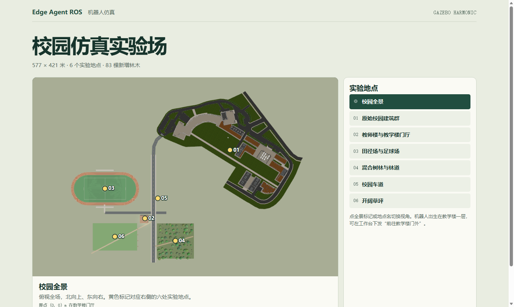

# 校园、感知与模型的插件边界

现行世界把体育设施、教学楼和机器人广场放进同一处 TU Delft X 场地。开发者可以切换校园地点、跟随四种机体，并核对测绘道路、位置与关节。下文保留 SDD-025 至 SDD-028 各版的隔离与回退实验，历史尺寸和照片对应各自场景版本。[当前办实验的方法](campus-robot-view.md) · [连通路线规格](../specs/SDD-029-unified-campus.md) · [测绘来源与边界](../../scene/campus_large/real_site_data/README.md)

判断一个需求能否独立迭代，可以分别检查三件事。增加一种设备时要改哪些代码？停止它时哪些运行过程会随之结束？旧任务的结果与公共接口是否仍可验证？dsh 在 Cordis 上通过共享上下文注册服务、事件和可撤销的副作用。本项目把这些原则用在 ROS 订阅、独立容器、配置清单和事件回执上。[dsh 官方架构](https://github.com/deepseek-ai/deepseek-harness/blob/ca33fd6843b205e279c7ccb6cb73a472c78f5760/docs/architecture.md)

| 能力 | 可以独立替换的部分 | 仍需共同遵守的契约 |
|---|---|---|
| 校园世界 | 下载资产、生成器、场地清单、取景与校园总览。单独启动一套仿真工程，默认小世界保留自己的网络、端口和状态卷。 | 场景复用原机器人、ROS 时钟和坐标、场地规划 API。切换整张世界需要启动目标世界，当前控制器对绝对目标坐标的每轴限制为 ±4 m。 |
| RGB-D 与三维地图 | D4xx 驱动发布标准消息。图像测距提供者、点云地图、可选硬件来源各自装卸。热增删点云来源只需修改运行中的来源清单。 | 深度与彩色配准、时间新鲜度、光学坐标和 TF 必须满足约定。测距与相机提供者共享有界图像处理代码。共享代码变更需要回归两个消费者。 |
| 模型 | 规划角色按请求加载路由；确认本地或云端的原始请求、模型回执及工具结果后可以切换。 | 既有任务使用兼容的模型 API。停止提供者会影响依赖它的新请求，其他已接入服务与已留存任务证据继续存在。 |
| 工作台 | 在视图清单登记入口；工作台校验插件启动事件与实例健康状态后显示链接。校园总览也可独立打开。 | 首次引入新视图需要一个通用的前端挂载点。以后新增符合契约的入口复用它。 |

**热拔插也有层次。** 停止传感器桥会停止向 ROS 发布。Gazebo 保留当前世界的固定渲染实体直到世界关闭。这个设计来自一次实测故障：原先从渲染中的世界删除传感器导致 Ogre2 中止整个仿真。改为复用实体后，三种传感器各拔插两轮，另外两路和仿真时钟均继续推进。整张校园的启动、修改、卸载有自己的部署生命周期。实际板卡上多个进程仍共享 CPU、GPU、内存与 USB 带宽。[故障原件](../evidence/rgbd-world-before-fix.json) · [六轮拔插记录](../evidence/rgbd-isolation.json)

**现有验证范围。** 真实 Qwen 和 DeepSeek 分别从相同规划入口选择只读状态工具并读取 ROS 里程计。正式硬件部署通过 amd64 双相机 DDS 验收；在 ARM64 模拟执行下，用已缓存的 ARM64 依赖层和当前应用又完成双相机与点云测试。实体设备的带宽、测距误差、时钟漂移和板载性能另按台架手册测量。感知与模型版本的全仓回归共 31 个执行阶段通过（含构建、部署与清理），本地工作台三个插件视图在桌面和窄屏均可访问。[全仓回归](../evidence/perception-system-regression.json) · [双模型任务](../evidence/workbench-model-routing.json) · [amd64 双相机](../evidence/realsense-board.json) · [ARM64 双相机](../evidence/realsense-arm64.json)

新增校园功能的代码位于独立场景目录与 Compose 叠加文件。ROS 节点、Agent 规划、运动内核、默认世界和原有传感器协议均沿用已有实现。工程目前提供的是可用实验复核的插件边界；底层 Agent 循环、C++ 执行内核以及进程级资源的回收机制仍有各自的生命周期。项目尚未实现 dsh 的全产品 Cordis 插件树。[场景规格](../specs/SDD-025-large-campus-world.md) · [校园运行方式](../../scene/campus_large/README.md)

## 一个可复查的校园任务

在约 577 × 421 米的已加载世界中，给原有 Agent 发“前往教学楼门外”。现有 `navigate_place` 收到目标，从校园提供者获得门厅、门口与门外三个有坐标的路点，再交给原有运动内核。Gazebo 独立世界真值记录了 218 个轨迹样本，车辆穿过门洞并停在距目标 6.30 厘米处。跑道和树林的实时渲染与归档图像抽样逐点吻合。校园工作台启停期间，原小场景的 20 个运行服务保持同一容器身份，独立采样的原世界时钟持续推进。[正式任务与双工程隔离验收](../evidence/campus-acceptance.json)

校园重载时会先通过公开任务与状态接口确认没有在途动作，关闭新任务入口后再核查。随后校园内消费时钟的进程一起切换到新世界。独立实验在重载前后各完成一次穿门，两次均有世界真值，前一任务回执保留。日常校园还保留了“前往教学楼门外”和“前往教学楼门厅”两个任务，实验结束时机器人位于门厅。该工作站一次采样中，大型 Gazebo 进程占用约 2.1 GiB。插件隔离保护任务与状态，边缘部署的资源预算仍需单独验证。[重载实验](../evidence/campus-reload.json) · [工作台实测与两条任务](../evidence/campus-workbench.json)

上游校园本体约 353 × 284 米，使用原 OBJ 的贴图及碰撞网格；田径场、可穿门的教师楼、空旷草坪与 83 棵混合林木属于项目补建。生成器将上游道路面抬到全场统一地面以上 15 毫米，接驳段与原道路的表面高差为 8 毫米。七个视角来自真实渲染，支持在浏览器内逐一切换。大型网格和细致碰撞需要额外资源。它们适合工作站仿真，具体边缘板的实时率需另测。[原始资产、版本与校验和](../../scene/campus_large/ASSETS.md)
