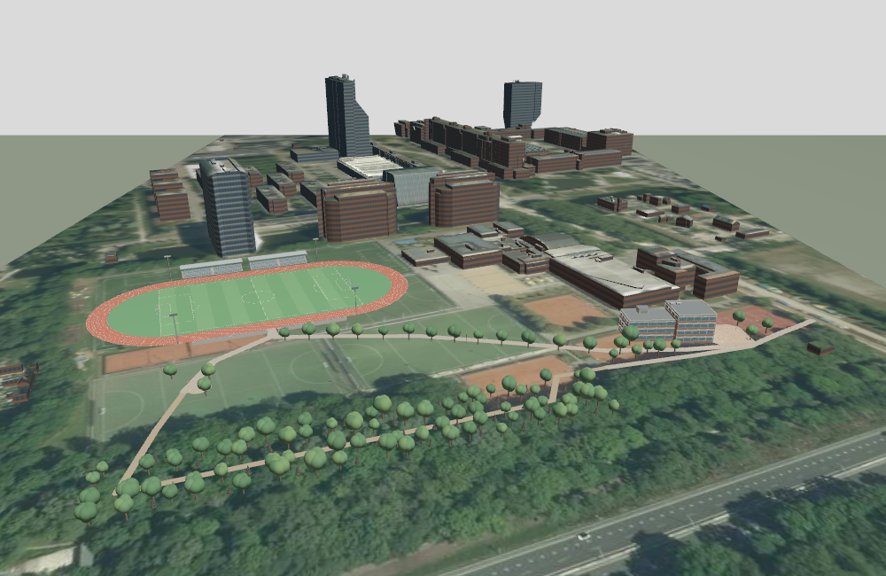
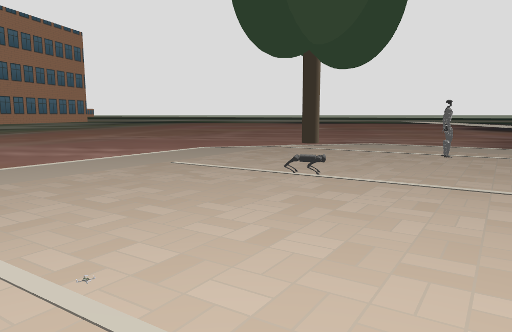
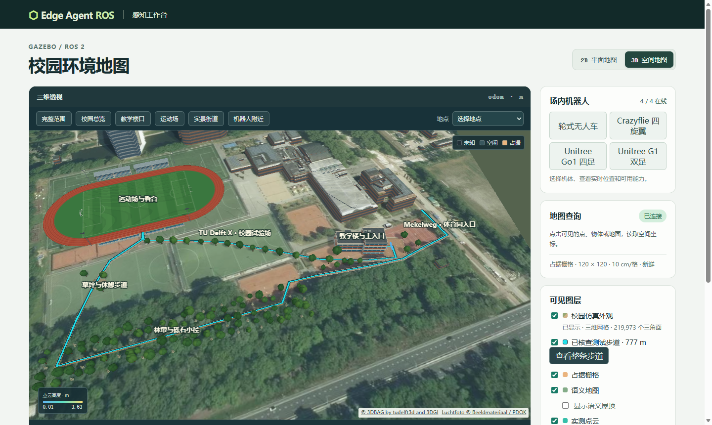

# 在校园地图中辨认机器人并核实它的动作

打开三维地图后，先选“校园总览”找到教学楼、广场、运动场与树林，再从“场内机器人”选一台机体。相机会移到机体旁边并跟随它。鼠标拖动能绕机体旋转，滚轮能放大手臂、机腿或轮子。右键平移后可以自由看周围环境。选择地点与机体只改变当前浏览器视角。实际任务从 8766 工作台提交。[三维地图](http://127.0.0.1:8773/?view=3d) · [任务工作台](http://127.0.0.1:8766/) · [Gazebo 原生广场快照](http://127.0.0.1:8780/robots.png)

| 要观察的现象 | 直接进入 | 在工作台输入的示例 | 如何确认 |
|---|---|---|---|
| 差速车从室内穿过门洞并停住 | [Edge Rover](http://127.0.0.1:8773/?robot=edge_rover) | 前往教学楼门外 | 对照任务航点、里程计与独立 Gazebo 世界真值。门外导航点为 (3.3, 0) m |
| 四旋翼的升降和离地高度 | [Crazyflie](http://127.0.0.1:8773/?robot=crazyflie) | 无人机起飞 | 读取带时间戳的机体高度、IMU 和对应子任务回执。仿真执行器采用速度控制 |
| 四条腿的关节改变姿态 | [Go1](http://127.0.0.1:8773/?robot=go1) | 四足机器人屈腿 | 检查四个大腿关节的实测角。该项实验验证关节跟踪，步态和平衡需要另外的实验 |
| 人形机器人的指定关节运动 | [G1](http://127.0.0.1:8773/?robot=g1) | 人形机器人举起左臂 | 对照左肩角度、IMU 和该机器人子任务的终态 |

## 从哪一层取得证据

1. **场景与外形。** 地图与 Gazebo 读取同一份 SDF 场景。GLB 的主场景包含静态楼群和道路，每台机器人另有一个模型场景。每个刚体部件保留自己的网格、材质和安装位姿。地图切换机型时可以直接看到它的真实比例。[GLB 导出器](../../scene/campus_large/export_mesh.py) · [模型、来源及授权](../../scene/campus_large/robots/assets.json)
2. **位置与关节。** 校园适配器从仿真测量生成机器人清单。地图插件通过可选的 ROS 话题 `/edge/robot_states` 接收清单，按同一场景版本和 `odom` 坐标系叠加机体。浏览器将实测位置、四元数和关节角作用于各刚体部件。缺少关节量测时，该关节按 SDF 参考姿态显示。等待位置测量的机体在面板中显示等待状态，过期观测以“已过期”标记。[状态发布者](../../scene/campus_large/robot_agent/provider.py) · [地图接收端](../../perception/map3d/provider.py)
3. **谁执行了动作。** 工作台给校园 Agent 发送自然语言。轮式车使用具名导航。其余机体通过各自 Agent 的能力清单和独立执行器接口处理动作。核对任务时，先找总任务、目标机体、子任务与工具，再对照动作前后的传感器时间和数值。页面上的机体外形和固定视角照片用于解释现场条件。[机体能力注册](../../scene/campus_large/robot_agent/catalog.py) · [独立动作验收](../../tests/system/campus_forms.py)

## 校园步道可以证明什么



从轮式车已经可以到达的教学楼门外，沿步道经过入口广场、运动场、草坪和林带，最后接入 Mekelweg 西侧人行道。验收程序分别读取构建输出和运行中 Gazebo 导出的 SDF，核对每条路的长度、宽度、接点，以及机器人高度范围内距障碍物的净距。专题测试使用 0.32 m 的水平半径和 0.065–0.60 m 的障碍物高度区间。末端路段每米抽样比对荷兰 BGT 人行道原始多边形，并把同一点投影到官方航片 UV 坐标。[路线几何验收](../../tests/system/campus_route_geometry.py)

轮式车的实际导航通过独立世界真值与里程计检查穿门和停车。运动场、林带和门前的传感器实验会在隔离实例中将车体依次放到测站，采集原车的雷达并恢复原位。全线自主导航需要定位、避障与长程控制实验，目前运动网关对每个目标的每个平面坐标保留 ±4 m 的授权边界。[测站实验](../../tests/system/campus_station_probe.py)

## 重复验证



### 怎样用这座校园做长时间回归

在二维或三维页面的“可见图层”中打开“已核查测试步道”，点击“查看整条步道”。青线表示由场景几何核查过的 26 个路点。实际行驶里程应从任务对应的 Gazebo 真值或里程计取得。旋转三维视角或缩放二维视图时，路线会继续与路面配准。



| 实验 | 应保存的证据 | 如何判断有进步 |
|---|---|---|
| 一次开机，连续下发“前往教学楼门外 → 回到教学楼门厅 → 前往教学楼门外” | 同一个仿真会话、三个独立任务及其 trace、正反向穿门的真值点、终点偏差与停稳速度 | 三次任务都成功、每次都从上一终点出发。在同一地图版本上增加往返次数，可比较每十次穿门的失败数与最大定位偏差 |
| 球场、林间、教学楼前三站采样 | 每站的车体真值、采样时刻、每圈雷达的总射线数、有效回波数和最近距离 | 开阔球场应明显少于林间的近距离回波；换地图或换传感器时沿用同一组测站，排查差异来自环境还是插件 |
| 恢复实验 | 重载前后的仿真会话、旧任务的原始回执、重载后新任务的起点和结果 | 时钟换代后还能查回旧证据；新任务从新世界的起点独立执行。子任务或执行器仍被占用时应阻止重载 |

全线自主行驶是下一阶段的实验。先开放教学楼到广场的一段，给每段定义许可范围和停车条件，再加入运动场、林带和 Mekelweg。全线记录已行驶距离、完成路段数、偏离许可范围次数、停滞后恢复次数和人工接管次数。把当前路线长度当作分母，可以区分“完成全部路线”和“通过部分地段”。

### 本次基线（2026-11-18）

在 Docker 的独立 ROS 域、Gazebo 分区中完成三次连续导航、六次机体动作、一次不支持动作、热重载后的再次出门和三个激光测站。返程与第二次出门实驶共 6.369 m，停稳后离目标点分别为 5.92 cm 和 7.25 cm。球场、林间和教学楼前三处测站各采集三帧单平面扫描，每帧含 360 条射线，三处每帧分别有 0、9、69 个有效回波。浏览器在 1440 px 与 390 px 两种宽度核对了机体、地图与路线。另完成 46 项校园及地图相关测试和 16 项部署测试。[版本、任务标识与测量摘要](../evidence/unified-campus.json) · [本机完整验收原件](../../artifacts/verification/unified-campus/final.json)

开发机另保存了可离线查看的[校园 GLB](../../artifacts/sim-assets/generated/tu-delft-x/scene.glb)、[米制路线与测站](../../artifacts/sim-assets/generated/tu-delft-x/campus.json)和[模型署名](../../artifacts/sim-assets/generated/tu-delft-x/ATTRIBUTION.txt)。这些生成物位于 `artifacts/`。Gazebo 的碰撞、传感器和控制器由校园构建器生成，运行实验时使用 Docker 场景。

在仓库根目录执行以下命令。将 `<镜像标签>` 替换为由当前提交构建的本地仿真镜像。

```sh
python tests/system/campus_acceptance.py --image <镜像标签> --verify-reload --verify-texture --out artifacts/verification/unified-campus/final.json
```

报告中的 `live_geometry.route` 保存生成场景与实际 Gazebo 的几何检查。`mission` 保存差速车穿门轨迹，`robot_forms` 保存各机体的任务与独立物理反馈，`station_probes` 保存各测站激光数据。`texture_browser` 记录桌面与手机视口中采样到的真实机体像素数、近景和各地点截图。浏览器使用与遮挡、坐标拾取相同的深度缓冲辨认机体像素。检验缩放后的细跑道线时，需同时查看运动场截图，颜色数量本身无法说明白线连续。[四机体规格](../specs/SDD-030-campus-robot-forms.md) · [校园连通性规格](../specs/SDD-029-unified-campus.md)
