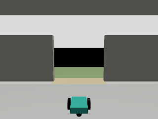
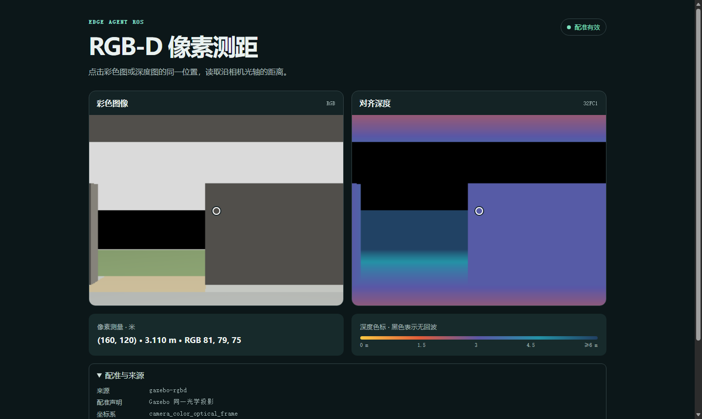
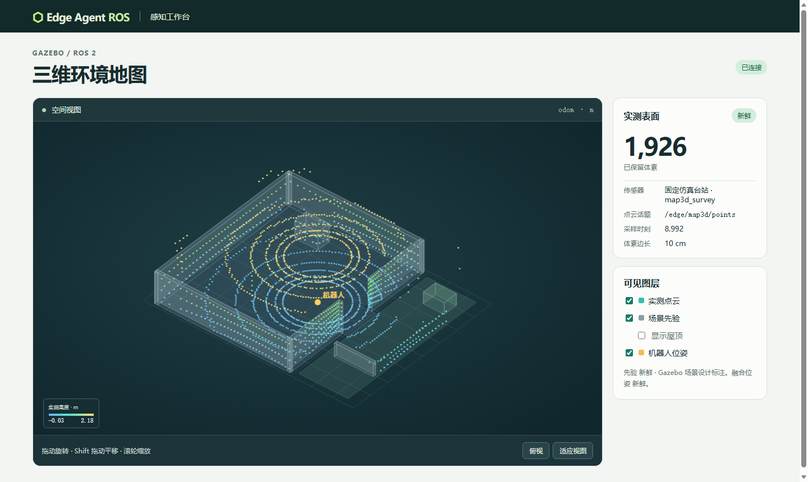

# 地图和模型能否各自升级

这次用两种性质不同的变更检验“插件化”。三维地图需要引入新的传感数据与展示方式；模型适配需要接手原有调用方发出的请求。判据是提供者能够独立启停，消费者沿原协议继续工作，已有任务和未改服务的状态可供第三方复核。[地图规格](../specs/SDD-020-3d-map-plugin.md) · [模型适配规格](../specs/SDD-021-model-provider.md)

## 从旧系统接入新插件

旧版地图消费 `OccupancyGrid`、水平 `LaserScan` 和平面位姿。场景文件还保存墙、顶棚等设计高度。它们可以绘制三维先验；实际高度量测需要深度相机、三维雷达等来源，还需要采样时刻的坐标变换。本次单独启动带空间视图的地图服务，再在运行中的 Gazebo 加入一台固定多线雷达。现场已经发布标准 `PointCloud2` 并有有效时间/外参时，可以仅接地图插件。仿真台站位于 `odom` 的 (0, 0, 1.2 m)，没有附着在机器人上。

规划器和工具作者已有 Ollama 请求接口。模型提供者支持这些已有请求，分别处理本地服务与已配置的远端路由。现有规划器可按任务重新读取 `planner-profile.json`；若部署中的作者固定指向旧服务，首次接入须改变该作者的启动配置。后续更换已接入的模型路由可以在独立提供者内完成。选择远端路由同时决定了允许出机的请求内容，须按角色配置。

## 怎样验证

独立黑盒启动九个原有服务，记录每个容器的 ID 和启动时间，用只读状态任务确认基线。使用真实 Gazebo、ROS 2 话题、地图插件、浏览器、Agent、归档及模型适配器。本地 Ollama 上游在本实验中由固定 HTTP 应答器代替，以便逐次核对转发顺序和请求次数。真实 Qwen、DeepSeek 服务连通性另行实验。无需云端凭证即可复跑本节。

| 故障或变更 | 见证方式 |
|---|---|
| 添加显示服务，尚未启用传感器 | 从新地图接口核对点数为 0。再从运行中的 Gazebo 安装传感器，独立 ROS 订阅读取原始 XYZ，应用已知台站位姿，核对与地图的空间重合以及跨高度覆盖。 |
| 两个插件同时运行 | 由 Agent 的自然语言任务经适配器生成单个 `status` 调用。核对 ROS 里程计话题、时间戳、操作 ID，查找响应中的适配器回执在归档中的父事件与模型请求摘要。 |
| 停传感器、再恢复 | 单独停掉采样进程，等待实测层超时；同时核对位姿层继续更新、模型仍可完成状态任务。重启后要求出现比停机前更新的采样。 |
| 停模型、停地图、热换路由 | 模型插件离线时，地图须发布新数据且 Agent 本地状态任务可成功。地图插件离线时，模型任务仍须返回 ROS 证据。更新已挂载的路由文件后用新任务触发，向独立上游核对实际模型及总调用数。最后复核二维栅格时间推进和九个基线容器启动时间。 |
| 浏览器 | 同时覆盖 1440 和 390 像素视口，检查俯视、轨道拖动、滚轮缩放、实测图层开关、页面宽度、控制台异常以及意外写请求。 |

从项目根目录构建当前仿真镜像后执行以下命令，`--core-image` 可指定此前已部署的基线镜像。不提供该参数时，使用同一候选镜像启动原有服务。结果、浏览器验收与截图放在指定结果目录。测试会回收自己的 Compose 工程及数据卷。

```powershell
python tests/system/map_model_isolation.py --image edge-agent-ros:v0.1 --core-image edge-agent-ros:event-evolution-20b212a --out .ci-results/system/map-model/acceptance.json
```

[跨模块实验](../../tests/system/map_model_isolation.py) · [浏览器验收](../../tests/system/map3d_browser.mjs)

## 新增摄像头与第二台雷达之后

SDD-022 和 SDD-023 接入后，再次使用旧版仿真内核。独立 ROS 订阅捕获到 Gazebo 原始 RGB 图像，将 HTTP PNG 解码为 RGB，与同一光学坐标系、同一采样时间的原始像素比较。320 × 240 像素逐字节 SHA-256 一致，图中有 224 种 RGB 颜色，仿真 CameraInfo 返回 fx≈233.87、fy≈233.87。首次实验还发现一个集成问题，ROS 返回的标定布尔类型无法直接由 JSON 序列化；相机插件转换为内置布尔值后，通过了这组真实消息复验。[传感器验收数据](../evidence/camera-lidar-isolation.json)



在同一工程动态装载第二路点云。独立 ROS 发布器按照 Livox 驱动 `xfer_format=0` 构造带 XYZ、强度、tag、line、逐点时间戳的标准 PointCloud2。缺少 `odom ← livox_frame` 外参时，此来源报告 `transform_unavailable`，地图只显示已能定位的其他来源。补入已知平移后，三个世界坐标与测试输入逐项吻合。随后停相机传感器，旧相机画面返回 HTTP 503，两个点云源保持工作；相机恢复后有新采样。撤下 MID-360 清单仅清除该来源及其体素。此试验覆盖实际 ROS 消息接入，真机的固件、网络、雷达扫描图样和外参需要物理设备实测。[厂商消息接口](https://github.com/Livox-SDK/livox_ros_driver2#32-livox-ros-driver-2-internal-main-parameter-configuration-instructions) · [可复现脚本](../../tests/system/sensor_plugin_isolation.py)

```powershell
python tests/system/sensor_plugin_isolation.py --image edge-agent-ros:v0.1 --core-image edge-agent-ros:event-evolution-20b212a --out .ci-results/system/map-model/sensors.json
```

## 在同一仿真中验证 RGB-D 测距、点云与反复拔插

在平面图上选一点无法得到它的高度。RGB-D 插件做的是另一件事：把一个彩色像素关联到同一光学投影的深度，并以米返回沿光轴的距离。实验同时启动固定 RGB 相机、三维雷达和 RGB-D 台站。两个独立的 ROS 订阅分别解码原始彩色帧与深度帧，再用采样时间与 HTTP 的帧身份核对。Gazebo 中台站位于 (−1.4, −1.0, 1.1) m，镜头正对 x=1.71 m 的门侧墙。沿中心光线的几何期望为 3.110 m。原始深度与 HTTP 在像素 (160, 120) 均为 3.11000013 m，1440 和 390 像素宽的浏览器点击两幅图片都显示 3.110 m、RGB (81, 79, 75)。更远的采样点约为 5.960 m。[实验数据与两种视口的结果](../evidence/rgbd-isolation.json)



| 验证对象 | 实际观测 |
|---|---|
| 实测点云进入地图 | 同一台站发布 320 × 240 的带 RGB 点云。其机体坐标的前向 X 与光学深度 Z 一致。按安装位置变换后，中心回波与地图最近体素相差 5.2 cm，地图体素边长 10 cm。地图保留 XYZ 并按高度着色，彩色纹理在相机画面读取。 |
| RealSense 消息与异常恢复 | 独立 ROS 发布器送入驱动等价的 `16UC1`，1250 mm 被读作 1.25 m，零深度返回 HTTP 422。依次注入 100 ms 错时、光学坐标系错误和图像数据截短，插件分别报告 `timestamp_skew`、`frame_mismatch`、`depth_layout`，测量接口都返回 HTTP 503。每次恢复正常输入后均可再次测量。 |
| 长时间运行时的热拔插 | 初版运行中删除 Gazebo 的 RGB-D 实体，另外的相机渲染时出现 Ogre2 异常，仿真以 134 退出。修复后三台仿真站留在同一世界，每次拔插只启停各自的 ROS 桥。按 RGB、雷达、RGB-D 顺序连做两轮，共六次拔插，独立订阅的仿真时钟、其余两路传感器均推进，被拔出的来源失去新鲜度，重新启动后出现新时间戳。 |
| 单独停止 RGB-D 测距插件 | 2D 栅格、主雷达、独立 RGB，相同主题上的驱动点云均持续更新。十个原有及同场观测服务的启动时间一致。 |

独立验收使用 Gazebo 的真实渲染输出和真实 ROS 2 消息，另用驱动等价发布器精确制造边界值。D435i/D455 设备、USB 带宽、相机恢复时间及实机标定和测距误差均需实物测量。运行前准备项目仿真镜像、Node 与 Chrome／Edge，脚本会自行分配端口、创建并回收隔离工程。[修复前的世界退出记录](../evidence/rgbd-world-before-fix.json) · [测距规格](../specs/SDD-024-realsense-rgbd.md) · [完整复现实验](../../tests/system/rgbd_acceptance.py) · [像素交互验收](../../tests/system/rgbd_browser.mjs)

```powershell
python tests/system/rgbd_acceptance.py --image edge-agent-ros:v0.1 --out .ci-results/system/map-model/rgbd.json
```

## 如何解释边界

2026-11-18 本机 Docker 使用 `edge-agent-ros:event-evolution-20b212a` 运行旧版九个服务。验收前后九个容器的 ID 和启动时间全部相同。160 × 16 波束的独立 ROS 订阅读得 2,184 个有限回波；在 10 cm 体素图中按每轴一个体素容差匹配 2,184 个，实际高度范围 −0.027 至 2.180 m，地图保留 1,926 个体素。同一体素可容纳多条回波。两种视口均完成交互且无浏览器异常或写请求。关闭传感器产生了归档事件，随后可以恢复新采样。四条依赖模型的状态任务在适配器处留下四条不同回执，转发顺序为 fixture-a、fixture-a、fixture-b、fixture-a。各回执 ID 与 Agent 响应一致，请求摘要同时匹配两侧。错误模型别名也有自己的归档事实。[原始测量、容器身份与事件回执](../evidence/map-model-isolation.json)



两项实验展示了 dsh 的“定义、提供者、消费者”解耦。ROS 总线、模型 API 契约、任务账本等底层接口仍是这些插件的依赖。增加地图视图并不会让原导航工具自动进行三维避障；将体素观测用于机器人决策还需要定义可通行空间、可靠度与独立任务验收。当前证明的是单机仿真中的扩展和隔离，板卡资源、真机点云时间同步、标定、带宽与外网服务质量均需现场测量。[已有扩展点与限制](../harness-extensions.md)
