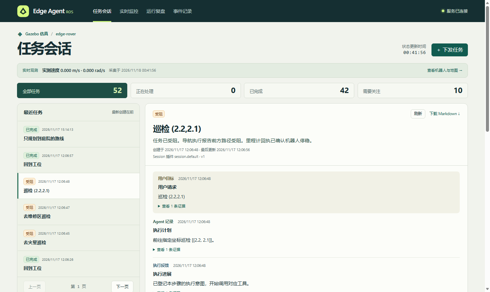

# Session 插件与按需取证验收

2026-11-18，Session 展示、证据查询和插件装卸已在本机 Docker/Gazebo 通过验收。小模型自主 SQL 诊断实验未通过，单独保留失败记录。部署代码为 `44fa0edc216890e9925a8c25562b1199e6a090bb`，本页及证据文件随后补入 Git。[机器可读报告](../evidence/session-evidence.json) · [SDD 与 AC](../specs/SDD-010-session-evidence.md)

## 覆盖与结果

| 层次 | 实测结果 | 证明什么 |
|---|---|---|
| Console 公共接口与消费者 | 32 项通过 | 身份、版本绑定、范围、脱敏、超时、插件撤回和原始事件读取。 |
| Session 提供者 | 9 项通过 | HTTP 取证、上千条审计、长窗口、权威终态、来源分组、取消、缺证据、重启和审计写失败。 |
| Evidence 提供者 | 15 项通过 | 范围隔离、只读 SQL、预算、分页身份、巨大字段、并发、断连、持久回执。 |
| 完整回归 | 18 类通过，`dbacac8` | ROS 执行、制动、传感器、重启恢复、Agent 故障、场景、时钟、UI、基础模型规划及硬件镜像。 |
| 最后修复的消费者回归 | 7 类通过，`44fa0ed` | 仓库、规划、观测、任务、语义地点、UI、硬件镜像；Session/Evidence 黑盒随 UI 阶段执行。 |
| 独立 Session 替换 | 通过 | 启动第二个 Docker 提供者，仅改清单即切换版本；撤回、draining、失联、错误版本和恢复给出准确诊断。12 项隔离任务状态不变。 |
| 自然语言复盘与取证 | 通过 | “复盘任务 &lt;id&gt;”实际调用 read_session；查询距离与源事件一致；热注册、撤回、重复回执和写 SQL 拒绝均验证。 |
| 桌面与手机 | 1440 / 390 px 通过 | 提供者版本、证据弹窗、Markdown、插件失效提示、回退和恢复；无未捕获异常或浏览器任务写请求。 |

硬件镜像使用 amd64 容器中的合成 ROS 输入。此次没有接触真实 RK3588、Jetson、Orin 板卡或底盘，物理制动与板卡资源验证仍需各自的实机门槛。

## 读会话，再查细节

隔离 Gazebo 样例的首读 Markdown 为 **1,477 字节**，原始任务事件 JSON 为 **140,362 字节**，首读字节减少约 **98.95%**。制动事件 `#722` 的精确距离为 **0.4189879596233368 m**，查询返回相同值和引用。该指标衡量输入体积，模型诊断质量另行评估。

日常任务的制动事件为 `#1850`，距离 **0.3952096700668335 m**。Session 串起目标、计划、制动、停稳与任务受阻；展开引用或调用取证工具时再看完整精度。



[手机 390 px 实测页面](../../artifacts/console/session-mobile.png)。

## 修复与负样本

1. 不同插件的同类型告警曾被误合并。现在聚合保留来源、模块、操作和原因边界，真正重复的事实仍可折叠。
2. 大模型记录曾阻断同任务中的小型测量查询。现在分别限制有界载入和最终输出，SELECT 可以只选所需字段。
3. 查询不存在的任务会产生审计，旧判断曾因此在第二次读取时生成空 UNKNOWN 会话。现在存在性只依据非审计事实；日常实测连续三次返回 404，任务源不可读的测试持续返回 503。真实模块事实仍能形成明确标记的 UNKNOWN 视图。
4. `qwen2.5:1.5b` 自主 SQL 实验未取得可验证的制动证据。早期实验添加无依据的模块过滤；最终部署实验选择过宽事件范围，并连续三次遗漏 seq，返回的测量可能属于动作开始时刻。脚本要求引用和值共同对上源事件，没有把查询成功当成诊断成功，也未执行恢复动作。[早期完整记录](../evidence/session-query-model.json) · [最终部署完整记录](../evidence/session-query-model-final.json)

SQL 工具和自然语言复盘已可用。多轮自主诊断、任意故障自修复仍需独立规格与故障数据集，应分别统计可执行查询率、目标证据命中率、引用/数值正确率、错误结论率、调用数和耗时。

## 部署与保全

只重建 Console，新增 Session、Evidence，其余 11 个原有服务容器身份不变。升级前后的 **52 项任务**（42 成功、10 受阻）及终态摘要哈希一致。归档身份未变化，升级前 **2,785 条事件**的序号与 event_id 摘要哈希一致。没有在日常机器人上创建测试任务或发送控制指令。

实际镜像为 `edge-agent-ros:sdd010-tested`，旧 Console 镜像保留为 `edge-agent-ros:sdd009-tested`。查询与发布审计会正常追加，原任务事实和历史事件未被覆盖。独立测试容器与测试卷已由 runner 清理。原始过程在 `.ci-results/system/runs/`，关键结果已随报告签入仓库。

## 复跑

```sh
python tests/system_suite.py --changed-since 7f7223d --ollama-cache-volume edge-agent-ros_models
python tests/system_suite.py --changed-since dbacac8
```

第二条命令只选择最后修复影响的消费者。自主 SQL 诊断单独运行 `tests/system/evidence_model_acceptance.py --url <Console地址> --evidence-url <Evidence地址> --model-project <Compose项目> --out <报告路径>`，每次提示、模型输出和工具回执均留档，失败也写报告并返回非零状态。
