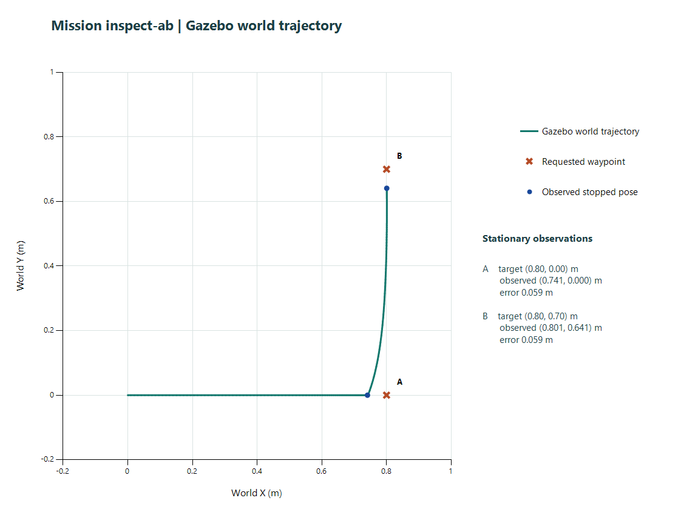

# v0.1 Docker / ROS 2 / Gazebo 发布验收

本页对应下述历史运行号。当前候选版本的运动、感知与 Agent 故障证据见[单机系统测试报告](../testing/single-edge.md)。

**通过。** 2026 年 11 月 17 日（北京时间），以公开 ROS 镜像构建的应用在 Docker Desktop 的 Linux x86-64 环境完成验收。正式验收运行号为 `20261116-161215-c0298b`（UTC）。在清空的临时世界中验收后，另在默认部署 `edge-agent-ros` 中从普通命令行提交 `demo-v1`，查询结果为 `SUCCEEDED`，两条到达证据保存在该部署的卷内。[运行结果](../evidence/releases/v0.1/result.json) · [环境版本](../evidence/releases/v0.1/environment.txt) · [源文件哈希](../evidence/releases/v0.1/source-sha256.txt)

## 一次完整巡检

委托 `inspect-ab` 要求从原点出发，先到 A，记录位置，再转向 B，记录第二个位置。软件报告完成后，验收程序独立检查 Gazebo 世界轨迹，逐点寻找连续低速且位置稳定的样本。全程采集到 **246 个世界位姿样本**。

| 观测点 | 目标 XY（m） | Edge 保存的里程计 XY（m） | Gazebo 独立停稳样本 XY（m） | 世界坐标误差 |
|---|---|---|---|---:|
| A | 0.800, 0.000 | 0.748, 0.000 | 0.741, 0.000 | 5.89 cm |
| B | 0.800, 0.700 | 0.801, 0.648 | 0.801, 0.641 | 5.89 cm |

两点均满足里程计误差 ≤12 cm、世界坐标误差 ≤18 cm 的 PRD 门槛。终点随后 0.8 秒内又取得 24 个真值样本，最大位移约 0.015 mm。这个数值只描述本次仿真停靠后的漂移。[任务证据](../evidence/releases/v0.1/mission.json) · [原始世界轨迹](../evidence/releases/v0.1/mission.trajectory.json)

## 故障发生时机器人实际走了多远

两次故障各用一个隔离的测试场景。独立真值观测器在故障前已经启动，注入前均观测到约 0.32 m/s 的实际速度。计时从宿主触发 kill 的文件标记开始，包含 Docker 发出信号的耗时。连续约 0.4 秒满足物理停稳条件后才作确认。

| 故障注入 | 首次观察到停稳 | 确认持续停稳 | 注入附近最后的真值样本至确认的累计路程 | 内核结果 |
|---|---:|---:|---:|---|
| 运动中强制终止任务内核 | 1.89 s | 2.30 s | 0.558 m | 重启后为 RECOVERY_REQUIRED，保留占用 |
| 运动中强制终止控制桥 | 0.68 s | 1.09 s | 0.163 m | 停车无里程计回执，返回 UNKNOWN 并禁止新动作 |

第一项依赖执行网关发现操作心跳失效，第二项依赖 Gazebo 内的速度看门狗。控制桥中断后，机器人事实上已停，Edge 却已看不到自己的里程计；它如实报告“结果待核查”。这使上层不会下发第二个可能冲突的动作。两项都是单次仿真观测；真机时限和安全距离需要按机体重新确定。[内核故障连续采样](../evidence/releases/v0.1/watch-crash.json) · [控制桥故障连续采样](../evidence/releases/v0.1/watch-bridge.json)

## 需求覆盖

| PRD | 实际检查及结果 |
|---|---|
| A1　构建与启动 | 从 `ros:jazzy-ros-base` 构建独立基础镜像，编译三个 ROS 包和 Gazebo 插件。部署检查确认三个任务服务、导航 Action、里程计及独立真值就绪。 |
| A2　两点巡检 | 两份有序证据、实际转向和两个停靠点全部通过；步骤 ID、网关结果和源时间戳可查询。[任务与步骤快照](../evidence/releases/v0.1/ledger-main.json) |
| A3　提交与取消 | 空列表、非有限值、越界、内容冲突及争用底盘均拒绝；同内容重投沿用状态。运动中取消得到 CANCELED，随后 0.8 秒独立观测漂移低于 0.03 mm。[取消结果](../evidence/releases/v0.1/cancel.json) |
| A4　恢复与保护 | 完成后重启可重查，重投未触发新运动；运动中崩溃和断桥均阻断新动作，数据库完整性检查通过。[重启历史](../evidence/releases/v0.1/history.json) · [断桥账本](../evidence/releases/v0.1/ledger-link.json) |
| A5　复现 | 两个 CTest 通过（策略准入、SQLite 持久化）；三组独立 ROS Action 探针通过（互斥及取消、心跳、里程计失效）。全部阶段以进程退出状态和 JSON 判定。[CTest 输出](../evidence/releases/v0.1/core-tests.txt) · [网关探针输出](../evidence/releases/v0.1/gateway-test.txt) |

## 联调时修正的问题

1. 开发机原有镜像的多版本 Python 使 ROS IDL 生成选择了错误解释器。构建固定使用发行版的 `/usr/bin/python3`。最终发布镜像也在独立的公开 ROS 基础环境重新构建和验证。
2. 初版轮胎接触建模使转向后的世界位姿和轮编码里程计出现明显偏差。调整碰撞几何，保留两个独立测量路径，以实际世界位姿作为回归条件。
3. 控制桥被杀后，Gazebo 默认差速系统会继续执行最后的速度。增加执行器侧 300 ms 命令超时保护；真值桥与控制桥分开，才能在注入故障期间连续观察停稳。

## 可复现的版本边界

应用镜像 `edge-agent-ros:v0.1`，本次标识 `sha256:232deffa0d786fefae4893fe2734602ed457b4c645c97320e3b23a824d135bf9`。基础镜像 `edge-agent-ros/base:jazzy-harmonic`，标识 `sha256:3b274e7c8fba7f857cebfb42c1f7a0ddb5756a015bb0e1a08b99dd02aa095ff4`。使用 ROS 2 Jazzy、Gazebo Sim 8.15.0、GCC 13.3、Docker Engine 29.9.3。镜像标签和软件源随时间可变，比较实验请保留实际镜像标识。

同机复现运行 `.\scripts\verify.ps1`，输出位于新的时间戳目录。完整原始容器日志保留在本地 `artifacts/verification/20261116-161215-c0298b/`。本次发布的精选证据存放在[发布证据目录](../evidence/releases/v0.1/)。目前覆盖单台轮式机器人、受信 ROS 网络和空旷平面。带障碍导航、现场通信、真机运动保护、模型决策与多机协作不在本次验收范围内。
