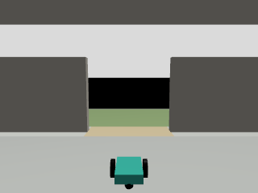

# 多路相机预览

相机插件是只读 ROS 2 观测提供者。页面中的每张图都来自所选传感器消息；页下方显示当前画面的原始采样时间（纳秒）和坐标系，可据此同驱动输出比对。开发者可以独立配置或停止相机，同时保留地图、模型和任务执行。它也可以查看 RGB‑D 设备的彩色流；对齐深度、从像素恢复米制坐标或估计机器人位置，需要独立的内外参和融合消费者。[SDD-022](../../docs/specs/SDD-022-camera-plugin.md)



上图来自隔离 Gazebo 工程，实验室内的固定相机朝向场景。当前仿真源为 RGB 光学相机，分辨率 320 × 240、采样频率 4 Hz；该视角独立于机器人运动。真实机载相机由部署方提供驱动、标定、时钟和外参。

## 启动与停用

在项目根目录运行：

```powershell
docker compose -f compose.yaml -f compose.camera.yaml --profile camera-sensor up -d sim bridge camera camera-sensor
```

打开 [相机预览](http://127.0.0.1:8771/) 或 [传感器目录](http://127.0.0.1:8771/api/cameras)。如果指定过另一个端口，用 `EDGE_CAMERA_PORT` 对应的端口访问。仿真中的 bridge 提供 ROS /clock，camera-sensor 在当前场景插入真实 RGB 相机并桥接 Image / CameraInfo。已有仿真场景无需重建。使用 `docker compose -f compose.yaml -f compose.camera.yaml --profile camera-sensor stop camera-sensor` 可以单独撤下模拟传感器；约 3 秒后页面应显示断流，图片接口返回 HTTP 503。重新 start 该服务应出现新时间戳。仅停止 camera 会保留 ROS 传感器和其他模块。

在原生 Linux 上可用下列组合接入已运行的 ROS 2 驱动。选择目标板架构镜像和正确的 ROS Domain，默认网络端口仅绑定宿主回环。

```sh
docker compose -f compose.hardware.yaml -f compose.camera.yaml -f compose.camera-hardware.yaml up -d camera
```

## 在运行中添加相机

设置 `EDGE_CAMERA_CONFIG_DIR` 选择部署方的目录，默认读取 [config/sources.json](config/sources.json)。按以下结构编写替代文件，在同一目录原子改名为 `sources.json`。每秒检查配置；坏版本在 /api/cameras 显示 invalid，已接受的定义继续工作。修改或移除某个来源会清空它的缓存。未变来源继续沿用原订阅。

```json
{
  "schema_version": 1,
  "sources": [
    {"id":"front","label":"仿真前方","type":"Image","topic":"/edge/cameras/front/image","info_topic":"/edge/cameras/front/camera_info","ttl_s":3},
    {"id":"inspection","label":"检查相机","type":"CompressedImage","topic":"/inspection/image_raw/compressed","ttl_s":2}
  ]
}
```

最多配置 8 路，TTL 范围为 0.25 至 60 秒。订阅采用 sensor best-effort QoS，深度 1。标准 Image 支持 RGB8、BGR8、mono8 和行末填充。预览将原始帧按整数步长采样到最多 640 × 480，再无损编码为 PNG；页面同时展示原始与实际预览来源。CompressedImage 支持 JPEG，插件检验格式标记、尺寸、段长和首尾，保留原 JPEG 字节交给浏览器解码。熵码损坏可能需要在浏览器的解码步骤才能发现，此时页面会撤下画面。原始输入尺寸限 4096 × 2160 的像素总数、单边至多 8192，原始数据限 27 MiB，JPEG 限 2 MiB。每路最多每秒生成 5 张预览，原始 ROS 订阅者仍可按驱动频率消费数据。实际传感器队列和 DDS 传输可能在插件校验前占用内存，板上多相机的负载和带宽需单独验证。

## 追溯一帧来自哪里

| 接口或记录 | 可以得知什么 |
|---|---|
| GET /health | 插件身份 camera、启动源事件 ID、配置状态。此状态接口支持匿名 CORS 读取，方便同机观测台发现插件。 |
| GET /api/cameras | 当前来源、类型、话题、配置摘要、状态原因、采样时间、帧坐标、原始尺寸、计数。标定同时满足尺寸/坐标系/时间范围才能显示。 |
| GET /api/cameras/front/image | 在线来源返回实际 PNG / JPEG；X-Frame-Stamp-Ns 和 X-Frame-Id 说明这份响应的原 ROS 帧。未知 ID 返回 404，等待、损坏、过期的图像返回 503。 |
| 事件源 journal:camera | 启动、配置、增加或移除订阅、源状态转换。只对状态或版本变化写入源日志。像素仅保存在来源的最新内存预览；如需逐帧原始证据可独立录制 ROS bag。 |

同一来源的晚到、重复消息会增加拒收计数；上一张已确认而且仍新鲜的图像继续显示。ROS 时钟回拨会清除各来源的像素与标定缓存。即使仿真暂停、ROS 时间不再向前，进程也按宿主单调时间判断断流。真实板端使用消息时间和板端 ROS 系统时钟，驱动不同步时能观察到 old_stamp 或 future_stamp。浏览器没有控制机器人或相机驱动的接口。

纯处理白盒可运行 `python perception/camera/test_frames.py -v`。Docker 实验可运行 `python tests/system/camera_acceptance.py --image <Edge镜像> --out .ci-results/system/camera/result.json`。它包含一台真实 Gazebo RGB 相机及一条明确标注为合成来源的 ROS JPEG 流，检验热增删、坏配置保留原流、断流撤图与恢复。原始实验报告同目录保存实际采样 PNG。
